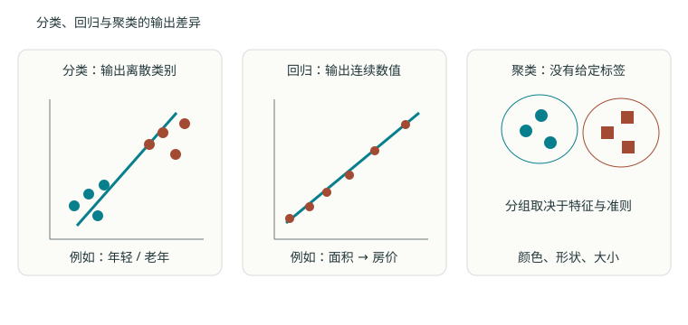
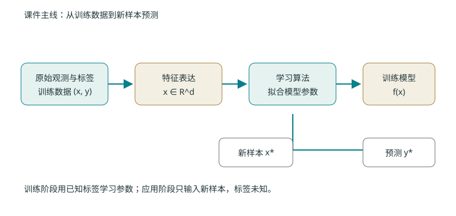

# 第一章 绪论：机器学习研究什么

> **课件主线**：本章严格沿 S01 的顺序展开：1.1 人工智能背景（PDF 8–31 页）→ 1.2 机器学习的发展（33–40 页）→ 1.3 机器学习研究的问题（42–54 页）→ 1.4 课程主要内容（56–63 页）→ 1.5 课程安排（4–6 页）。课件中的动态产品清单不作为已核实现状转载；正文的推导与泛化说明均显式标成“编者补充”。

| 课件段落 | 本文位置 | 处理方式 |
| --- | --- | --- |
| S01 8–31 页：人工智能背景 | 1.1 | 保留定义、弱人工智能定位与历史脉络；动态产品表只说明存在，不更新事实 |
| S01 33–40 页：机器学习发展 | 1.1 | 保留“从经验改进算法”与统计学习主线 |
| S01 42–54 页：研究问题与例子 | 1.2–1.3 | 原题、原数值与图示优先；其后再补定义和推导 |
| S01 56–63 页：课程内容 | 1.5 | 对应全书目录，不扩张考核范围 |
| S01 4–6 页：课程安排 | 1.5 | 只记录课件信息冲突，不替教师判断 |

## 1.1 人工智能背景与机器学习的发展 {#ml-01-01}

### 1.1.1 课件先回答：人工智能与机器学习是什么

S01 8–11 页从“让机器完成通常需要人的智能才能完成的任务”引出人工智能，并明确本课程讨论的是**弱人工智能**：针对特定任务建立可计算的方法，不把分类器或回归器等同于人的全部智能。S01 12–31 页用推理期、知识期、统计学习、深度学习和大模型串起人工智能的发展背景；这些历史页用于定位课程，不等于本课程要逐项讲授所有产品。

S01 33 页给出的共同核心是：机器学习研究**如何让计算机算法通过经验自动改进性能**。这里的“经验”通常由数据提供，“改进”必须由可检验的性能指标定义。S01 34–40 页进一步说明，机器学习从早期逻辑与知识驱动逐步发展到以统计学习为主，并服务于信息安全、识别、自然语言处理、生物信息等领域。

### 1.1.2 学习任务的三要素（编者补充）

为了把课件的定义变成可操作检查，可把一个学习任务拆成三个对象：

| 要素 | 含义 | 通用对应 |
| --- | --- | --- |
| 任务（Task） | 要解决的问题是什么 | 分类、回归、聚类等 |
| 经验（Experience） | 从什么数据里学 | 已有训练样本及其标签（监督学习） |
| 性能（Performance） | 怎样算“学得好” | 分类正确率、回归误差或任务特定指标 |

**记住：** 没有明确性能标准，“算法学得更好”就没有可检验的含义。我们后面评价任何模型，都必须先说清用哪个性能指标。

### 1.1.3 学习与非学习的边界（编者解释）

需要澄清的是：机器学习解决的是“从经验中自动改进性能”的问题。如果一个系统的每一条判断规则都是人写死的、不会因为新数据而改变，那它就不是机器学习系统，只是传统的程序。本课程关心的是“参数由数据决定”的那一类方法。

---

## 1.2 机器学习研究的问题：分类、回归与无监督学习 {#ml-01-02}

S01 44 页先区分监督学习、无监督学习与强化学习，随后 46–52 页用三个连续例子说明它们的输入输出差异。下面先保留课件例题，再补一般符号。

### 1.2.1 监督学习的数据形式

监督学习的数据是 $D=\{(\mathbf x_i,y_i)\}_{i=1}^N$。其中：

- $\mathbf x_i\in\mathbb R^d$ 是第 $i$ 个输入特征，是一个 $d$ 维列向量（见符号表：$d$ 为原始特征维度，正整数）；
- $y_i$ 是第 $i$ 个已知目标（标签）；
- $N$ 是训练样本数（$N\ge 1$）。

我们要学习一个函数 $f:\mathbb R^d\to\mathcal Y$，使对**新的**输入 $\mathbf x_{\text{new}}$ 也能给出合理的输出 $f(\mathbf x_{\text{new}})$。注意：学习的目标不是记住训练集，而是对没见过的数据也能给出好结果（这一点在 1.4 节展开）。

### 1.2.2 分类 vs 回归：差别在输出 $y_i$ 的含义

**分类（classification）** 中 $y_i$ 表示离散类别，例如正常／异常、猫／狗／鸟。数字编码 0、1、2 只是类别的“名字”，不表示异常程度相差一个单位。

> **常见误区**：把类别编码成 0 和 1 之后，对它们做算术（例如算“平均类别 = 0.3”）是没有意义的。类别之间没有自然的“大小”或“距离”关系。

**回归（regression）** 中 $y_i$ 是连续量，例如房价、温度、流量大小。此时预测 100 与预测 101 的数值差有实际意义——它代表“差了 1 个单位的响应量”。

**关键结论**：任务的区别取决于**输出 $y_i$ 的含义**，不取决于输入 $\mathbf x_i$ 是不是连续。例如“根据一张图片预测温度”输入是连续像素、输出是连续温度，属于回归；“根据连续传感器读数判断是否故障”输入连续、输出离散，属于分类。

### 1.2.3 课件例题一：年轻人与老年人分类（S01 46 页）

课件把标签设为年轻人 $y=+1$、老年人 $y=-1$，特征为

$$\mathbf x=(x_1,x_2)^T\in\mathbb R^2,$$

其中 $x_1$ 是黑头发比例，值域为 $(0,1)$；$x_2$ 是行走速度，值域为 $(0,100)$ 米/分钟。课件给出部分训练样本：

| 类别 | 训练特征 $(x_1,x_2)$ |
| --- | --- |
| 年轻人 $y=+1$ | $(1,99)$、$(0.9,80)$、$(0.80,100)$、…… |
| 老年人 $y=-1$ | $(0.2,30)$、$(0.5,50)$、$(0.4,30)$、…… |

待测样本是 $\mathbf x_*=(0.85,98)^T$，问题是预测 $y_*$。从课件散点图看，它更靠近“高黑发比例、高行走速度”的年轻人簇，因此按图示直觉会判为 $+1$；**课件该页只提出问题，没有给出教师标准算法或标准答案**。后续章节会分别用贝叶斯、线性分类器等方法把“靠近”变成明确规则。

### 1.2.4 课件例题二：房价回归（S01 47 页）

输入 $x$ 是房屋面积（m²），输出 $y\ge0$ 是房价（万元）。课件给出 13 个训练点：

| 面积 $x$ | 35 | 40 | 45 | 65 | 74 | 80 | 120 | 140 | 230 | 300 | 400 | 500 | 600 |
| --- | --- | --- | --- | --- | --- | --- | --- | --- | --- | --- | --- | --- | --- |
| 房价 $y$ | 150 | 170 | 190 | 200 | 224 | 245 | 320 | 400 | 640 | 780 | 900 | 1100 | 1300 |

课件提出：用 $y=ax+b$ 建模，面积 $x_*=90$ 时房价是多少？该页没有给出教师答案。若按普通最小二乘拟合全部 13 点，编者复算得到

$$\hat y=2.0560x+93.3621,
\qquad \hat y(90)\approx278.40\text{ 万元}.$$

这只是对课件问题的一种**编者计算**；若损失、异常点处理或模型形式不同，答案会变化。

### 1.2.5 课件例题三：颜色、形状、大小的聚类（S01 49–52 页）

课件给出若干颜色、形状和大小不同的物体，只给特征

$$\mathbf x=(\text{颜色},\text{形状},\text{大小}),$$

没有给标签 $y$，并连续展示多种可能分组：可以按形状分、按颜色与形状组合分、按大小分，甚至全部放成一组。这个例子要说明的不是“哪一种分法唯一正确”，而是：**无监督学习的结果取决于特征表示、相似性定义和聚类目标**；数据本身不会自动告诉我们哪种语义最重要。

### 1.2.6 一般定义与强化学习（编者补充）

**无监督学习（unsupervised learning）** 只有输入集合 $\{\mathbf x_i\}_{i=1}^N$，没有给定目标 $y_i$。典型任务包括：

- **聚类（clustering）**：把相似样本分到一组；
- **降维（dimensionality reduction）**：寻找数据的紧凑表示；
- **密度估计（density estimation）**：描述数据背后的分布。

> **记住**：算法得到的簇**不自动等同于**真实语义类别。例如把动物按“体型大小”聚类，可能把“大象”和“河马”聚到一起，但它们并不是同一个物种类别。聚类结果的意义需要人来解释。

**强化学习（reinforcement learning）** 则通过与环境交互、接收奖励信号来学习行动策略。它的反馈方式（延迟的、稀疏的奖励）与监督学习“每条样本都有一个明确标签”不同；本课程只在概述和网络扩展中提及，不作为主线内容。

---

## 1.3 课件的建模过程：数据、模型、误差与学习 {#ml-01-03}

S01 42–43 页先给出“观测 → 特征提取与选择 → 分类器 → 决策”的模式识别流程；54 页再把建模过程写成“数据 → 模型与误差函数 → 学习参数 → 应用”。一个完整建模过程需要依次回答四个问题：**输入输出是什么？可选择的函数有哪些？什么预测算好？怎样找到参数？** 这四个问题对应“模型—损失—优化”三元组。

### 1.3.1 建模流程（从数据到应用）

从数据到应用依次经过：

1. **观测与标注**：收集原始数据并给出目标（监督学习需要标注）；
2. **特征表达**：把原始对象变成特征向量 $\mathbf x_i\in\mathbb R^d$；
3. **拟合模型**：选定函数族 $f(\cdot;\theta)$，用数据估计参数 $\theta$；
4. **独立评估**：用未参与学习的数据评价性能；
5. **新样本预测**：把学到的 $f$ 用于未来数据。

后续章节分别研究这些环节。

### 1.3.2 模型、损失、优化三者不可混为一谈

仍以预测房价为例。

- **模型（model）** 决定“函数长什么样”。例如取线性模型
  $$f(x)=wx+b$$
  其中 $x$ 是面积，$w$ 是斜率，$b$ 是截距。模型是一族函数，不是某个具体数字。
- **损失（loss）** 决定“什么样的预测算好”。例如用**平方误差**评价参数 $(w,b)$。
- **优化（optimization）** 决定“怎么找到最好的参数”。例如用梯度下降在 $(w,b)$ 空间里求使损失最小的那个点。

**关键结论**：同一个模型可以使用不同损失（线性模型 + 平方误差，或线性模型 + 绝对误差）；同一个损失也可训练不同模型（平方误差既能训线性模型，也能训神经网络）。三者是正交的选择，不能混为一谈。

### 1.3.3 编者补充：平方误差损失的写法与单位（重点推导）

我们用平方误差作为学习准则。先写出最一般的形式，再做单位分析，最后给出逐步推导。

**假设与符号（先对齐维度）**

- 第 $i$ 个样本：$\mathbf x_i\in\mathbb R^d$（列向量），$y_i\in\mathbb R$（标量响应）。
- 线性模型参数：$\mathbf w\in\mathbb R^d$，$b\in\mathbb R$（符号表约定）。
- 预测值 $\hat y_i = \mathbf w^\top \mathbf x_i + b\in\mathbb R$（$\mathbf w^\top\mathbf x_i$ 是向量内积，结果为标量，加上标量 $b$ 仍是标量）。
- 残差（residual）$r_i = y_i - \hat y_i\in\mathbb R$，表示“真实值减去预测值”。

**起始式（标量求和形式）**

平方误差（均方误差，MSE）定义为残差平方的平均值：

$$J(\mathbf w,b)=\frac1N\sum_{i=1}^N (y_i-\hat y_i)^2=\frac1N\sum_{i=1}^N \bigl(y_i-(\mathbf w^\top \mathbf x_i+b)\bigr)^2$$

**紧凑的矩阵形式（对齐符号表）**

令设计矩阵 $X\in\mathbb R^{N\times d}$（按行放样本，每行一个 $\mathbf x_i^\top$），$\mathbf 1\in\mathbb R^N$ 为全 1 向量，$\mathbf y=(y_1,\dots,y_N)^\top\in\mathbb R^N$。则

$$J(\mathbf w,b)=\frac1N\bigl\|\mathbf y-X\mathbf w-b\mathbf 1\bigr\|^2$$

**维度核对**：$X$ 是 $N\times d$，$\mathbf w$ 是 $d\times 1$，故 $X\mathbf w$ 是 $N\times 1$；$b\mathbf 1$ 是 $N\times 1$；$\mathbf y$ 是 $N\times 1$；相减得 $N\times 1$ 向量，其 2-范数平方为标量。维度一致，公式成立。

**过程讲解①：损失的“单位”从哪来（为什么 $J$ 的单位不是 $y$ 的单位）**

设 $x$ 的单位是“平方米（m²）”，$y$ 的单位是“元”。

- 预测 $f(x)=wx+b$ 的量纲必须是元，所以：
  - $w$ 的单位 = 元 / m²（每多一平方米，价格增加多少）；
  - $b$ 的单位 = 元（面积为 0 时的基准价，截距）。
- 残差 $r_i=y_i-f(x_i)$ 的单位是元；
- $r_i^2$ 的单位是元²；
- 平均之后 $J$ 的单位仍是**元²**。

**结论**：平方误差 $J$ 的单位是“响应量纲的平方”，和 $y$ 本身不在同一尺度。因此**跨数据集比较 $J$ 没有意义**（单位不同或量级不同）；比较模型好坏必须在同一数据集、同一损失定义下进行。

> **常见误区**：看到 $J=0.05$ 就以为“误差只有 0.05 元”。实际上 $J$ 的单位是元²，它的平方根（RMSE）才和 $y$ 同单位。要报“平均误差大约多少”，应看 $\sqrt J$（均方根误差），而不是 $J$ 本身。

**过程讲解②：为什么“平方误差”是自然的（最优常数预测 = 样本均值）**

平方误差不是一个随意的选择。我们可以证明：在“只允许输出一个常数 $c$”的最简单模型下，使平方误差最小的 $c$ 恰好是样本均值 $\bar y$。这说明平方误差天然在“让预测贴近数据的中心”。

*假设*：固定目标 $y_1,\dots,y_N$，只选一个常数 $c$ 作预测；损失为
$$J(c)=\frac1N\sum_{i=1}^N (y_i-c)^2$$

*起始式*：对 $c$ 求导并令其为 0。

**步骤 1**：写出导数（用链式法则，记 $\frac{d}{dc}(y_i-c)^2=2(y_i-c)\cdot(-1)$）：

$$\frac{dJ}{dc}=\frac1N\sum_{i=1}^N 2(y_i-c)(-1)=-\frac{2}{N}\sum_{i=1}^N (y_i-c)$$

**步骤 2**：把求和拆开：
$$\frac{dJ}{dc}=-\frac{2}{N}\Bigl(\sum_{i=1}^N y_i - \sum_{i=1}^N c\Bigr)=-\frac{2}{N}\Bigl(\sum_{i=1}^N y_i - Nc\Bigr)$$

**步骤 3**：令导数为 0 求极值点：
$$-\frac{2}{N}\Bigl(\sum_{i=1}^N y_i - Nc\Bigr)=0 \quad\Longrightarrow\quad \sum_{i=1}^N y_i - Nc=0 \quad\Longrightarrow\quad c=\frac1N\sum_{i=1}^N y_i=\bar y$$

**步骤 4**：验证是最小值（看二阶导数）：
$$\frac{d^2J}{dc^2}=\frac{2}{N}>0$$
二阶导恒正，故 $c=\bar y$ 处取得**最小值**，而非最大值。

**结论**：在平方误差下，最优的常数预测就是样本均值。平方误差因此与“方差/离散程度”直接挂钩——它惩罚的是预测偏离数据中心的程度，且偏离越大惩罚越重（平方放大了大误差）。这正是平方误差被广泛采用的根本原因。

**过程讲解③：梯度是什么（连接“优化”这一元）**

对 1 维线性模型 $f(x)=wx+b$，平方误差为
$$J(w,b)=\frac1N\sum_{i=1}^N (y_i-wx_i-b)^2$$
记预测 $\hat y_i=wx_i+b$，残差 $r_i=y_i-\hat y_i$。

**步骤 1**：对 $w$ 求偏导（链式法则，内层对 $w$ 的导数是 $-x_i$）：
$$\frac{\partial J}{\partial w}=\frac1N\sum_{i=1}^N 2r_i(-x_i)=-\frac{2}{N}\sum_{i=1}^N x_i\,r_i$$

**步骤 2**：对 $b$ 求偏导（内层对 $b$ 的导数是 $-1$）：
$$\frac{\partial J}{\partial b}=\frac1N\sum_{i=1}^N 2r_i(-1)=-\frac{2}{N}\sum_{i=1}^N r_i$$

**步骤 3**：梯度下降更新（学习率 $\eta>0$，符号表约定）：
$$w\leftarrow w-\eta\,\frac{\partial J}{\partial w},\qquad b\leftarrow b-\eta\,\frac{\partial J}{\partial b}$$

**结论**：只要能算出梯度（一阶偏导数），就能用梯度下降逐步降低 $J$。这正是后续章节（尤其是第十章反向传播）反复使用的同一套逻辑：定义损失 → 求梯度 → 沿负梯度更新参数。

### 1.3.4 一个自编数值例（把三元组走通）

**自编数值例（确定性小数据，不依赖随机）**

数据（面积 $x$（百 m²），房价 $y$（十万元））：

| $i$ | $x_i$ | $y_i$ |
| --- | --- | --- |
| 1 | 1 | 2 |
| 2 | 2 | 3 |
| 3 | 3 | 5 |

模型 $f(x)=wx+b$，平方误差 $J(w,b)=\frac1N\sum_{i=1}^N(y_i-wx_i-b)^2$，$N=3$。

**（a）直观对比两个参数**——展示“更小的 $J$ = 更好的拟合”：

- 取 $(w,b)=(1,0)$：预测 $\hat y=(1,2,3)$，残差 $r=(1,1,2)$，$r^2=(1,1,4)$，
  $$J=\frac{1+1+4}{3}=2$$
- 取 $(w,b)=(1.5,0)$：预测 $\hat y=(1.5,3,4.5)$，残差 $r=(0.5,0,0.5)$，$r^2=(0.25,0,0.25)$，
  $$J=\frac{0.25+0+0.25}{3}=0.5$$

$J$ 从 2 降到 0.5，说明第二组参数拟合得更好。

**（b）求最优参数（优化环节）**——把 1.3.3 的梯度置零条件写成方程组求解。

令偏导为 0（即正规方程）：
$$\frac{\partial J}{\partial w}=0\;\Rightarrow\;\sum x_i(y_i-\hat y_i)=0,\qquad \frac{\partial J}{\partial b}=0\;\Rightarrow\;\sum (y_i-\hat y_i)=0$$

代入数据（$\sum x_i=6,\ \sum y_i=10,\ \sum x_i^2=1+4+9=14,\ \sum x_i y_i=2+6+15=23$）：

**步骤 1**：由 $\sum(y_i-wx_i-b)=0$ 得
$$10-6w-3b=0\quad\Longrightarrow\quad 2w+b=\frac{10}{3}\tag{A}$$

**步骤 2**：由 $\sum x_i(y_i-wx_i-b)=0$ 得
$$23-14w-6b=0\quad\Longrightarrow\quad 14w+6b=23\tag{B}$$

**步骤 3**：由 (A) 得 $b=\frac{10}{3}-2w$，代入 (B)：
$$14w+6\Bigl(\frac{10}{3}-2w\Bigr)=23\;\Longrightarrow\;14w+20-12w=23\;\Longrightarrow\;2w=3\;\Longrightarrow\;w=1.5$$

**步骤 4**：代回得 $b=\frac{10}{3}-2\times1.5=\frac{1}{3}\approx0.333$。

**结论（参考解）**：最优参数为 $(w^*,b^*)=(1.5,\ 1/3)$。此时预测为 $(1.833,\ 3.333,\ 4.833)$，残差为 $(0.167,\ -0.333,\ 0.167)$，
$$J_{\min}=\frac{0.167^2+0.333^2+0.167^2}{3}\approx\frac{0.0278+0.1111+0.0278}{3}\approx 0.0556$$
这就是在该线性模型下能达到的最小平方误差。注意三条点并不共线，所以 $J_{\min}>0$——直线无法完美穿过所有点，这正是“模型容量有限”与“用更复杂模型可降低训练误差”的雏形（也为 1.4 节的过拟合埋下伏笔）。

---

## 1.4 编者补充：为什么训练误差不够 {#ml-01-04}

> 本节不是 S01 绪论的独立课件小节，而是为解释“训练模型如何用于未见样本”补入的基础；其中数据划分内容与 S05 39–41 页相呼应。

### 1.4.1 过拟合的直觉

记住全部训练样本（或者说让模型复杂到能“背下”训练集）可能使训练错误为零，却无法预测新样本。泛化能力指模型在目标分布中**新数据**上的表现。模型越复杂，往往越能贴近已有数据，但也可能把偶然噪声一起记住——这就是**过拟合（overfitting）**。

> **通俗类比**：考试前把历年真题的答案全背下来，平时练习满分；但考题一换就傻眼。训练误差像“平时练习分”，泛化误差才像“真正考试分”。我们要的是后者。

### 1.4.2 泛化与数据划分的前提

要谈论“学得怎样”，必须先把数据分成不同角色：

- **训练集（training set）**：用来估计模型参数（做优化）。
- **验证集（validation set）**：用来选超参数、选模型（如选多项式阶数）。
- **测试集（test set）**：只在最后评估一次，用来报告最终性能。

**记住**：标准化、PCA、特征选择、超参数选择等所有“会用到数据分布信息”的步骤，都必须**只从训练流程中学习**，再把同样变换应用到验证/测试集。任何让验证或测试信息提前泄漏到训练中的做法，都会高估性能。

### 1.4.3 留出法（hold-out）

留出法将数据分成训练与评估两部分。需要调参时，应再区分验证集和最终测试集：先用训练集拟合，用验证集选方案，最后才用测试集报告。测试集一旦用于选模型，它就不再是“独立评估”，结果会偏乐观。

### 1.4.4 $k$ 折交叉验证（k-fold CV）

$k$ 折交叉验证将训练资料分成 $k$ 份（折）。每次用其中一份作验证，其余 $k-1$ 份作训练，得到一个验证得分；重复 $k$ 次（每份都当过一次验证），汇总 $k$ 个结果（通常取平均）来选择方案。

- 优点：每个样本都既当过训练又当过验证，数据利用更充分；
- 代价：要训练 $k$ 次模型，计算更贵；
- **重要顺序**：先在每折内部完成“训练+验证”来选方案，确定方案**以后**才访问最终测试集。

### 1.4.5 自助法（bootstrap）及其概率推导（重点）

自助法从 $N$ 个样本中有放回抽取 $N$ 次，得到一个同样大小为 $N$ 的“自助样本”。我们要弄清：原样本中某个特定样本，有多大概率**一次都没被抽中**？

**假设与符号**

- 总体有 $N$ 个样本，编号 $1,\dots,N$；
- 每次抽取独立、均匀，抽到任一号的概率都是 $1/N$；
- 共抽 $N$ 次（有放回）。

**过程讲解（逐步推导）**

**步骤 1**：某一次抽取中，特定样本（比如第 1 号）**没被抽中**的概率：
$$P(\text{单次未抽中})=1-\frac1N$$

**步骤 2**：因为有放回，各次独立。$N$ 次全都未抽中该样本的概率为每次概率的乘积：
$$P(\text{全程未抽中})=\underbrace{\Bigl(1-\frac1N\Bigr)\cdots\Bigl(1-\frac1N\Bigr)}_{N\text{ 次}}=\Bigl(1-\frac1N\Bigr)^N$$

**步骤 3**：看 $N$ 很大时的极限。利用标准极限公式
$$\lim_{n\to\infty}\Bigl(1+\frac{a}{n}\Bigr)^n=e^a$$
令 $a=-1,\ n=N$，得到
$$\lim_{N\to\infty}\Bigl(1-\frac1N\Bigr)^N=e^{-1}\approx 0.3679$$

**步骤 4**：因此，当 $N$ 较大时，任意一个原始样本约有 $36.8\%$ 的概率不出现在自助样本中；等价地，约 $1-e^{-1}\approx 63.2\%$ 的原始样本**至少出现一次**。自助样本虽然大小仍是 $N$，但其中约 $36.8\%$ 的位置是重复抽取得到的，只有约 $63.2\%$ 是“不重复的原始样本”（这些未出现的约 $36.8\%$ 可作**包外样本 out-of-bag，OOB** 用于评估）。

**数值核对表（自编验证，说明 $(1-1/N)^N\to e^{-1}$）**

| $N$ | $(1-1/N)^N$ | 含义（该样本被遗漏的概率） |
| --- | --- | --- |
| 10 | $0.9^{10}\approx 0.3487$ | 约 34.9% |
| 100 | $0.99^{100}\approx 0.3660$ | 约 36.6% |
| 1000 | $0.999^{1000}\approx 0.3677$ | 约 36.8% |
| $\infty$ | $e^{-1}\approx 0.3679$ | 极限约 36.79% |

可见随着 $N$ 增大，数值稳定趋近于 $e^{-1}$，原课件结论 $(1-1/N)^N\to e^{-1}$ 成立。

**结论与含义**：自助样本含重复记录，不能当作 $N$ 个新的独立来源。它适合样本量有限、难以划分训练/测试的场景（如集成学习中的 bagging）；其代价是引入了重复样本、丢失了约 36.8% 的原始信息。

### 1.4.6 数据泄漏反例（自编）

自编反例：先用**所有数据**挑选与标签最相关的特征，再做交叉验证。即使模型在每一折都重新训练，验证标签也已经参与了“特征选择”这一步——因为特征选择看过了全部样本的标签，验证集的信息提前泄漏进了建模流程。这是**数据泄漏（data leakage）**，会导致交叉验证分数虚高、上线后性能大跌。

**正确做法**：特征选择、标准化、PCA 等“看数据”的步骤，必须放在每一折的**训练侧**内部进行，验证集只用于给已经定好的流程打分。

---

## 1.5 课程主要内容与课程安排

S01 56 页把课程目标分成三层：理解监督学习与无监督学习问题；掌握最大似然、最小均方、梯度下降和随机梯度下降等统计与优化基础；掌握 Bayes、SVM、鉴别分析、Logistic、决策树等基础算法。57 页给出的十章顺序就是本书目录：

1. 绪论；2. 贝叶斯学习；3. 线性分类；4. 非线性分类；5. 回归分析；
6. 聚类分析；7. 特征降维；8. 信息论模型；9. 概率图模型；10. 深度学习。

当前本年度文件只到线性分类第二部分；第四至十章只能以往年课件为来源，并已在相应章首标明版本，不能据此推定本年度考核范围。

绪论 5 页写明“作业＋课堂闭卷考试”，但同页“2026 年 1 月 15 日”早于课件学期；此处只记录原文冲突，不推定正确日期、成绩比例或考试范围。未来安排以教师更新通知为准。

复习时应能对一个新任务写清输入、输出、数据、模型、损失、优化和评估七项。只会说“用神经网络”还没有完成问题建模。

---

## 1.6 本章要点回顾：从七问到三元组 {#ml-01-06}

为方便复习，把全章收敛成两张“速查表”。

### 1.6.1 接到一个新任务，先回答七问

| 序号 | 问题 | 要写清的内容 |
| --- | --- | --- |
| 1 | 输入是什么 | 特征 $\mathbf x_i\in\mathbb R^d$ 的含义与维度 |
| 2 | 输出是什么 | 类别（分类）还是连续量（回归）；$y_i$ 的含义 |
| 3 | 数据从哪来 | 训练集 $D=\{(\mathbf x_i,y_i)\}_{i=1}^N$，是否标注 |
| 4 | 模型选哪族 | 函数形式 $f(\cdot;\theta)$，如线性 $f=\mathbf w^\top\mathbf x+b$ |
| 5 | 损失怎么算 | 平方误差 $J=\frac1N\sum(y_i-\hat y_i)^2$ 等 |
| 6 | 怎么优化 | 梯度下降、正规方程等求使 $J$ 最小的 $\theta$ |
| 7 | 如何评估 | 留出 / k 折 / 自助；用验证集选、测试集最终报 |

### 1.6.2 全章关键公式速查

- **平方误差（线性模型）**
  $$J(\mathbf w,b)=\frac1N\sum_{i=1}^N\bigl(y_i-(\mathbf w^\top\mathbf x_i+b)\bigr)^2=\frac1N\|\mathbf y-X\mathbf w-b\mathbf 1\|^2$$
  其中 $X\in\mathbb R^{N\times d}$（按行放样本），$\mathbf w\in\mathbb R^d$，$b\in\mathbb R$，$J$ 的单位是“响应量纲的平方”。
- **最优常数预测**（平方误差下）：$c^*=\bar y=\frac1N\sum y_i$。
- **梯度（1 维）**：$\frac{\partial J}{\partial w}=-\frac{2}{N}\sum x_i r_i$，$\frac{\partial J}{\partial b}=-\frac{2}{N}\sum r_i$。
- **自助法遗漏概率**：单样本全程未被抽中概率 $(1-1/N)^N\to e^{-1}\approx0.3679$（$N\to\infty$）。

记住：训练误差低不等于泛化好；任何“看数据”的步骤都只能从训练流程中学习，否则就是数据泄漏。
