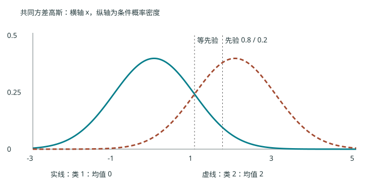
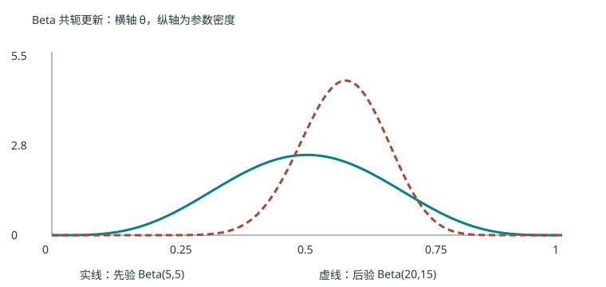

# 第二章 贝叶斯学习：让证据改变判断

> 主来源：S02 4–13 页；S03 4–17 页（贝叶斯分类）、19–30 页（高斯判别）、33–51 页（参数估计）。33–51 页的嵌入公式已查看渲染原页。推导、边界条件和小例为编者解释，未标注为教师答案。

## 2.1 先验、似然、后验与证据 {#ml-02-01}

不知道明天的天气时，可以先按历史频率判断。S02 的例子中，365 天里有 265 个晴天。令 $A$ 为“明天晴”，$B$ 为“今晚有晚霞”。先验 $P(A)=265/365$ 描述尚未观察晚霞时的信念。

再假设 $P(B\mid A)=0.7$、$P(B\mid\neg A)=0.1$。这两个量描述不同天气下出现证据的可能性，不能与 $P(A\mid B)$ 互换。由联合概率的两种分解，

$$P(A,B)=P(B\mid A)P(A)=P(A\mid B)P(B).$$

当 $P(B)>0$，两边除以 $P(B)$，再用全概率公式展开分母，得到

$$P(A\mid B)=\frac{P(B\mid A)P(A)}{P(B\mid A)P(A)+P(B\mid\neg A)P(\neg A)}.$$

用未提前舍入的频率计算，结果为 $185.5/195.5\approx0.948849$。没有晚霞时则为 $79.5/169.5\approx0.469027$，预测方向会反转。后验的变化来自证据对不同假设的支持程度不同。

对一般类别 $C\in\{1,\ldots,K\}$ 和已观测特征 $\mathbf x$，

$$P(C=c\mid\mathbf x)=\frac{p(\mathbf x\mid C=c)P(C=c)}{\sum_{j=1}^Kp(\mathbf x\mid C=j)P(C=j)}.$$

分子是似然乘先验；分母是证据，用于归一化。连续特征的 $p$ 是密度，单点概率为零并不妨碍比较密度。似然是固定数据以后关于假设或参数的函数，不要求对参数积分为 1。

## 2.2 从后验到决策 {#ml-02-02}

当每次错判的损失相同，选择后验最大的类就使条件错误概率最小：

$$h(\mathbf x)=\arg\max_c P(C=c\mid\mathbf x)=\arg\max_c p(\mathbf x\mid c)P(c).$$

因为证据对所有候选类别相同，所以可以从比较中删去；这不表示证据等于 1。对正数取对数不会改变大小关系，因此也可比较

$$g_c(\mathbf x)=\log p(\mathbf x\mid c)+\log P(c).$$

二分类令 $g=g_1-g_2$；$g>0$ 归第一类，$g<0$ 归第二类，$g=0$ 时需约定平局规则。只有对所有类共同的加法项可以删除，不可随意删掉某个类自己的常数。

编者扩展：实际错判代价可能不同。令 $L(a,c)$ 是采取动作 $a$、真实类别为 $c$ 的损失，则条件风险为 $R(a\mid\mathbf x)=\sum_c L(a,c)P(c\mid\mathbf x)$，应选风险最小的动作。最大后验分类是 0–1 损失的特例，不是所有应用下的最优规则。

## 2.3 朴素贝叶斯如何降低估计难度 {#ml-02-03}

若特征有很多种组合，直接估计整个 $p(\mathbf x\mid c)$ 需要大量数据。朴素贝叶斯作条件独立假设：给定类别后，各特征独立，于是

$$p(\mathbf x\mid c)=\prod_{j=1}^d p(x_j\mid c),\qquad
g_c(\mathbf x)=\log P(c)+\sum_{j=1}^d\log p(x_j\mid c).$$

这是假设“给定类别以后独立”，并不要求特征在总体上独立。两个特征都随类别变化时，总体上仍可相关。

类别先验用 $N_c/N$ 估计。离散特征第 $j$ 维有 $m_j$ 个可能取值，某取值 $v$ 在类 $c$ 中出现 $N_{cjv}$ 次，可用

$$\widehat P(x_j=v\mid c)=\frac{N_{cjv}+\alpha}{N_c+\alpha m_j},\qquad\alpha>0.$$

平滑避免一个未出现的取值让整类得分变成零。分母必须累计所有候选取值增加的伪计数。类别先验也可平滑为 $(N_c+\alpha)/(N+K\alpha)$；两种平滑的分母不同，因为候选对象分别是特征取值和类别。连续特征可在每一类、每个维度用一维高斯密度建模；标准差必须为正，样本不足或零方差时需要正则处理。

S03 5 页还提及半朴素贝叶斯：放宽完全的类内条件独立性，允许部分属性依赖。课件此处没有展开具体结构和算法，本书只记录其思想，不凭名称补造讲授细节。

S03 13–17 页用西瓜数据演示离散与连续特征混合分类。该页计算的未归一化类别得分约为 $0.038$ 与 $6.80\times10^{-5}$；它们不是两个相加为 1 的后验。由于含连续密度，得分本身也不能解释成单点概率。完整原始表尚未逐格视觉核对，本版不声称重现该表的全部数值。

## 2.4 高斯分类器：为什么边界有时是直线 {#ml-02-04}

设 $\mathbf x\in\mathbb R^d$，类 $c$ 的均值为 $\boldsymbol\mu_c$，协方差为正定矩阵 $\Sigma_c\in\mathbb R^{d\times d}$。正定保证逆矩阵、正行列式及通常的全维密度存在。

$$p(\mathbf x\mid c)=\frac{\exp[-\frac12(\mathbf x-\boldsymbol\mu_c)^T\Sigma_c^{-1}(\mathbf x-\boldsymbol\mu_c)]}{(2\pi)^{d/2}|\Sigma_c|^{1/2}}.$$

二次型衡量按类内变异缩放后的距离。取对数并省略所有类共有的 $-\frac d2\log(2\pi)$：

$$g_c=-\frac12(\mathbf x-\boldsymbol\mu_c)^T\Sigma_c^{-1}(\mathbf x-\boldsymbol\mu_c)-\frac12\log|\Sigma_c|+\log P(c).$$

共同协方差 $\Sigma_c=\Sigma$ 时，展开二次型：

$$g_c=-\frac12\mathbf x^T\Sigma^{-1}\mathbf x+\boldsymbol\mu_c^T\Sigma^{-1}\mathbf x-\frac12\boldsymbol\mu_c^T\Sigma^{-1}\boldsymbol\mu_c+\log P(c).$$

第一项对各类相同，比较时抵消，余下是线性得分。两类边界写成 $\mathbf w^T\mathbf x+b=0$，其中

$$\mathbf w=\Sigma^{-1}(\boldsymbol\mu_1-\boldsymbol\mu_2),\qquad b=-\frac12(\boldsymbol\mu_1^T\Sigma^{-1}\boldsymbol\mu_1-\boldsymbol\mu_2^T\Sigma^{-1}\boldsymbol\mu_2)+\log\frac{P(1)}{P(2)}.$$

若进一步 $\Sigma=\sigma^2I$ 且先验相等，判别退化为比较欧氏距离。共同但非球形的协方差对应马氏距离；各类协方差不同则通常保留二次项，得到二次边界，但也可能出现特殊退化情形。

自编一维例：两类均值 0 和 2，共同方差 1。等先验时边界是 1；若 $P(1)=0.8$、$P(2)=0.2$，则 $g_1-g_2=-2x+2+\log4$，边界约为 1.693147，第一类的决策区域扩大。

观察下面的图：先验变化使边界移动，却没有改变两条条件密度曲线。

S03 30 页原例为 $\boldsymbol\mu_1=(3,6)^T$、$\Sigma_1=\operatorname{diag}(1/2,2)$，$\boldsymbol\mu_2=(3,-2)^T$、$\Sigma_2=\operatorname{diag}(2,2)$，等先验。直接相减得 $g_1-g_2=-0.75(x_1-3)^2+4x_2-8+\log2$，故

$$x_2=0.1875(x_1-3)^2+2-\frac{\log2}{4}\approx3.514213-1.125x_1+0.1875x_1^2.$$

这也独立核对了课件的抛物线常数。目录中的课堂板书照片 `2f830756d2f83a2ea6c09f6878b20e33.jpg` 已单独查看：它通过协方差的对称性，把两个交叉项合并，再相减消去共同二次项，得到相同法向量。这里还应区分“协方差必为半正定”和“此全维高斯密度假设协方差正定”；可逆性来自后者，而不是所有协方差天然可逆。

## 2.5 极大似然估计 {#ml-02-05}

前面的分类假设概率模型已知；现在需要从数据估计参数。对独立同分布样本，似然是 $L(\theta)=\prod_i p(x_i\mid\theta)$。ML 选择使观测数据最受支持的参数。

硬币模型中 $x_i\in\{0,1\}$，未知正面概率为 $\theta\in[0,1]$，观察 $n_1$ 次正面与 $n_0$ 次反面，$N=n_1+n_0$。对已观测的有序序列，

$$L(\theta)=\theta^{n_1}(1-\theta)^{n_0},\qquad\ell(\theta)=n_1\log\theta+n_0\log(1-\theta).$$

当两种结果都出现时，内部驻点满足 $n_1/\theta-n_0/(1-\theta)=0$，两边乘 $\theta(1-\theta)$ 得 $n_1-N\theta=0$，所以 $\widehat\theta_{ML}=n_1/N$。二阶导为负，驻点为极大值。若全是正面或反面，最大值在端点，不能机械使用内部导数推理。

对于只记录正面次数的二项分布，还要乘组合数 $\binom N{n_1}$；该项与 $\theta$ 无关，因此不改变 ML。S03 44 页的 $n_1=15,n_0=10$ 得到 0.6。

一维高斯模型的对数似然为

$$\ell(\mu,\sigma^2)=-\frac N2\log(2\pi\sigma^2)-\frac1{2\sigma^2}\sum_i(x_i-\mu)^2.$$

对 $\mu$ 求导，得 $\sum_i(x_i-\mu)/\sigma^2=0$，故 $\widehat\mu=\bar x$。令 $v=\sigma^2$ 再求导，$-N/(2v)+\sum_i(x_i-\mu)^2/(2v^2)=0$，得 $\widehat v=\sum_i(x_i-\mu)^2/N$。当均值也由样本估计，分母 $N$ 的 ML 方差通常有偏；无偏样本方差用 $N-1$。如果均值已知，围绕已知均值计算的该估计则无偏，两种情况应区分。

## 2.6 完整后验、MAP 与后验预测 {#ml-02-06}

少量数据时，15/25 只是一个点，不能表示不确定程度。给 $\theta$ 一个 $\operatorname{Beta}(a,b)$ 先验，$a,b>0$ 是预先设定的超参数，密度为

$$p(\theta)=\frac{\theta^{a-1}(1-\theta)^{b-1}}{B(a,b)},\quad0<\theta<1.$$

将它与硬币似然相乘，分别合并 $\theta$ 与 $(1-\theta)$ 的指数：

$$p(\theta\mid D)\propto\theta^{a+n_1-1}(1-\theta)^{b+n_0-1}.$$

因此后验仍是 Beta 分布：$\operatorname{Beta}(a+n_1,b+n_0)$。这种先验与后验同属一族的性质叫共轭。

MAP 选择后验密度的众数。令 $A=a+n_1$、$B=b+n_0$，当 $A>1,B>1$ 时，对对数后验求导得到

$$\widehat\theta_{MAP}=\frac{A-1}{A+B-2}.$$

若 $A\le1$ 或 $B\le1$，众数可能位于边界、双边界或不唯一，不能直接套内部众数公式。S03 50 页使用 $a=b=5$，得后验 $\operatorname{Beta}(20,15)$、MAP 为 $19/33\approx0.575758$。完整后验保留不确定性，MAP 只保留一个位置。

观察先验与后验形状：本例后验向观测成功频率移动，并更集中。

编者补充：预测下一次正面概率要对未知参数积分：$P(x_{new}=1\mid D)=\int\theta p(\theta\mid D)d\theta=A/(A+B)=20/35\approx0.571429$。它等于后验均值，一般不同于 MAP。

S03 51 页的高斯均值 MAP 可在一维写清楚。已知观测方差 $\sigma^2>0$，先验 $\mu\sim N(\mu_0,\tau^2)$，$\tau^2>0$。负对数后验忽略常数后为

$$\frac1{2\sigma^2}\sum_i(x_i-\mu)^2+\frac1{2\tau^2}(\mu-\mu_0)^2.$$

求导并置零，得到 $(N/\sigma^2+1/\tau^2)\mu=N\bar x/\sigma^2+\mu_0/\tau^2$。因此 MAP 是观测均值和先验均值按精度加权的平均。样本增加时数据项权重增大；先验方差很大时趋于 ML。

## 2.7 本章常见混淆

类别后验 $P(c\mid\mathbf x)$ 用于分类；参数后验 $p(\theta\mid D)$ 表示未知参数的不确定性。两者都使用贝叶斯公式，但未知对象不同。朴素贝叶斯是条件独立模型；ML 和 MAP 是估计准则，不能将三者当作同一层次的三个分类器。

复习问题：为何对数判别可以删除证据？为什么共同协方差会消去二次项？Beta 后验参数为何增加的是次数？能回答这三问，再做[练习](../exercises.md)。
