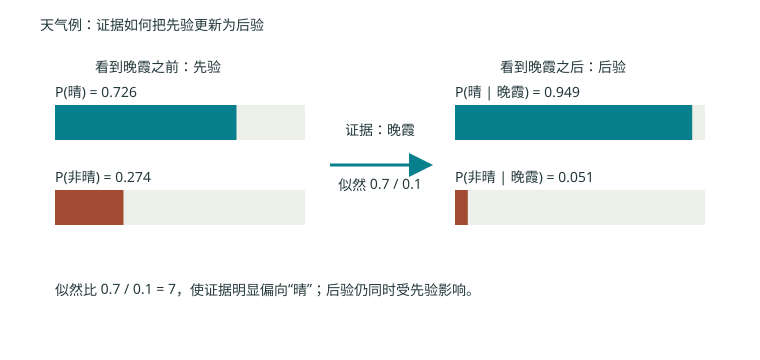
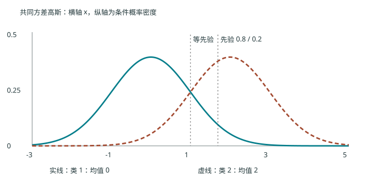
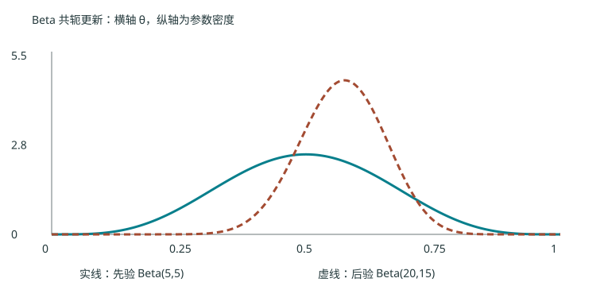

# 第二章 贝叶斯学习：让证据改变判断

> **课件主线**：S02 4–10 页先用天气预报引出先验、证据与贝叶斯决策；S03 4–17 页依次讲判别函数、朴素贝叶斯和“西瓜”完整例题；19–30 页讨论三种高斯协方差情形；33–51 页讲参数估计。正文按这一顺序展开，编者推导与自编例另行标注。

本章是全书“概率主线”的起点。我们会反复用到一句话：**先验代表旧判断，似然代表新证据有多支持各假设，后验是证据修正后的新判断，证据（分母）只负责把概率归一化到 `[0,1]`。** 读完本章，你应该能独立写出：贝叶斯公式的来历、多类后验、MAP 决策为什么能删去证据、朴素贝叶斯的独立性假设、高斯分类器何时给出直线边界（并把 $\mathbf w,\ b$ 推出来）、以及 MLE / 共轭先验 / MAP / 后验预测各自的推导与区别。

---

## 2.1 先验、似然、后验与证据 {#ml-02-01}

### 2.1.1 为什么这样想：用天气建立直觉

先不要急着背公式。设想你每天早晨想知道“今天是否晴天”。在**还没看任何征兆**（比如傍晚的晚霞）之前，你只能按历史频率猜：一年 365 天里有 265 天晴，于是你先入为主地认为“晴天”的可能性是 $265/365$。这个“还没看证据时的判断”就叫**先验（prior）**。

到了傍晚，你看到了“晚霞”。经验告诉你：晴天更容易出晚霞，阴天偶尔也出。于是“晚霞”这条**证据（evidence / observation）**会改变你的判断，得到“看了晚霞之后晴天的把握”，这就是**后验（posterior）**。而“在晴天假设下出现晚霞的可能性”描述的是证据与假设之间的关系，叫做**似然（likelihood）**。

记住这三者角色不同：**先验是旧信念，似然是证据对各假设的区分力，后验是修正后的新信念。**

### 2.1.2 贝叶斯公式的逐步推导（联合概率两种分解 → 除以 $P(B)$ → 全概率展开分母）

下面把贝叶斯公式从无到有推一遍，每一步都说明在做什么。

**过程讲解**

- **符号与假设**：设 $A,\ B$ 为两个事件，且 $P(B)>0$。$P(B)>0$ 是公式成立的硬条件——分母不能为零，否则“在 $B$ 发生条件下”没有意义。
- **起点（联合概率的两种分解）**：把“两件事同时发生”的概率按不同顺序展开，得到两个式子，它们都等于同一个联合概率 $P(A,B)$：
  $$P(A,B)=P(B\mid A)P(A),\qquad P(A,B)=P(A\mid B)P(B).$$
  第一式是“先固定 $A$，再看 $B$ 给 $A$ 的条件概率”；第二式是“先固定 $B$，再看 $A$ 给 $B$ 的条件概率”。
- **步骤 1（两式相等）**：既然两式都等于 $P(A,B)$，于是
  $$P(B\mid A)P(A)=P(A\mid B)P(B).$$
- **步骤 2（两边除以 $P(B)$）**：因为 $P(B)>0$，可以除，得到后验的表达式
  $$P(A\mid B)=\frac{P(B\mid A)P(A)}{P(B)}.$$
  这就是贝叶斯公式的雏形：分子是“似然 × 先验”。
- **步骤 3（用全概率展开分母）**：分母 $P(B)$ 本身可以用对 $A$ 及其补集 $\neg A$ 的全概率公式拆开：
  $$P(B)=P(B\mid A)P(A)+P(B\mid\neg A)P(\neg A).$$
  代回步骤 2，得到完整形式：
  $$P(A\mid B)=\frac{P(B\mid A)P(A)}{P(B\mid A)P(A)+P(B\mid\neg A)P(\neg A)}.$$

- **结论**：后验 $= \dfrac{\text{似然}\times\text{先验}}{\text{证据}}$；证据 $P(B)$ 正好是所有假设下产生该证据的总概率之和，起归一化作用。
- **成立条件**：$P(B)>0$。若 $P(B)=0$（数据在已知假设下根本不可能出现），需要另行处理，不能机械套公式。

### 2.1.3 数值核对：晴天与晚霞

沿用 S02 的设定：一年 365 天有 265 天晴。令 $A=$“明天晴”，$B=$“今晚有晚霞”。

- 先验：$P(A)=265/365$，$P(\neg A)=100/365$。
- 似然（不同天气下出晚霞的可能）：$P(B\mid A)=0.7$，$P(B\mid\neg A)=0.1$。

**先算证据 $P(B)$**（注意用未提前舍入的分数，最后再取整，避免累积误差）：

$$
\begin{aligned}
P(B) &= P(B\mid A)P(A)+P(B\mid\neg A)P(\neg A) \\
     &= 0.7\cdot\frac{265}{365}+0.1\cdot\frac{100}{365}
      =\frac{185.5+10}{365}
      =\frac{195.5}{365}.
\end{aligned}
$$

**再算后验 $P(A\mid B)$**：

$$
P(A\mid B)=\frac{0.7\cdot 265/365}{195.5/365}
          =\frac{185.5}{195.5}
          \approx 0.948849.
$$

看到晚霞后，晴天的把握从先验的 $265/365\approx0.726$ 提升到约 $0.949$。

**反例：没有晚霞时会怎样？** 这时证据换成 $\neg B$，$P(\neg B\mid A)=1-0.7=0.3$，$P(\neg B\mid\neg A)=1-0.1=0.9$：

$$
\begin{aligned}
P(\neg B) &= 0.3\cdot\frac{265}{365}+0.9\cdot\frac{100}{365}
          =\frac{79.5+90}{365}
          =\frac{169.5}{365},\\
P(A\mid\neg B) &= \frac{79.5/365}{169.5/365}
               =\frac{79.5}{169.5}
               \approx 0.469027.
\end{aligned}
$$

没有晚霞时，晴天的把握反而降到约 $0.469$，**预测方向会反转**。这个对比说明：后验的变化完全来自“证据对不同假设的支持程度不同”。

> **记住**：分子里明明是 $P(B\mid A)$（证据给假设），后验却是 $P(A\mid B)$（假设给证据）。两者**不能互换**——“晴天容易有晚霞”不等于“有晚霞多半是晴天”（还要看先验和另一类）。

### 2.1.4 多类后验与“证据归一化”

把二分类推广到 $K$ 个类别。设类别 $C\in\{1,\ldots,K\}$，已观测特征为 $\mathbf x\in\mathbb R^d$（列向量，维度 $d$）。

$$
P(C=c\mid\mathbf x)=\frac{p(\mathbf x\mid C=c)P(C=c)}{\sum_{j=1}^K p(\mathbf x\mid C=j)P(C=j)}.
$$

- **分子** $p(\mathbf x\mid c)P(c)$：第 $c$ 类的似然乘先验。
- **分母** $\sum_{j=1}^K p(\mathbf x\mid j)P(j)$：把所有类别的“似然×先验”加起来，就是证据（也称边际似然），作用是把分子归一化，使所有类别的后验加起来等于 1。

**过程讲解（为什么分母保证归一化）**

- **起点**：对任意 $\mathbf x$，后验之和应为 1。
- **步骤**：把上式的分子对所有 $c$ 求和：
  $$
  \sum_{c=1}^K P(C=c\mid\mathbf x)
  =\frac{\sum_{c=1}^K p(\mathbf x\mid c)P(C=c)}{\sum_{j=1}^K p(\mathbf x\mid j)P(C=j)}
  =1.
  $$
- **结论**：分母恰好等于分子之和，因此后验是一个合法的概率分布。比较“哪个类最大”时，这个归一化常数可以省掉（见 2.2）。

> **常见误区**：这里 $p(\mathbf x\mid c)$ 是**密度**（连续情形下单点概率为零），密度值可以大于 1。密度“大”只表示相对更可能，不等于“概率接近 1”。似然 $p(\mathbf x\mid c)$ 是“给定 $c$ 时数据出现的可能性”的函数，它**不要求对参数/类别积分为 1**——这是似然与概率分布的根本区别。

---

## 2.2 从后验到决策 {#ml-02-02}

### 2.2.1 为什么这样想：分类就是“选最像的那个类”

分类器的任务是给新样本 $\mathbf x$ 一个类别标签。最朴素也最常用的准则：**选后验概率最大的类**。直觉上，既然后验是“证据修正后的判断”，那当然信最有可能那个。下面证明：在“错判代价相同”的前提下，这确实使错误率最小。

### 2.2.2 MAP 决策：删去证据只因它对所有类相同

**过程讲解（最大后验分类 = 最小错误率）**

- **符号与假设**：类别 $c=1,\ldots,K$。采用 0–1 损失：判错损失为 1，判对为 0。条件错误概率为 $1-\max_c P(C=c\mid\mathbf x)$。
- **起点**：要使错误率最小，等价于使 $\max_c P(C=c\mid\mathbf x)$ 最大。
- **步骤**：由 2.1.4 的后验公式，
  $$
  \arg\max_c P(C=c\mid\mathbf x)
  =\arg\max_c \frac{p(\mathbf x\mid c)P(c)}{\sum_{j=1}^K p(\mathbf x\mid j)P(j)}.
  $$
  分母 $\sum_{j=1}^K p(\mathbf x\mid j)P(j)$ 与 $c$ **无关**（对所有候选类都相同），正数常数不影响“取最大”的位置，因此可删：
  $$
  h(\mathbf x)=\arg\max_c P(C=c\mid\mathbf x)=\arg\max_c p(\mathbf x\mid c)P(c).
  $$
- **结论**：最大后验（MAP）决策只需比较“似然×先验”，无需算证据。
- **成立条件与边界**：删去证据**绝不表示证据等于 1**，只是它对所有类是常数。**只有对所有类共同的因子可以删**（例如共同的对数常数、共同协方差项）；某个类**自己独有的常数不能删**。

### 2.2.3 对数判别函数

因为对数 $\log$（本章默认自然对数，见统一符号表）是严格单调递增函数，对正数取对数不改变大小顺序，于是可比较

$$
g_c(\mathbf x)=\log p(\mathbf x\mid c)+\log P(c).
$$

- **二分类写法**：令 $g(\mathbf x)=g_1(\mathbf x)-g_2(\mathbf x)$。
  - $g>0$：归第一类（因为 $g_1>g_2$，即 $P(C=1\mid\mathbf x)>P(C=2\mid\mathbf x)$）；
  - $g<0$：归第二类；
  - $g=0$：两类后验相等，平局，需**事先约定**平局规则（如固定归某一类）。
- **为什么用对数**：把乘积变加法，数值上更稳定（避免很多小于 1 的密度相乘导致下溢）。

> **记住**：只在“比较谁最大”时才能删常数。若你需要**输出真实后验概率**（比如要报告“有 95% 把握是晴天”），就必须保留分母把结果归一化。

### 2.2.4 编者扩展：错判代价不相等时的风险最小化

实际错判代价可能不同。令 $L(a,c)$ 为“采取动作 $a$、真实类别为 $c$”的损失，则**条件风险**为

$$
R(a\mid\mathbf x)=\sum_c L(a,c)P(C=c\mid\mathbf x).
$$

应选使风险最小的动作。最大后验分类只是 0–1 损失（$L(a,c)=1-\delta_{ac}$）下的特例，并非所有应用下的最优规则。例如“把健康人误判为有病”和“把病人误判为健康”的代价天差地别，此时必须用风险最小化而非单纯比后验。

---

## 2.3 朴素贝叶斯如何降低估计难度 {#ml-02-03}

### 2.3.1 为什么这样想：特征组合爆炸

直接估计整个 $p(\mathbf x\mid c)$ 意味着要刻画 $d$ 个特征在所有类别下的联合分布。若每个特征有几种取值，组合数是指数级的，样本根本不够。朴素贝叶斯用一个大胆但常用的假设来“降维”：**给定类别之后，各特征相互独立**。这样就把联合密度拆成一维密度的乘积，估计难度从“指数”降到“线性”。

### 2.3.2 条件独立假设与判别函数

**过程讲解**

- **假设（关键）**：给定类别 $c$ 后，特征 $x_1,\ldots,x_d$ 条件独立，即
  $$p(\mathbf x\mid c)=p(x_1,\ldots,x_d\mid c)=\prod_{j=1}^d p(x_j\mid c).$$
- **步骤**：代入 2.2.3 的对数判别函数，
  $$
  g_c(\mathbf x)=\log P(c)+\log\prod_{j=1}^d p(x_j\mid c)
              =\log P(c)+\sum_{j=1}^d \log p(x_j\mid c).
  $$
- **结论**：判别函数变成“类别先验的对数 + 各维条件密度的对数之和”，每个一维密度可独立从该类样本中估计。

> **常见误区**：这是“**给定类别以后**独立”，并不要求特征在总体上独立。两个特征可以都随类别变化（例如“颜色”和“形状”都随“水果种类”变），于是总体上它们相关；但一旦固定了类别，两者就互不提供额外信息。换句话说，朴素贝叶斯的独立性是**条件独立性**，不是边际独立性。

### 2.3.3 参数估计与平滑（拉普拉斯平滑）

- **类别先验**：用频率估计 $\widehat P(c)=N_c/N$，其中 $N_c$ 是第 $c$ 类样本数，$N$ 是总样本数。
- **离散特征**：第 $j$ 维有 $m_j$ 个可能取值，某取值 $v$ 在类 $c$ 中出现 $N_{cjv}$ 次，可用
  $$\widehat P(x_j=v\mid c)=\frac{N_{cjv}+\alpha}{N_c+\alpha m_j},\qquad\alpha>0.$$

**过程讲解（平滑为什么必要）**

- **起点**：若某个取值 $v$ 在类 $c$ 中一次都没出现（$N_{cjv}=0$），未平滑的估计为 0。
- **问题**：由于判别函数是各项对数之和，一项为 $\log 0=-\infty$，会**让整类得分变成零**，即使其他特征都强烈支持该类。
- **步骤**：加 $\alpha>0$ 的伪计数到分子，并在分母累计**所有候选取值**增加的伪计数 $\alpha m_j$，得到上式。
- **结论**：平滑给未出现的取值留出正概率，避免“一票否决”。$\alpha=1$ 即拉普拉斯平滑。

> **记住**：两类平滑的分母**不同**，因为候选对象不一样——类别先验的候选是“类别”（共 $K$ 个），故可平滑为 $(N_c+\alpha)/(N+K\alpha)$；特征取值的候选是“该维的取值”（共 $m_j$ 个），故分母是 $N_c+\alpha m_j$。混用分母会算错。

- **连续特征**：可在每一类、每个维度用一维高斯密度建模 $p(x_j\mid c)$。注意标准差必须为正；样本不足或某维零方差时需要正则处理（例如加一个小常数），否则密度无定义或退化为冲激。

### 2.3.4 一点点小数值例子（离散平滑）

设某类 $c$ 有 $N_c=10$ 个样本，特征第 $j$ 维有 $m_j=3$ 种取值，其中一种取值 $v$ 在训练集里出现 $0$ 次。

- 不平滑：$\widehat P(v\mid c)=0/10=0$，一旦测试样本在该维取 $v$，整类对数得分 $-\infty$。
- 拉普拉斯平滑（$\alpha=1$）：$\widehat P(v\mid c)=(0+1)/(10+1\cdot 3)=1/13\approx0.0769$，该类仍有机会被选中。

### 2.3.5 课件完整例题：用朴素贝叶斯判断“测 1”是不是好瓜（S03 13–17 页）

这道题不是编者另造的例子，而是课件连续 5 页的课堂例题。训练集有 17 个西瓜，前 8 个为好瓜、后 9 个为坏瓜；特征包含 6 个离散属性和 2 个连续属性：

| 编号 | 色泽 | 根蒂 | 敲声 | 纹理 | 脐部 | 触感 | 密度 | 含糖率 | 好瓜 |
| --- | --- | --- | --- | --- | --- | --- | --- | ---: | ---: | --- |
| 1 | 青绿 | 蜷缩 | 浊响 | 清晰 | 凹陷 | 硬滑 | 0.697 | 0.460 | 是 |
| 2 | 乌黑 | 蜷缩 | 沉闷 | 清晰 | 凹陷 | 硬滑 | 0.774 | 0.376 | 是 |
| 3 | 乌黑 | 蜷缩 | 浊响 | 清晰 | 凹陷 | 硬滑 | 0.634 | 0.264 | 是 |
| 4 | 青绿 | 蜷缩 | 沉闷 | 清晰 | 凹陷 | 硬滑 | 0.608 | 0.318 | 是 |
| 5 | 浅白 | 蜷缩 | 浊响 | 清晰 | 凹陷 | 硬滑 | 0.556 | 0.215 | 是 |
| 6 | 青绿 | 稍蜷 | 浊响 | 清晰 | 稍凹 | 软粘 | 0.403 | 0.237 | 是 |
| 7 | 乌黑 | 稍蜷 | 浊响 | 稍糊 | 稍凹 | 软粘 | 0.481 | 0.149 | 是 |
| 8 | 乌黑 | 稍蜷 | 浊响 | 清晰 | 稍凹 | 硬滑 | 0.437 | 0.211 | 是 |
| 9 | 乌黑 | 稍蜷 | 沉闷 | 稍糊 | 稍凹 | 硬滑 | 0.666 | 0.091 | 否 |
| 10 | 青绿 | 硬挺 | 清脆 | 清晰 | 平坦 | 软粘 | 0.243 | 0.267 | 否 |
| 11 | 浅白 | 硬挺 | 清脆 | 模糊 | 平坦 | 硬滑 | 0.245 | 0.057 | 否 |
| 12 | 浅白 | 蜷缩 | 浊响 | 模糊 | 平坦 | 软粘 | 0.343 | 0.099 | 否 |
| 13 | 青绿 | 稍蜷 | 浊响 | 稍糊 | 凹陷 | 硬滑 | 0.639 | 0.161 | 否 |
| 14 | 浅白 | 稍蜷 | 沉闷 | 稍糊 | 凹陷 | 硬滑 | 0.657 | 0.198 | 否 |
| 15 | 乌黑 | 稍蜷 | 浊响 | 清晰 | 稍凹 | 软粘 | 0.360 | 0.370 | 否 |
| 16 | 浅白 | 蜷缩 | 浊响 | 模糊 | 平坦 | 硬滑 | 0.593 | 0.042 | 否 |
| 17 | 青绿 | 蜷缩 | 沉闷 | 稍糊 | 稍凹 | 硬滑 | 0.719 | 0.103 | 否 |

测试样本“测 1”为

$$
\mathbf x_*=(\text{青绿},\text{蜷缩},\text{浊响},\text{清晰},\text{凹陷},\text{硬滑},0.697,0.460)^T.
$$

**步骤 1：估计类别先验。** 课件未做平滑，直接按频数估计：

$$P(\text{是})=\frac8{17}\approx0.471,
\qquad P(\text{否})=\frac9{17}\approx0.529.$$

**步骤 2：估计 6 个离散属性的条件概率。** 对“测 1”实际出现的属性值，课件给出的频数为：

| 条件概率 | 好瓜“是” | 好瓜“否” |
| --- | ---: | ---: |
| 色泽=青绿 | $3/8=0.375$ | $3/9=0.333$ |
| 根蒂=蜷缩 | $5/8=0.625$ | $3/9=0.333$ |
| 敲声=浊响 | $6/8=0.750$ | $4/9=0.444$ |
| 纹理=清晰 | $7/8=0.875$ | $2/9=0.222$ |
| 脐部=凹陷 | $6/8=0.750$ | $2/9=0.222$ |
| 触感=硬滑 | $6/8=0.750$ | $6/9=0.667$ |

**步骤 3：对连续属性使用类条件高斯密度。** 课件用各类样本的均值和标准差估计密度，得到

$$
\begin{aligned}
p(0.697\mid\text{是})&\approx1.959,&
p(0.697\mid\text{否})&\approx1.203,\\
p(0.460\mid\text{是})&\approx0.788,&
p(0.460\mid\text{否})&\approx0.066.
\end{aligned}
$$

注意这些是**概率密度**，不是单点概率，所以 $1.959>1$ 并不矛盾。

**步骤 4：乘上先验并比较未归一化后验。** 在朴素条件独立假设下：

$$
\begin{aligned}
s_{\text{是}}
&=0.471\times0.375\times0.625\times0.750\times0.875\times0.750\times0.750\times1.959\times0.788\\
&\approx0.0629,\\
s_{\text{否}}
&=0.529\times0.333\times0.333\times0.444\times0.222\times0.222\times0.667\times1.203\times0.066\\
&\approx6.8\times10^{-5}.
\end{aligned}
$$

> **课件数值核算记录**：S03 17 页把第一项写成约 $0.038$，但把 S03 14–16 页展示的全部因子按上式直接相乘，得到约 $0.0629$；第二项可复现为约 $6.80\times10^{-5}$。$0.038$ 与 $0.0629$ 的差异远大于显示小数的舍入误差，当前无法仅凭课件页确定第一项为何不同。本文保留课件原值并同时报告独立复算值，不将其静默改成教师答案。

无论使用课件写出的 $0.038$ 还是按显示因子复算的 $0.0629$，都有 $s_{\text{是}}>s_{\text{否}}$，因此课件把“测 1”判为**好瓜**，分类结论不变。这里比较的是共同证据分母消去后的未归一化分数；若要报告真正的后验概率，还需计算

$$P(\text{是}\mid\mathbf x_*)=\frac{s_{\text{是}}}{s_{\text{是}}+s_{\text{否}}}.$$

> **限制与误区**：本题直接使用频数，没有对未见取值做拉普拉斯平滑；一旦某个条件频数为 0，整类乘积会变成 0。另一个风险是 8 个属性未必真的条件独立，所以“朴素”是建模近似，不是数据事实。半朴素贝叶斯在 S03 1 页只被提及，课件没有展开其结构学习，本文不据标题补造考核内容。

---

## 2.4 高斯分类器：为什么边界有时是直线 {#ml-02-04}

### 2.4.1 为什么这样想：用“椭圆等高线”看图

每个类用一个高斯分布建模。若两类形状（协方差）相同，它们的概率等高线是**同向的椭圆**；比较两类后验时，二次项会相互抵消，只剩下 $\mathbf x$ 的一次项——决策边界就成了直线（超平面）。若两类形状不同，二次项消不掉，边界就是曲线（二次曲面）。下面把这件事严格推出来。

### 2.4.2 高斯密度与对数判别函数

**符号与维度**：设 $\mathbf x\in\mathbb R^d$（列向量），$d$ 维特征。类 $c$ 的均值为 $\boldsymbol\mu_c\in\mathbb R^d$，协方差为 $\Sigma_c\in\mathbb R^{d\times d}$。我们假定 $\Sigma_c$ **正定**（不是仅半正定）：

- 正定保证 $\Sigma_c^{-1}$ 存在（可逆），$\det\Sigma_c>0$（分母有意义），且全维高斯密度定义良好；
- “协方差必为半正定”是任何协方差矩阵的通性，但“可逆性”来自这里更强的正定假设，二者不可混为一谈（见 2.4.5 末的提醒）。

类条件密度（多元高斯）：

$$
p(\mathbf x\mid c)=\frac{\exp\!\left[-\frac12(\mathbf x-\boldsymbol\mu_c)^T\Sigma_c^{-1}(\mathbf x-\boldsymbol\mu_c)\right]}{(2\pi)^{d/2}|\Sigma_c|^{1/2}}.
$$

**过程讲解（写出对数判别函数）**

- **起点**：代入 2.2.3 的 $g_c(\mathbf x)=\log p(\mathbf x\mid c)+\log P(c)$。
- **步骤**：对密度取对数（注意 $\log\exp(\cdot)$ 抵消指数，$\log$ 把除法变减法）：
  $$
  \begin{aligned}
  g_c(\mathbf x)
  &=\log p(\mathbf x\mid c)+\log P(c)\\
  &=-\frac12(\mathbf x-\boldsymbol\mu_c)^T\Sigma_c^{-1}(\mathbf x-\boldsymbol\mu_c)
    -\frac d2\log(2\pi)-\frac12\log|\Sigma_c|+\log P(c).
  \end{aligned}
  $$
- **化简**：对所有类比较时，$-\frac d2\log(2\pi)$ 是公共常数，可暂略（属于“对所有类相同的项”），得到
  $$g_c=-\frac12(\mathbf x-\boldsymbol\mu_c)^T\Sigma_c^{-1}(\mathbf x-\boldsymbol\mu_c)-\frac12\log|\Sigma_c|+\log P(c).$$
- **结论**：判别函数由“按协方差缩放的二次距离”加“协方差行列式项”加“先验对数”组成。

### 2.4.3 共同协方差下二次项如何抵消（得到线性）

**过程讲解（二次型展开）**

- **假设**：两类共享同一正定协方差 $\Sigma_c=\Sigma$（即 $\Sigma_1=\Sigma_2=\Sigma$）。
- **起点**：展开 $(\mathbf x-\boldsymbol\mu_c)^T\Sigma^{-1}(\mathbf x-\boldsymbol\mu_c)$。利用 $\Sigma^{-1}$ 对称（故 $\mathbf x^T\Sigma^{-1}\boldsymbol\mu_c=\boldsymbol\mu_c^T\Sigma^{-1}\mathbf x$，二者都是标量、互为转置相等）：
  $$
  \begin{aligned}
  (\mathbf x-\boldsymbol\mu_c)^T\Sigma^{-1}(\mathbf x-\boldsymbol\mu_c)
  &=(\mathbf x^T-\boldsymbol\mu_c^T)\Sigma^{-1}(\mathbf x-\boldsymbol\mu_c)\\
  &=\mathbf x^T\Sigma^{-1}\mathbf x-\mathbf x^T\Sigma^{-1}\boldsymbol\mu_c-\boldsymbol\mu_c^T\Sigma^{-1}\mathbf x+\boldsymbol\mu_c^T\Sigma^{-1}\boldsymbol\mu_c\\
  &=\mathbf x^T\Sigma^{-1}\mathbf x-2\boldsymbol\mu_c^T\Sigma^{-1}\mathbf x+\boldsymbol\mu_c^T\Sigma^{-1}\boldsymbol\mu_c.
  \end{aligned}
  $$
- **步骤**：代回 $g_c$ 并略去公共项 $-\frac12\mathbf x^T\Sigma^{-1}\mathbf x$（对所有类相同）和 $-\frac12\log|\Sigma|$ 与 $-\frac d2\log(2\pi)$：
  $$
  g_c=-\frac12\mathbf x^T\Sigma^{-1}\mathbf x+\boldsymbol\mu_c^T\Sigma^{-1}\mathbf x-\frac12\boldsymbol\mu_c^T\Sigma^{-1}\boldsymbol\mu_c+\log P(c).
  $$
- **结论**：保留下来的部分关于 $\mathbf x$ 是**一次（线性）**的（$-\frac12\mathbf x^T\Sigma^{-1}\mathbf x$ 被抵消掉了）。因此两类比较时边界是直线。

### 2.4.4 边界 $\mathbf w$ 与 $b$ 的逐步推导 {#ml-02-04a}

这是本章重点，务必亲手推一遍。

**过程讲解（由 $g_1-g_2=0$ 得到 $\mathbf w,b$）**

- **符号与假设**：二分类，$c\in\{1,2\}$，共享正定协方差 $\Sigma$。记 $P(1),P(2)$ 为类先验，$\boldsymbol\mu_1,\boldsymbol\mu_2\in\mathbb R^d$。
- **起点**：边界是使两类得分相等的点集：$g_1(\mathbf x)=g_2(\mathbf x)$，即 $g_1-g_2=0$。
- **步骤 1（写出差值）**：用 2.4.3 中化简后的 $g_c$，公共项 $-\frac12\mathbf x^T\Sigma^{-1}\mathbf x$ 与 $-\frac12\log|\Sigma|$ 相减时抵消：
  $$
  \begin{aligned}
  g_1-g_2
  &=\Big[\boldsymbol\mu_1^T\Sigma^{-1}\mathbf x-\tfrac12\boldsymbol\mu_1^T\Sigma^{-1}\boldsymbol\mu_1+\log P(1)\Big]\\
  &\quad-\Big[\boldsymbol\mu_2^T\Sigma^{-1}\mathbf x-\tfrac12\boldsymbol\mu_2^T\Sigma^{-1}\boldsymbol\mu_2+\log P(2)\Big]\\
  &=(\boldsymbol\mu_1-\boldsymbol\mu_2)^T\Sigma^{-1}\mathbf x
    -\frac12\big(\boldsymbol\mu_1^T\Sigma^{-1}\boldsymbol\mu_1-\boldsymbol\mu_2^T\Sigma^{-1}\boldsymbol\mu_2\big)
    +\log\frac{P(1)}{P(2)}.
  \end{aligned}
  $$
- **步骤 2（认出线性形式）**：因为 $\Sigma^{-1}$ 对称，$(\boldsymbol\mu_1-\boldsymbol\mu_2)^T\Sigma^{-1}\mathbf x = \big(\Sigma^{-1}(\boldsymbol\mu_1-\boldsymbol\mu_2)\big)^T\mathbf x$。令
  $$
  \mathbf w=\Sigma^{-1}(\boldsymbol\mu_1-\boldsymbol\mu_2)\in\mathbb R^d,\qquad
  b=-\frac12\big(\boldsymbol\mu_1^T\Sigma^{-1}\boldsymbol\mu_1-\boldsymbol\mu_2^T\Sigma^{-1}\boldsymbol\mu_2\big)+\log\frac{P(1)}{P(2)}\in\mathbb R.
  $$
  则 $g_1-g_2=\mathbf w^T\mathbf x+b$。
- **步骤 3（边界方程）**：令 $g_1-g_2=0$，得决策边界
  $$
  \mathbf w^T\mathbf x+b=0,
  $$
  即一个超平面（一维时是点，二维时是直线）。
- **结论**：
  - 权重 $\mathbf w=\Sigma^{-1}(\boldsymbol\mu_1-\boldsymbol\mu_2)$ 指向“两类均值差、并按共享协方差逆缩放”的方向；
  - 偏置 $b$ 由两类的“按协方差加权的均值自相似度之差”和先验比共同决定。
- **成立条件**：共享协方差且正定（保证 $\Sigma^{-1}$ 存在）；二分类设定。多类时可用“一对多”或“一对一”比较，或写成多类线性判别。

### 2.4.5 特例与边界情形

- **球形协方差 $\Sigma=\sigma^2 I$ 且先验相等**：$\mathbf w=(\boldsymbol\mu_1-\boldsymbol\mu_2)/\sigma^2$（方向就是均值差方向），边界是两类均值连线的中垂面，判别等价于比较**欧氏距离**。
- **共同但非球形协方差**：$\mathbf w=\Sigma^{-1}(\boldsymbol\mu_1-\boldsymbol\mu_2)$，对应**马氏距离**（按协方差形状“压扁/旋转”后的距离）。
- **各类协方差不同**：二次项 $-\frac12\mathbf x^T\Sigma_c^{-1}\mathbf x$ 对两类不同，**无法抵消**，通常得到二次边界（二次判别分析 QDA）。但也可能出现特殊退化情形（例如两类协方差虽不同却在该方向上投影相同），这时边界仍可能局部呈线性——不能想当然认为“协方差不同就一定是曲线”。
- **可逆性提醒**：我们说“协方差必为半正定”永远成立（协方差矩阵的通性）；但高斯判别要能写出 $\Sigma^{-1}$，需要的是**正定**（或更一般可逆）。低维流形上的退化高斯（奇异协方差）需另行处理，不能直接套本节公式。

### 2.4.6 自编一维例：先验如何移动边界

**一维情形**：$d=1$，$\Sigma=\sigma^2=1$，两类均值 $\mu_1=0,\ \mu_2=2$。判别函数

$$
g_c=-\frac12\frac{(x-\mu_c)^2}{\sigma^2}+\log P(c)
    =-\frac12(x-\mu_c)^2+\log P(c).
$$

**等先验** $P(1)=P(2)=0.5$：两者对数先验抵消，边界由 $g_1=g_2$ 给出，即 $(x-0)^2=(x-2)^2\Rightarrow x=1$。边界恰在两点中点。

**不等先验** $P(1)=0.8,\ P(2)=0.2$：

**过程讲解**

- **起点**：计算差值
  $$
  \begin{aligned}
  g_1-g_2
  &=-\frac12x^2+\log 0.8-\Big[-\frac12(x-2)^2+\log 0.2\Big]\\
  &=-\frac12x^2+\frac12(x^2-4x+4)+\log\frac{0.8}{0.2}\\
  &=-2x+2+\log 4.
  \end{aligned}
  $$
  （其中 $\log 4\approx1.386294$。）
- **步骤**：令 $g_1-g_2=0$：
  $$
  -2x+2+\log 4=0\quad\Rightarrow\quad x=\frac{2+\log 4}{2}=1+\frac{\log 4}{2}\approx1.693147.
  $$
- **结论**：边界从 $1$ 移到约 $1.693$。先验更偏向第一类（$P(1)=0.8$）使**第一类的决策区域扩大**——即使样本离均值 0 更远，只要超过 1.693 才判为第二类。

> **观察**：上图显示先验变化只移动边界，却**没有改变两条条件密度曲线的形状**。这再次印证：证据（密度形状）是客观的，先验只是平移了你的判定门槛。

### 2.4.7 二维抛物线边界核对（S03 30 页）

S03 30 页原例：$\boldsymbol\mu_1=(3,6)^T$、$\Sigma_1=\operatorname{diag}(1/2,2)$，$\boldsymbol\mu_2=(3,-2)^T$、$\Sigma_2=\operatorname{diag}(2,2)$，等先验。

**过程讲解（核对抛物线常数）**

- **起点**：类 1 协方差 $\Sigma_1=\operatorname{diag}(1/2,2)$，其逆 $\Sigma_1^{-1}=\operatorname{diag}(2,1/2)$，行列式 $|\Sigma_1|=1$，故 $-\frac12\log|\Sigma_1|=0$；类 2 协方差 $\Sigma_2=\operatorname{diag}(2,2)$，逆 $\Sigma_2^{-1}=\operatorname{diag}(1/2,1/2)$，行列式 $|\Sigma_2|=4$，故 $-\frac12\log|\Sigma_2|=-\log 2$。等先验使 $\log P(c)$ 抵消。
- **步骤**：写出 $g_1-g_2$（只保留与 $\mathbf x$ 有关和常数项）：
  $$
  \begin{aligned}
  g_1
  &=-\frac12\Big[2(x_1-3)^2+\tfrac12(x_2-6)^2\Big],\\
  g_2
  &=-\frac12\Big[\tfrac12(x_1-3)^2+\tfrac12(x_2+2)^2\Big]-\log 2.
  \end{aligned}
  $$
  相减（注意 $g_1-g_2$ 中 $-g_2$ 会把 $-\log2$ 变成 $+\log2$）：
  $$
  g_1-g_2
  =-0.75(x_1-3)^2-\tfrac14(x_2-6)^2+\tfrac14(x_2+2)^2+\log 2.
  $$
  展开 $x_2$ 项：
  $$
  -\tfrac14(x_2^2-12x_2+36)+\tfrac14(x_2^2+4x_2+4)=4x_2-8.
  $$
  于是
  $$
  g_1-g_2=-0.75(x_1-3)^2+4x_2-8+\log 2.
  $$
- **步骤（解出边界）**：令 $g_1-g_2=0$，得
  $$
  4x_2=0.75(x_1-3)^2+8-\log2
  \quad\Rightarrow\quad
  x_2=0.1875(x_1-3)^2+2-\frac{\log2}{4}.
  $$
  展开 $(x_1-3)^2=x_1^2-6x_1+9$：
  $$
  x_2=0.1875x_1^2-1.125x_1+1.6875+2-\frac{\log2}{4}
     \approx 3.514213-1.125x_1+0.1875x_1^2.
  $$
- **结论**：与课件一致，独立核对了抛物线常数 $\approx3.514213$。

> 目录中的课堂板书照片 `2f830756d2f83a2ea6c09f6878b20e33.jpg` 已单独查看：它通过协方差的对称性把两个交叉项合并，再相减消去共同二次项，得到相同法向量。这里应区分“协方差必为半正定”和“此全维高斯密度假设协方差正定”；可逆性来自后者，而不是所有协方差天然可逆。

---

## 2.5 极大似然估计 {#ml-02-05}

### 2.5.1 为什么这样想：从“模型已知”到“模型要学”

前面分类都假设概率模型已知。现实中均值、方差、硬币正面概率都要从数据里估。极大似然（MLE）的哲学很直白：**选那个让“已观测到的数据”最不意外的参数**——即最大化观测数据的似然。

### 2.5.2 硬币模型（二项 MLE）

**符号与假设**：抛硬币 $N$ 次，第 $i$ 次结果 $x_i\in\{0,1\}$（$1=$ 正面）。未知正面概率 $\theta\in[0,1]$。观测到 $n_1$ 次正面、$n_0$ 次反面，且 $N=n_1+n_0$。样本独立同分布。

**过程讲解（有序序列的似然）**

- **起点**：对每个样本，$P(x_i\mid\theta)=\theta^{x_i}(1-\theta)^{1-x_i}$。独立样本联合概率为乘积：
  $$
  L(\theta)=\prod_{i=1}^N \theta^{x_i}(1-\theta)^{1-x_i}
          =\theta^{n_1}(1-\theta)^{n_0}.
  $$
- **步骤（取对数，化乘为加）**：
  $$
  \ell(\theta)=\log L(\theta)=n_1\log\theta+n_0\log(1-\theta).
  $$
- **步骤（求导并置零，假设两种结果都出现，即 $n_1>0,n_0>0$）**：
  $$
  \frac{d\ell}{d\theta}=\frac{n_1}{\theta}-\frac{n_0}{1-\theta}=0.
  $$
  两边乘 $\theta(1-\theta)$（正数，不改变零点）：
  $$
  n_1(1-\theta)-n_0\theta=0
  \;\Rightarrow\;
  n_1-n_1\theta-n_0\theta=0
  \;\Rightarrow\;
  n_1=(n_1+n_0)\theta=N\theta.
  $$
  故
  $$
  \widehat\theta_{ML}=\frac{n_1}{N}.
  $$
- **步骤（验证是极大值）**：二阶导
  $$
  \frac{d^2\ell}{d\theta^2}=-\frac{n_1}{\theta^2}-\frac{n_0}{(1-\theta)^2}<0
  \quad(\text{当 }n_1,n_0>0),
  $$
  故驻点为极大值。
- **结论**：MLE 就是“正面频率”。
- **边界情形（务必说明）**：若**全是正面**（$n_0=0$）或**全是反面**（$n_1=0$），上面“两边乘 $\theta(1-\theta)$”的步骤会使某一项消失，内部驻点法失效。此时 $\ell(\theta)=n_1\log\theta$ 在 $(0,1)$ 上单调递增，最大值在**端点** $\widehat\theta_{ML}=1$（全正面）或 $0$（全反面）。**不能机械使用内部导数得到的 $n_1/N$ 公式**——虽然这里它“恰好”给出 1 或 0，但推导逻辑在端点处不成立，必须单独说明。

> **只记录次数 vs 有序序列**：若只记录“正面次数” $n_1$ 而不记录顺序，似然还要乘组合数 $\binom N{n_1}$；但该组合数是与 $\theta$ 无关的常数，求导时消失，**不改变 MLE**。S03 44 页的 $n_1=15,n_0=10$ 给出 $\widehat\theta_{ML}=15/25=0.6$。

### 2.5.3 一维高斯 MLE：均值与方差

**符号与假设**：一维高斯样本 $x_1,\ldots,x_N\stackrel{\text{i.i.d.}}{\sim} N(\mu,\sigma^2)$，未知 $\mu\in\mathbb R$、$\sigma^2>0$。样本均值记为 $\bar x=\frac1N\sum_i x_i$。

**过程讲解（对 $\mu$ 求导）**

- **起点**：对数似然
  $$
  \ell(\mu,\sigma^2)=-\frac N2\log(2\pi\sigma^2)-\frac1{2\sigma^2}\sum_{i=1}^N(x_i-\mu)^2.
  $$
- **步骤**：对 $\mu$ 求偏导（视 $\sigma^2$ 暂固定）：
  $$
  \frac{\partial\ell}{\partial\mu}
  =\frac1{\sigma^2}\sum_i(x_i-\mu)
  =\frac1{\sigma^2}(N\bar x-N\mu)
  =0
  \;\Rightarrow\;
  \widehat\mu=\bar x.
  $$
- **结论**：均值 MLE 就是样本均值。

**过程讲解（对 $\sigma^2$ 求导，记 $v=\sigma^2$）**

- **起点**：把 $\ell$ 写成 $v$ 的函数：
  $$
  \ell(v)=-\frac N2\log(2\pi v)-\frac1{2v}\sum_i(x_i-\mu)^2.
  $$
- **步骤**：对 $v$ 求导（用 $\frac{d}{dv}\log v=1/v$，$\frac{d}{dv}(1/v)=-1/v^2$）：
  $$
  \frac{d\ell}{dv}=-\frac N{2v}+\frac1{2v^2}\sum_i(x_i-\mu)^2=0.
  $$
  两边乘 $2v^2$：
  $$
  -Nv+\sum_i(x_i-\mu)^2=0
  \;\Rightarrow\;
  \widehat v=\frac1N\sum_i(x_i-\mu)^2.
  $$
- **代入 $\widehat\mu=\bar x$**：
  $$
  \widehat\sigma^2_{ML}=\frac1N\sum_i(x_i-\bar x)^2.
  $$

### 2.5.4 为什么方差 MLE 的分母是 $N$ 而不是 $N-1$（小数值例）{#ml-02-05a}

**过程讲解（偏差来源）**

- **起点**：方差 MLE 用样本均值 $\bar x$ 代替了真均值 $\mu$。因为 $\bar x$ 本身是使平方和最小的点，用它算的平方和**偏小**：
  $$
  \sum_i(x_i-\bar x)^2 \le \sum_i(x_i-\mu)^2\quad(\text{对任意 }\mu).
  $$
- **结论**：因此 $E[\widehat\sigma^2_{ML}]=\frac{N-1}{N}\sigma^2\neq\sigma^2$，即 MLE 方差是**有偏**的（低估），偏差为 $-\sigma^2/N$。
- **两种情形要区分**：
  1. **均值未知、由样本估计**：无偏样本方差用分母 $N-1$：
     $$s^2=\frac1{N-1}\sum_i(x_i-\bar x)^2,\qquad E[s^2]=\sigma^2.$$
  2. **均值已知**（用真值 $\mu$ 而非 $\bar x$）：则 $\frac1N\sum_i(x_i-\mu)^2$ 的期望正好是 $\sigma^2$，此时 MLE **无偏**。

> **小数值例子**：数据 $\{2,4,6\}$，$N=3$，$\bar x=4$，$\sum(x_i-\bar x)^2=(2-4)^2+(4-4)^2+(6-4)^2=4+0+4=8$。
> - 方差 MLE（分母 $N$）：$\widehat\sigma^2=8/3\approx2.667$；
> - 无偏估计（分母 $N-1$）：$s^2=8/2=4$。
> 二者不同，且 $N$ 越小差距越显著。记住：**MLE 追求“在数据下最可能”，不保证“无偏”**。

---

## 2.6 完整后验、MAP 与后验预测 {#ml-02-06}

### 2.6.1 为什么这样想：一个点估计不够

MLE 只给一个数值（如 15/25），但少量数据时它**不能表示不确定程度**——25 次里 15 次正面，和 2500 次里 1500 次正面，频率都是 0.6，可信度却天差地别。贝叶斯方法不直接估计一个点，而是估计**参数的完整后验分布** $p(\theta\mid D)$，再用它做决策或预测。

### 2.6.2 Beta–二项共轭

**符号与假设**：硬币正面概率 $\theta\in(0,1)$ 未知，给一个 $\operatorname{Beta}(a,b)$ 先验，$a,b>0$ 是预先设定的超参数（不来自数据）。Beta 密度为

$$
p(\theta)=\frac{\theta^{a-1}(1-\theta)^{b-1}}{B(a,b)},\quad0<\theta<1,
$$

其中 $B(a,b)=\int_0^1 t^{a-1}(1-t)^{b-1}dt$ 是 Beta 函数（仅作归一化常数）。观测数据 $D$ 给出 $n_1$ 次正面、$n_0$ 次反面。

**过程讲解（共轭：后验仍属 Beta 族）**

- **起点**：后验正比于“似然 × 先验”（分母证据与 $\theta$ 无关，写作 $\propto$）：
  $$
  p(\theta\mid D)\propto p(D\mid\theta)\,p(\theta)
  =\theta^{n_1}(1-\theta)^{n_0}\cdot\frac{\theta^{a-1}(1-\theta)^{b-1}}{B(a,b)}.
  $$
- **步骤**：合并 $\theta$ 与 $(1-\theta)$ 的指数（常数项 $1/B(a,b)$ 吸收进 $\propto$）：
  $$
  p(\theta\mid D)\propto \theta^{a+n_1-1}(1-\theta)^{b+n_0-1}.
  $$
- **结论**：这正好是一个 Beta 分布的形式，故
  $$
  \theta\mid D\sim\operatorname{Beta}(a+n_1,\ b+n_0).
  $$
- **定义**：这种“先验与后验属于同一分布族”的性质叫**共轭（conjugacy）**。这里 Beta 是二项似然的**共轭先验**。直观上，先验的两个参数 $(a,b)$ 可理解为“先验里已见到的伪正面/反面次数”。

> **记住**：后验参数增加的正是“观测到的次数” $n_1,n_0$，而不是比例。所以“Beta 后验参数为何增加的是次数”——因为似然 $\theta^{n_1}(1-\theta)^{n_0}$ 的指数直接加上了 $n_1,n_0$。

### 2.6.3 MAP：取后验众数

MAP（最大后验）选后验密度的**众数**（最高点）。

**过程讲解**

- **符号**：记 $A=a+n_1,\ B=b+n_0$（后验的两个参数，均 $>0$）。
- **起点**：后验密度 $\propto \theta^{A-1}(1-\theta)^{B-1}$，对数后验（忽略与 $\theta$ 无关的常数）为
  $$
  \log p(\theta\mid D)\propto (A-1)\log\theta+(B-1)\log(1-\theta).
  $$
- **步骤（对内部众数求导，假设 $A>1$ 且 $B>1$，使众数在开区间 $(0,1)$ 内）**：
  $$
  \frac{d}{d\theta}\log p
  =\frac{A-1}{\theta}-\frac{B-1}{1-\theta}=0.
  $$
  两边乘 $\theta(1-\theta)$：
  $$
  (A-1)(1-\theta)-(B-1)\theta=0
  \;\Rightarrow\;
  A-1-(A+B-2)\theta=0.
  $$
  故
  $$
  \widehat\theta_{MAP}=\frac{A-1}{A+B-2}.
  $$
- **结论与边界情形**：当 $A>1,B>1$ 时众数为上式。若 $A\le1$ 或 $B\le1$，众数可能位于边界、双边界或不唯一（例如 $a=b=0.5$ 的 Jeffreys 先验在两端有尖峰），**不能直接套内部众数公式**，须单独分析端点。

**数值核对（S03 50 页）**：取 $a=b=5$，观测 $n_1=15,n_0=10$，则后验 $\operatorname{Beta}(A,B)=\operatorname{Beta}(20,15)$。MAP 为

$$
\widehat\theta_{MAP}=\frac{20-1}{20+15-2}=\frac{19}{33}\approx0.575758.
$$

> 完整后验保留不确定性（一个分布），MAP 只保留一个位置（众数）。看下图：本例后验相比先验 $\operatorname{Beta}(5,5)$ 向观测成功频率移动，并且更集中（数据越多越窄）。

### 2.6.4 后验预测：预测下一次结果

**过程讲解（对未知参数积分，而非只取一个点）**

- **起点**：预测“下一次还是正面”的概率，要对未知参数 $\theta$ 积分（因为 $\theta$ 本身不确定）：
  $$
  P(x_{\text{new}}=1\mid D)=\int_0^1 P(x_{\text{new}}=1\mid\theta)\,p(\theta\mid D)\,d\theta
  =\int_0^1 \theta\,p(\theta\mid D)\,d\theta.
  $$
- **步骤**：右边正是后验均值 $E[\theta\mid D]$。对 $\operatorname{Beta}(A,B)$，均值为 $A/(A+B)$：
  $$
  P(x_{\text{new}}=1\mid D)=\frac{A}{A+B}.
  $$
- **结论**：后验预测 = **后验均值**，一般**不同于** MAP（众数是最高点，均值是重心，二者只在对称时重合）。
- **数值核对**：沿用上例 $A=20,B=15$：
  $$
  P(x_{\text{new}}=1\mid D)=\frac{20}{20+15}=\frac{20}{35}\approx0.571429.
  $$
  注意 $20/35\approx0.5714$ 与 MAP 的 $19/33\approx0.5758$ 并不相等——这正是“用分布预测”与“用众数点估计”的区别。

### 2.6.5 高斯均值 MAP：精度加权平均

**符号与假设**：一维观测 $x_1,\ldots,x_N\stackrel{\text{i.i.d.}}{\sim} N(\mu,\sigma^2)$，$\sigma^2>0$ **已知**。对均值 $\mu$ 给高斯先验 $\mu\sim N(\mu_0,\tau^2)$，$\tau^2>0$ 已知（先验方差）。

**过程讲解（负对数后验最小化）**

- **起点**：后验正比于“似然 × 先验”。取负对数并略去与 $\mu$ 无关的常数：
  $$
  -\log p(\mu\mid D)\propto \frac1{2\sigma^2}\sum_{i=1}^N(x_i-\mu)^2+\frac1{2\tau^2}(\mu-\mu_0)^2.
  $$
- **步骤（对 $\mu$ 求导并置零）**：
  $$
  \frac{d}{d\mu}\Big[\cdots\Big]
  =-\frac1{\sigma^2}\sum_i(x_i-\mu)+\frac{\mu-\mu_0}{\tau^2}=0.
  $$
  注意 $\sum_i(x_i-\mu)=N\bar x-N\mu=N(\bar x-\mu)$，代入得
  $$
  -\frac{N(\bar x-\mu)}{\sigma^2}+\frac{\mu-\mu_0}{\tau^2}=0
  \;\Rightarrow\;
  \frac{N}{\sigma^2}(\mu-\bar x)+\frac{\mu-\mu_0}{\tau^2}=0.
  $$
  整理（把含 $\mu$ 的项移到一边）：
  $$
  \Big(\frac{N}{\sigma^2}+\frac1{\tau^2}\Big)\mu
  =\frac{N\bar x}{\sigma^2}+\frac{\mu_0}{\tau^2}.
  $$
- **结论（精度加权）**：
  $$
  \widehat\mu_{MAP}
  =\frac{\dfrac{N}{\sigma^2}\,\bar x+\dfrac1{\tau^2}\,\mu_0}{\dfrac{N}{\sigma^2}+\dfrac1{\tau^2}}.
  $$
  其中 $N/\sigma^2$ 是**数据精度**（样本量除以观测方差），$1/\tau^2$ 是**先验精度**。MAP 是“观测样本均值 $\bar x$”与“先验均值 $\mu_0$”按精度加权的折中：
  - 样本量增加（$N\to\infty$）：数据精度主导，$\widehat\mu_{MAP}\to\bar x$（趋近 MLE）；
  - 先验很模糊（$\tau^2\to\infty$，先验精度 $\to0$）：先验权重消失，$\widehat\mu_{MAP}\to\bar x$（趋近 MLE）；
  - 观测极精确（$\sigma^2\to0$）：数据精度 $\to\infty$，同样趋近 $\bar x$。

> **小数值例**：设 $\bar x=5$，$N=10$，$\sigma^2=4$（数据精度 $10/4=2.5$）；先验 $\mu_0=0$，$\tau^2=1$（先验精度 $1$）。则
> $$
> \widehat\mu_{MAP}=\frac{2.5\times5+1\times0}{2.5+1}=\frac{12.5}{3.5}\approx3.571.
> $$
> 它介于先验均值 0 与样本均值 5 之间，更靠近样本均值（因为数据精度更大）。若把 $N$ 增到 100，则 $\frac{25\times5}{25+1}\approx4.807$，明显更靠近 5。

---

## 2.7 本章常见混淆

类别后验 $P(c\mid\mathbf x)$ 用于**分类**；参数后验 $p(\theta\mid D)$ 表示**未知参数的不确定性**。两者都套贝叶斯公式，但未知对象不同（一个是类别，一个是参数）。

三者层次不同，不要混为一谈：

- **朴素贝叶斯**是一种**生成式模型/条件独立假设**，用来建模 $p(\mathbf x\mid c)$；
- **MLE** 是一种**估计准则**（最大化似然），给出点估计；
- **MAP** 是另一种**估计准则**（最大化后验密度），也给出点估计，但引入先验。

它们不是“同一层的三个分类器”。例如你完全可以在朴素贝叶斯的框架里用 MLE 或 MAP 去估计那些一维条件密度 $p(x_j\mid c)$——模型假设和参数估计准则是两件事。

> **常见误区速查**
> 1. 似然 $p(\mathbf x\mid c)$ 不是概率分布（对类别/参数不归一）；后验才是。
> 2. 删证据只因它对所有类相同；某类独有常数不能删。
> 3. 协方差“半正定”通用，“正定可逆”是额外假设。
> 4. 全正面时硬币 MLE 在端点，内部导数法失效。
> 5. 高斯方差 MLE 分母用 $N$（有偏），无偏用 $N-1$；均值已知时 $N$ 也无偏。
> 6. Beta 后验增加的是“次数”不是“比例”；MAP 是众数，后验预测是均值，二者一般不同。

复习问题：为何对数判别可以删除证据？为什么共同协方差会消去二次项？Beta 后验参数为何增加的是次数？能回答这三问，再做[练习](../exercises.md)。

---

## 2.8 从本章到后续章节：贝叶斯视角的延伸 {#ml-02-08}

本章建立的“先验—似然—后验—证据”四件套会贯穿全书，属于学习指南里的**概率主线**。几个衔接点先记下来，读到对应章节时自然呼应：

- **回归中的噪声假设**（后续线性回归章）：把“观测 = 真值 + 高斯噪声”写成似然，最大似然就推出最小二乘；这就把本章 2.5 的高斯 MLE 直接接上了。
- **概率图模型**：朴素贝叶斯的“条件独立”正是概率图里最常见的一类结构（一个类别父节点指向所有特征）。
- **模型评价**（第三章）：用似然/后验可以定义训练与测试的表现，而“证据”在模型比较（边际似然）里正是关键角色。
- **熵与信息**（第八章）：Beta/高斯后验的“集中度”可用熵来量化不确定性，与本章“后验比点估计更完整地表达不确定”的动机一致。

一句话收尾：**贝叶斯学习不是又一种分类器，而是一套“用数据更新信念”的通用语言**；本章的公式推导，是后面所有概率方法的语法基础。
