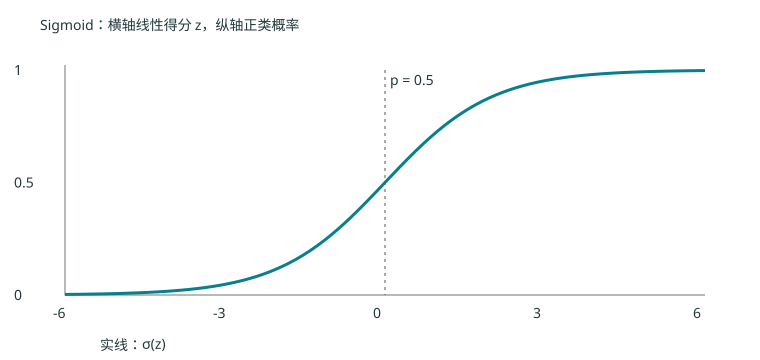

# 第三章 线性分类：几何、统计与概率的三个入口

> 来源：S05 6–48 页；S06 4–27 页（感知机）、30–43 页（Fisher）、46–60 页（logistic）。本章统一使用列向量；$b$ 对应课件的 $w_0$。推导补足与反例为编者解释。

## 3.1 从特征到超平面 {#ml-03-01}

先把每个样本表示成 $\mathbf x\in\mathbb R^d$，再用

$$g(\mathbf x)=\mathbf w^T\mathbf x+b$$

打分。$\mathbf w\in\mathbb R^d$ 是法向量，$b\in\mathbb R$ 是偏置。当 $\mathbf w\ne0$，零水平集是超平面。分类采用分数正负；分数本身还不是概率。

为什么 $\mathbf w$ 垂直于平面？任取平面上两点 $\mathbf u,\mathbf v$，相减得到 $\mathbf w^T(\mathbf u-\mathbf v)=0$。所以所有沿平面的方向都与 $\mathbf w$ 正交。

把点 $\mathbf x$ 写成垂足 $\mathbf x_p$ 加上法向位移 $r\mathbf w/\|\mathbf w\|$。代入 $g$ 并利用 $g(\mathbf x_p)=0$，得 $g(\mathbf x)=r\|\mathbf w\|$。因此有符号距离为

$$r=\frac{\mathbf w^T\mathbf x+b}{\|\mathbf w\|}.$$

同时把 $\mathbf w,b$ 乘正数不改变分类面；若只看分数大小而不除以范数，不能比较不同尺度参数的几何距离。

可把偏置合并为 $\widetilde{\mathbf x}=(\mathbf x^T,1)^T$、$\widetilde{\mathbf w}=(\mathbf w^T,b)^T$。但原始特征空间中距离的分母仍是 $\|\mathbf w\|$，不能因增广表示就换成含偏置的范数。

## 3.2 相似性与样本统计 {#ml-03-02}

向量如何编码决定了距离是否有意义。把血型任意编码成 1、2、3、4 后计算欧氏距离，会引入没有依据的顺序。对不同单位的特征，也要决定是否标准化。

| 度量 | 定义 | 注意事项 |
| --- | --- | --- |
| $L_p$ 距离 | $(\sum_j|x_j-z_j|^p)^{1/p}$ | $p\ge1$ 才是通常的范数距离 |
| 欧氏距离 | $\|\mathbf x-\mathbf z\|_2$ | 对单位与尺度敏感 |
| 曼哈顿距离 | $\sum_j|x_j-z_j|$ | 各轴差值绝对值累加 |
| 切比雪夫距离 | $\max_j|x_j-z_j|$ | 取最大值，不是求和 |
| 马氏距离 | $\sqrt{(\mathbf x-\mathbf z)^T\Sigma^{-1}(\mathbf x-\mathbf z)}$ | $\Sigma$ 正定；去掉平方根是平方距离 |
| 余弦相似度 | $\mathbf x^T\mathbf z/(\|\mathbf x\|\|\mathbf z\|)$ | 两向量非零；越大越相似 |

S05 31–32 页的 $(3,3)$ 与 $(1,2)$：欧氏距离 $\sqrt5$，曼哈顿距离 3，切比雪夫距离 2，余弦相似度 $9/\sqrt{90}\approx0.948683$。课件称其“余弦距离”，本书按公式称“相似度”，以免混淆大小方向。

第 $k$ 类均值为 $\boldsymbol\mu_k=N_k^{-1}\sum_{i:y_i=k}\mathbf x_i$。本书 Fisher 推导采用不归一化散度

$$S_W=\sum_k\sum_{i:y_i=k}(\mathbf x_i-\boldsymbol\mu_k)(\mathbf x_i-\boldsymbol\mu_k)^T.$$

它是 $d\times d$ 对称半正定矩阵。协方差会再除以样本数或自由度；不同归一化可改变类间相对权重，比较公式时必须检查定义。

## 3.3 评价分类结果 {#ml-03-03}

设关注“异常”为正类。TP 是正类正确检出数，FP 是正常样本被误报数，FN 是异常漏报数，TN 是正常正确识别数。

$$\mathrm{Precision}=\frac{TP}{TP+FP},\quad\mathrm{Recall}=\frac{TP}{TP+FN},\quad F_1=\frac{2TP}{2TP+FP+FN}.$$

分母为零时必须说明约定。准确率为 $(TP+TN)/N$；在极度不平衡数据上，“全部判正常”也可能有很高准确率。ROC 绘制不同阈值下的 $TPR=TP/(TP+FN)$ 与 $FPR=FP/(FP+TN)$；AUC 衡量整体排序表现，不指定实际部署阈值。PR 曲线对正类稀少的情境常更有解释力。

S05 41 页还列出假设检验、交叉验证 t 检验、McNemar、Friedman 与 Nemenyi，但没有展开。本版将其记录为课件提及项，不从标题推断教师要求。编者提醒：同一测试样本上的两个模型预测是配对数据，不能把所有折分数当作完全独立观测。

## 3.4 感知机：错了以后朝正确方向移动 {#ml-03-04}

二分类标签取 $y_i\in\{-1,+1\}$。正确且不在边界上意味着 $y_i(\mathbf w^T\mathbf x_i+b)>0$。如果该值不大于零，就用

$$\mathbf w\leftarrow\mathbf w+\eta y_i\mathbf x_i,\qquad b\leftarrow b+\eta y_i$$

更新，$\eta>0$ 是步长。正样本分数太低就增加与其同向的权重；负样本则反向调整。它对应错分样本损失之和 $J=-\sum_{i\in E}y_i(\mathbf w^T\mathbf x_i+b)$ 的逐样本下降规则。$E$ 随参数变化，边界点需统一处理。

对同一个增广样本，更新后带标签分数恰好增加 $\eta\|\widetilde{\mathbf x}_i\|^2$。因此自适应步长满足

$$\eta>\frac{-y_i\widetilde{\mathbf w}^T\widetilde{\mathbf x}_i}{\|\widetilde{\mathbf x}_i\|^2}$$

可使该样本更新后得到严格正分数。等号只保证到达边界；并不保证别的样本不会变错。S06 18–19 页的“误差为零”应理解为针对当前点的修正，不能扩大成全训练集单调改进。

自编一步例：$\mathbf w=(0,0)$、$b=0$，样本 $(2,1)$ 标签 $+1$，$\eta=1$。边界点触发更新后 $\mathbf w=(2,1)$、$b=1$，新分数为 6。

批量梯度下降一次汇总错分点，在线方法每次处理一个点。两者的更新轨迹可能不同。固定正步长感知机在线性可分、反复遍历数据等标准条件下能在有限次错误更新后找到分离面；非线性可分时没有此保证，也不保证找到最大间隔面。XOR 四点是最简单的反例。

## 3.5 Fisher 线性鉴别：投影后类间远、类内紧 {#ml-03-05}

仅沿两类中心连线投影，可能同时把很大的类内波动带进来。Fisher 的目标是在投影均值差与投影散度之间取平衡。

令投影结果 $z_i=\mathbf w^T\mathbf x_i$，第 $k$ 类投影均值为 $m_k=\mathbf w^T\boldsymbol\mu_k$。令 $\boldsymbol\delta=\boldsymbol\mu_1-\boldsymbol\mu_2$、$S_B=\boldsymbol\delta\boldsymbol\delta^T$。投影均值差的平方为 $\mathbf w^TS_B\mathbf w$；投影类内散度之和是 $\mathbf w^TS_W\mathbf w$。于是

$$J(\mathbf w)=\frac{\mathbf w^TS_B\mathbf w}{\mathbf w^TS_W\mathbf w}.$$

这个比值不随非零缩放变化。设 $S_W$ 正定，可固定分母为 1，用拉格朗日函数 $\mathbf w^TS_B\mathbf w-\lambda(\mathbf w^TS_W\mathbf w-1)$。求导得 $S_B\mathbf w=\lambda S_W\mathbf w$。

又因 $S_B\mathbf w=\boldsymbol\delta(\boldsymbol\delta^T\mathbf w)$ 总与 $\boldsymbol\delta$ 同向，非退化解满足

$$\mathbf w\propto S_W^{-1}\boldsymbol\delta.$$

实际计算解线性方程 $S_W\mathbf w=\boldsymbol\delta$ 即可，不必显式求逆。若 $S_W$ 奇异，可采用 $S_W+\lambda I$、$\lambda>0$，但这已经是正则化版本，应说明选择依据。

Fisher 给出的是方向，仍需选择分类阈值。等先验、共同协方差高斯模型下，中点阈值有明确依据；一般情况下可用训练或验证流程选择，不能无条件认为“投影中点永远最优”。

## 3.6 Logistic：把线性分数变成概率 {#ml-03-06}

从这里改用 $y_i\in\{0,1\}$。设 $z=\mathbf w^T\mathbf x+b$ 是正类后验优势的对数，即 $\log[p/(1-p)]=z$。指数化得 $p=e^z(1-p)$，将 $p$ 项移到一起，得到

$$p=P(y=1\mid\mathbf x)=\sigma(z)=\frac1{1+e^{-z}}.$$

Sigmoid 非线性，但以 0.5 为阈值时边界是 $z=0$，仍为线性分类。其他固定阈值 $t\in(0,1)$ 对应 $z=\log[t/(1-t)]$，只是移动了超平面。

单个标签的条件概率可写成 $p_i^{y_i}(1-p_i)^{1-y_i}$。对独立样本最大化似然等价于最小化平均交叉熵

$$J=-\frac1N\sum_i[y_i\log p_i+(1-y_i)\log(1-p_i)].$$

利用 $\sigma'(z)=p(1-p)$，单样本损失对 $z$ 的导数为 $-y(1-p)+(1-y)p=p-y$，再用 $\partial z/\partial\mathbf w=\mathbf x$，得到

$$\nabla_{\mathbf w}J=\frac1N\sum_i(p_i-y_i)\mathbf x_i,\qquad\frac{\partial J}{\partial b}=\frac1N\sum_i(p_i-y_i).$$

数值实现可用 $\max(z,0)+\log(1+e^{-|z|})-yz$ 计算单点损失，避免指数溢出。完全可分且无正则的数据上，似然可能沿权重越来越大的方向逼近上确界，未必存在有限的 ML 参数；加入正则项是常用处理。

多类时令 $z_c=\mathbf w_c^T\mathbf x+b_c$，采用 $P(c\mid\mathbf x)=e^{z_c}/\sum_j e^{z_j}$。可同时减去最大分数改善数值稳定性；对所有类别加同一分数不改变概率，因此参数表示有冗余。

## 3.7 三个方法放在一起 {#ml-03-07}

| 方法 | 优化或学习依据 | 输出与边界 |
| --- | --- | --- |
| 感知机 | 错分点的线性惩罚 | 分类符号；可分时收敛 |
| Fisher | 类间散度／类内散度 | 投影方向，再定阈值 |
| Logistic | 条件似然／交叉熵 | 类别概率，固定阈值下线性边界 |

它们可能产生相似超平面，但背后的问题不同。联系第二章：共同协方差高斯分类的后验对数优势也是线性的；logistic 直接建模该后验，不需要为每一类建完整输入分布。

S05 46–48 页将线性判别推广到多类。一对其余训练 $K$ 个模型，一对一为每对类别训练一个模型，共 $K(K-1)/2$ 个；也可以直接建立 $K$ 个类别分数再取最大值。若测试时用淘汰树逐次排除类别，一条路径可以只比较 $K-1$ 次，但这不等于必须训练的模型数。预先固定的层次二叉分类树也可只含 $K-1$ 个内部模型；因此要把训练方案与测试比较策略分开，不能将两两分类器数量解释为所有多类方法的最低训练数。
