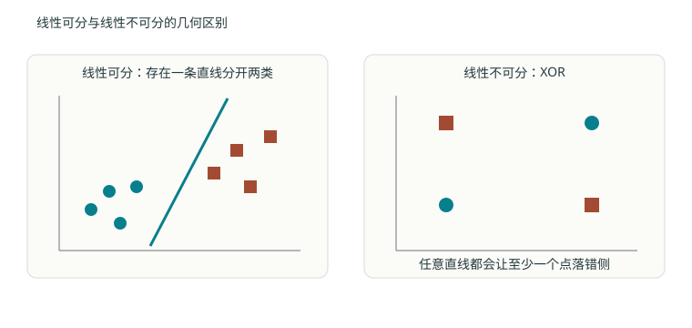
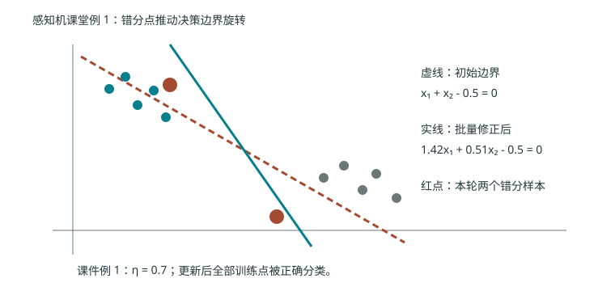
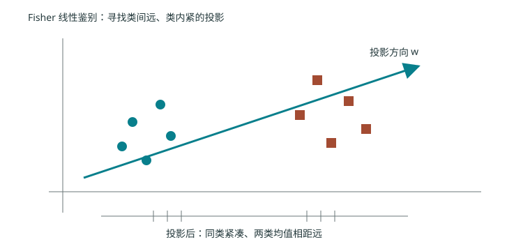
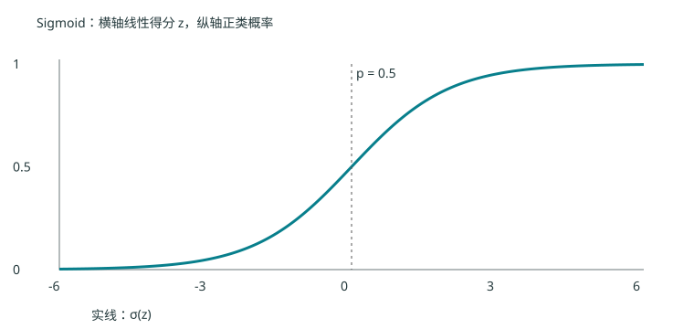
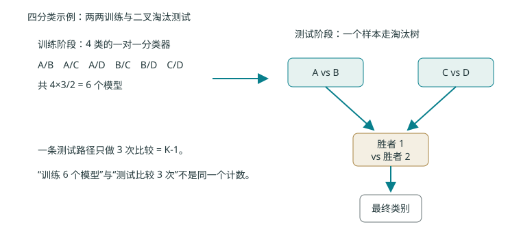

# 第三章 线性分类：几何、统计与概率的三个入口

> **课件主线**：S05 6–41 页讲基础知识与模型评价，42–48 页讲线性分类与多分类；S06 4–27 页讲感知机（含两个课堂例题），30–43 页讲 Fisher，46–60 页讲 Logistic。正文按这一顺序保留课件概念和例题；本章统一使用列向量，$b$ 对应课件的 $w_0$，补足推导与反例均标为编者解释。

> **本章学习路线（编者提示）**　本章用三条互补的视角看同一个问题——如何把两类（或多类）样本用“平面”分开：
> 1. **几何视角**（3.1–3.2）：样本是空间中的点，分类面是一张超平面；我们用“有符号距离”衡量点离分界面的远近。
> 2. **统计/评价视角**（3.3）：分完后怎么算“分得好不好”。
> 3. **三个学习算法**（3.4–3.6）：感知机（错了就修正）、Fisher（投影后类间远类内紧）、Logistic（把分数变成概率）。
> 4. **横向对比与数值演练**（3.7–3.9）：把三者放在一起，再用小数据手算一遍。

符号严格遵循 `docs/guide.md`：特征 $\mathbf x\in\mathbb R^d$ 为**列向量**；设计矩阵 $X$ 按**行**放样本（$N\times d$）；$\log$ 默认自然对数。

---

## 3.1 从特征到超平面 {#ml-03-01}

**直觉**　在二维平面上，分开两类点通常画一条直线；在三维空间里是一张平面；在 $d$ 维空间里就是一张“超平面”。我们需要一个能同时描述“点在分界面的哪一侧”和“点离分界面多远”的数学工具。

### 3.1.1 线性打分函数

把第 $i$ 个样本的特征写成列向量 $\mathbf x_i\in\mathbb R^d$。定义线性打分函数

$$g(\mathbf x)=\mathbf w^T\mathbf x+b.$$

- $\mathbf w\in\mathbb R^d$ 是**权重（法向量）**，也是列向量；
- $b\in\mathbb R$ 是**偏置**；
- 对给定的 $\mathbf x$，$g(\mathbf x)$ 是一个实数（标量）。

当 $\mathbf w\ne\mathbf 0$ 时，方程 $g(\mathbf x)=0$（即 $\mathbf w^T\mathbf x+b=0$）的解集就是一张超平面 $\mathcal H$。**分类规则**是看分数的正负：

- 若 $g(\mathbf x)>0$，判为正侧；若 $g(\mathbf x)<0$，判为负侧；
- 分数本身**不是概率**，只是一个“带符号的严重程度”。

### 3.1.2 为什么 $\mathbf w$ 垂直于整个平面（过程讲解）

> **假设与符号**：设 $\mathbf u,\mathbf v\in\mathcal H$ 是任意两个落在平面上的点，即 $g(\mathbf u)=0$ 且 $g(\mathbf v)=0$。
> **维度**：$\mathbf u,\mathbf v,\mathbf w\in\mathbb R^d$；$\mathbf u-\mathbf v\in\mathbb R^d$ 表示平面内的一条方向向量。

**步骤 1｜写出两点满足的方程**

$$\mathbf w^T\mathbf u+b=0,\qquad \mathbf w^T\mathbf v+b=0.$$

**步骤 2｜两式相减，消去偏置 $b$**

$$\mathbf w^T\mathbf u-\mathbf w^T\mathbf v=0
\;\Longrightarrow\;
\mathbf w^T(\mathbf u-\mathbf v)=0.$$

**步骤 3｜解释**　$\mathbf u-\mathbf v$ 是平面上任意一条方向向量（因为 $\mathbf u,\mathbf v$ 都可在平面内任取）。它与 $\mathbf w$ 的内积为 $0$，说明 $\mathbf w$ 与平面内**每一条**方向都正交。

**结论**：$\mathbf w$ 是超平面 $\mathcal H$ 的**法向量**（垂直于平面）。这与二维里直线 $ax+by+c=0$ 的法向量是 $(a,b)$ 完全一致。

### 3.1.3 有符号距离 $r=\dfrac{\mathbf w^T\mathbf x+b}{\|\mathbf w\|}$ 的几何推导（核心）

> **假设与符号**
> - $\mathbf w\ne\mathbf 0$，超平面 $\mathcal H=\{\mathbf x\mid \mathbf w^T\mathbf x+b=0\}$ 非空；
> - $\mathbf x\in\mathbb R^d$ 是任意一个（不一定在平面上的）点；
> - $\mathbf x_p\in\mathcal H$ 是 $\mathbf x$ 在平面上的**垂足**（正交投影点），故 $g(\mathbf x_p)=\mathbf w^T\mathbf x_p+b=0$；
> - $\mathbf w/\|\mathbf w\|$ 是单位法向量；$\|\mathbf w\|=\sqrt{\mathbf w^T\mathbf w}$ 是 $\mathbf w$ 的欧几里得范数。
> **关键几何事实**：从垂足 $\mathbf x_p$ 指向 $\mathbf x$ 的位移，恰好沿着单位法向，且长度就是带符号的距离 $r$：

$$\mathbf x=\mathbf x_p+r\,\frac{\mathbf w}{\|\mathbf w\|}.$$

这里 $r$ 的**符号**表示 $\mathbf x$ 位于平面的哪一侧：$r>0$ 在正侧（$g>0$ 一侧），$r<0$ 在负侧。

**过程讲解（逐步代入）**

**步骤 1｜把分解式代入打分函数**

$$g(\mathbf x)=\mathbf w^T\mathbf x+b
=\mathbf w^T\!\left(\mathbf x_p+r\,\frac{\mathbf w}{\|\mathbf w\|}\right)+b.$$

**步骤 2｜利用线性性展开**

$$g(\mathbf x)=\mathbf w^T\mathbf x_p+b+r\,\frac{\mathbf w^T\mathbf w}{\|\mathbf w\|}.$$

**步骤 3｜代入垂足条件**　因为 $\mathbf x_p\in\mathcal H$，有 $\mathbf w^T\mathbf x_p+b=0$。

**步骤 4｜化简法向项**　$\mathbf w^T\mathbf w=\|\mathbf w\|^2$，所以

$$r\,\frac{\mathbf w^T\mathbf w}{\|\mathbf w\|}
=r\,\frac{\|\mathbf w\|^2}{\|\mathbf w\|}
=r\,\|\mathbf w\|.$$

**步骤 5｜得到等式**　合并后

$$g(\mathbf x)=r\,\|\mathbf w\|.$$

**结论（有符号距离公式）**

$$r=\frac{\mathbf w^T\mathbf x+b}{\|\mathbf w\|}=\frac{g(\mathbf x)}{\|\mathbf w\|}.$$

**成立条件**：$\mathbf w\ne\mathbf 0$（否则分母为零，且“平面”退化）。$r$ 是点 $\mathbf x$ 到超平面的、带符号的欧氏距离：绝对值是几何距离，符号是所在侧。

### 3.1.4 一维小例子（先把直觉坐实）

当 $d=1$ 时，超平面退化成一个“阈值点”。取 $w=2,\ b=-3$，则分界点满足 $2x-3=0\Rightarrow x^*=1.5$。

- 点 $x=3$：$g=2\cdot3-3=3$，$\|w\|=2$，$r=3/2=1.5>0$。确实在 $1.5$ 右侧 $1.5$ 处。
- 点 $x=0$：$g=-3$，$r=-1.5<0$。在 $1.5$ 左侧 $1.5$ 处。

可见**符号告诉你在哪一侧，绝对值告诉你隔多远**——这正是“有符号距离”的含义。

### 3.1.5 缩放不变性与一个常见误区

**直觉**　把 $\mathbf w,b$ 同时乘一个正数 $c>0$，分类面不会变（等式 $\mathbf w^T\mathbf x+b=0$ 两边同乘 $c$ 不变），但原始分数 $g(\mathbf x)$ 会被放大 $c$ 倍。

**过程讲解**

$$\frac{(c\mathbf w)^T\mathbf x+cb}{\|c\mathbf w\|}
=\frac{c(\mathbf w^T\mathbf x+b)}{c\|\mathbf w\|}
=\frac{\mathbf w^T\mathbf x+b}{\|\mathbf w\|}=r.$$

所以**有符号距离 $r$ 对正缩放不变**，但分数 $g(\mathbf x)$ 会变。

> **常见误区**：若你拿两个不同尺度的参数 $(\mathbf w,b)$ 和 $(c\mathbf w,cb)$ 直接比较“分数大小”，会得出错误结论——分数大只代表参数尺度大，不代表离分界面更远。**要比较几何远近，必须除以 $\|\mathbf w\|$**。

### 3.1.6 增广表示：把偏置合进向量（并澄清分母）

为了把 $\mathbf w^T\mathbf x+b$ 写成一个干净的内积，引入**增广向量**：

$$\widetilde{\mathbf x}=
\begin{pmatrix}\mathbf x\\ 1\end{pmatrix}\in\mathbb R^{d+1},
\qquad
\widetilde{\mathbf w}=
\begin{pmatrix}\mathbf w\\ b\end{pmatrix}\in\mathbb R^{d+1}.$$

于是

$$g(\mathbf x)=\mathbf w^T\mathbf x+b=\widetilde{\mathbf w}^T\widetilde{\mathbf x}.$$

**但请特别注意**（这也是初学者最容易踩的坑）：

> **记住**：在**原始 $d$ 维特征空间**里，点 $\mathbf x$ 到分界面的几何距离，分母仍是 $\|\mathbf w\|=\sqrt{\mathbf w^T\mathbf w}$，**不是** $\|\widetilde{\mathbf w}\|$。增广表示只改变了“打分写成内积”的写法，并没有改变原始空间里的几何。误把间隔写成 $1/\|\widetilde{\mathbf w}\|$ 是错误的。

---

## 3.2 相似性与样本统计 {#ml-03-02}

**直觉**　“距离”只有在特征编码合理时才有意义。把血型任意编成 1、2、3、4 再算欧氏距离，会凭空制造出“A 型比 B 型更靠近 C 型”这种毫无依据的的顺序。单位不同的特征（如“身高 cm”和“体重 kg”）直接算距离，数值会被量纲绑架。

### 3.2.1 常用距离/相似度度量（定义与注意）

设 $\mathbf x,\mathbf z\in\mathbb R^d$ 为两个样本列向量。

| 度量 | 定义 | 注意事项 |
| --- | --- | --- |
| $L_p$ 距离 | $\displaystyle\bigl(\sum_{j=1}^d|x_j-z_j|^p\bigr)^{1/p}$ | 需 $p\ge1$ 才是通常的范数距离 |
| 欧氏距离 | $\|\mathbf x-\mathbf z\|_2=\sqrt{\sum_j(x_j-z_j)^2}$ | 对单位与尺度敏感 |
| 曼哈顿距离 | $\sum_{j=1}^d|x_j-z_j|$ | 各轴绝对差累加 |
| 切比雪夫距离 | $\max_j|x_j-z_j|$ | 取最大分量差，不是求和 |
| 马氏距离 | $\sqrt{(\mathbf x-\mathbf z)^T\Sigma^{-1}(\mathbf x-\mathbf z)}$ | $\Sigma$ 需正定；去掉根号是平方距离 |
| 余弦相似度 | $\dfrac{\mathbf x^T\mathbf z}{\|\mathbf x\|\,\|\mathbf z\|}$ | 两向量均非零；值越大越相似，范围 $[-1,1]$ |

**过程讲解（余弦为何落在 $[-1,1]$）**　由柯西–施瓦茨不等式 $|\mathbf x^T\mathbf z|\le\|\mathbf x\|\,\|\mathbf z\|$，得比值绝对值 $\le1$，故余弦相似度 $\in[-1,1]$；取 $-1$ 表示反向，$+1$ 表示同向，$0$ 表示正交（不相关）。

### 3.2.2 用 $(3,3)$ 与 $(1,2)$ 核对全部数字（编者核算）

来源 S05 31–32 页给出两点 $\mathbf x=(3,3)^T,\ \mathbf z=(1,2)^T$（均为 $\mathbb R^2$ 列向量）。记差向量 $\mathbf d=\mathbf x-\mathbf z=(2,1)^T$。

- **欧氏距离**：$\|\mathbf d\|_2=\sqrt{2^2+1^2}=\sqrt5\approx2.23607$。
- **曼哈顿距离**：$|2|+|1|=3$。
- **切比雪夫距离**：$\max(|2|,|1|)=2$。
- **余弦相似度**：
  $$\mathbf x^T\mathbf z=3\cdot1+3\cdot2=9,\quad
  \|\mathbf x\|=\sqrt{3^2+3^2}=\sqrt{18},\quad
  \|\mathbf z\|=\sqrt{1^2+2^2}=\sqrt5,$$
  $$\text{余弦相似度}=\frac{9}{\sqrt{18}\,\sqrt5}=\frac{9}{\sqrt{90}}
  \approx\frac{9}{9.48683}\approx0.948683.$$

> **记作说明（沿用来源、避免混淆）**：S05 原课件称其为“余弦距离”，本书按公式本质称“余弦相似度”。相似度越大表示越相近，不要把它当成“距离越大越不相似”的反向量，以免在排序任务里把方向搞反。

**马氏距离小例子（编者示例）**　取一维情形 $d=1$，$\Sigma=4$（即方差为 4，标准差为 $2$）。两点差值 $|\mathbf x-\mathbf z|=2$，则马氏距离 $=\sqrt{(2)^2/4}=1$。对比欧氏距离 $=2$：马氏距离按“标准差”重新度量，消除了量纲与离散程度的影响——这正是它在异方差数据上更合理的原因。$\Sigma$ 必须正定（二维及以上时至少是满秩）才能求逆。

### 3.2.3 类内散度矩阵 $S_W$ 与它的半正定性

第 $k$ 类的样本均值（列向量，$\mathbb R^d$）定义为

$$\boldsymbol\mu_k=\frac{1}{N_k}\sum_{i:y_i=k}\mathbf x_i,$$

其中 $N_k$ 是第 $k$ 类的样本数。本书 Fisher 推导采用**不归一化**的散度（与课件一致）：

$$S_W=\sum_{k=1}^K\sum_{i:y_i=k}(\mathbf x_i-\boldsymbol\mu_k)(\mathbf x_i-\boldsymbol\mu_k)^T.$$

- **维度**：$S_W$ 是 $d\times d$ 的实对称矩阵。
- **半正定性的过程讲解**：任取任意列向量 $\mathbf a\in\mathbb R^d$，

$$\mathbf a^TS_W\mathbf a
=\sum_{k}\sum_{i:y_i=k}\mathbf a^T(\mathbf x_i-\boldsymbol\mu_k)(\mathbf x_i-\boldsymbol\mu_k)^T\mathbf a.$$

注意 $(\mathbf x_i-\boldsymbol\mu_k)^T\mathbf a$ 是一个标量，其平方等于该标量乘自身，于是

$$\mathbf a^T(\mathbf x_i-\boldsymbol\mu_k)(\mathbf x_i-\boldsymbol\mu_k)^T\mathbf a
=\bigl((\mathbf x_i-\boldsymbol\mu_k)^T\mathbf a\bigr)^2\ge0.$$

对所有项求和仍为非负数，故

$$\mathbf a^TS_W\mathbf a\ge0\quad(\forall\mathbf a).$$

> **结论**：$S_W$ 是**对称半正定（PSD）**矩阵。它**不必然可逆/正定**——当特征共线、或样本数少于维度、或类内波动完全落在某个子空间时，$S_W$ 会奇异。这一点在 3.5 的 Fisher 求逆中会直接产生影响。

**关于归一化的提醒**　有的教材把类内散度再除以 $N_k$（或 $N_k-1$）得到协方差矩阵；不同归一化会改变类间的相对权重。比较任何公式前，必须先确认 $S_W$ 的定义是否与本文一致。

---

## 3.3 评价分类结果 {#ml-03-03}

**直觉**　分类器输出“正/负”后，我们要量化它错在哪：是把正常样本误报成异常（狼来了），还是把真正的异常放过了（更危险）。不同任务关心不同的错误。

### 3.3.1 混淆矩阵与 TP/FP/FN/TN

设我们关注“异常”为**正类**，则对每一次预测有四种可能：

| 真实 \ 预测 | 预测正类 | 预测负类 |
| --- | --- | --- |
| **真实正类** | TP（真正例，正确检出） | FN（假负例，漏报） |
| **真实负类** | FP（假正例，误报） | TN（真负例，正确排除） |

- **TP**：异常被正确检出；
- **FP**：正常被误报为异常（虚惊）；
- **FN**：异常被漏报（最危险的一类错误）；
- **TN**：正常被正确排除。

### 3.3.2 准确率、精确率、召回率与 $F_1$（逐步推导）

**准确率**衡量全体分对的比例：

$$\mathrm{Accuracy}=\frac{TP+TN}{N},\qquad N=TP+FP+FN+TN.$$

**精确率（Precision）**＝“报出来的异常里有多少是真的”：

$$\mathrm{Precision}=\frac{TP}{TP+FP}.$$

**召回率（Recall）**＝“真正的异常里有多少被找出来”：

$$\mathrm{Recall}=\frac{TP}{TP+FN}.$$

**$F_1$ 是精确率与召回率的调和平均**（过程讲解，验证公式等价）：

$$F_1=\frac{2\cdot\mathrm{Precision}\cdot\mathrm{Recall}}{\mathrm{Precision}+\mathrm{Recall}}.$$

代入 $P=\dfrac{TP}{TP+FP},\ R=\dfrac{TP}{TP+FN}$：

$$\text{分子： }2PR=2\cdot\frac{TP}{TP+FP}\cdot\frac{TP}{TP+FN}
=\frac{2TP^2}{(TP+FP)(TP+FN)}.$$

$$\text{分母： }P+R=\frac{TP}{TP+FP}+\frac{TP}{TP+FN}
=TP\cdot\frac{(TP+FN)+(TP+FP)}{(TP+FP)(TP+FN)}
=\frac{TP\,(2TP+FN+FP)}{(TP+FP)(TP+FN)}.$$

两式相除，分母的 $(TP+FP)(TP+FN)$ 相消：

$$F_1=\frac{2TP^2}{TP\,(2TP+FN+FP)}
=\frac{2TP}{2TP+FN+FP}.$$

> **结论**：$$F_1=\frac{2TP}{2TP+FN+FP}.$$ 它比准确率更关注“正类”的表现，因为 $TP$ 同时出现在分子与分母的每一项里。

**分母为零的约定（必须显式说明）**：若 $TP+FP=0$（没有任何样本被判为正），精确率无定义，常见做法有“记为 1”“记为 0”或“报告 NA”——**任何选择都应在报告中写明**，不能默认。召回率同理（当 $TP+FN=0$，即根本没有正类样本时）。

### 3.3.3 一个不平衡数据的小例子（编者示例）

假设共 $100$ 个样本，真实异常仅 $10$ 个。某分类器给出：TP$=8$, FP$=2$, FN$=2$, TN$=88$。

- 精确率 $=8/(8+2)=0.80$；召回率 $=8/(8+2)=0.80$；$F_1=2\cdot8/(16+2+2)=16/20=0.80$。
- 准确率 $=(8+88)/100=0.96$。

对比“偷懒分类器”：**永远判为正常**，则 TP$=0$, FP$=0$, FN$=10$, TN$=90$。

- 准确率 $=90/100=0.90$（看起来不错！），但召回率 $=0$，一个异常都没抓住。

> **记住**：在极度不平衡数据上，高准确率可能毫无意义。**先盯召回率和精确率，再谈准确率**。

### 3.3.4 ROC 与 AUC

**ROC 曲线**通过改变判定阈值，画出一对指标：

$$TPR=\frac{TP}{TP+FN}\quad(\text{真正例率，即召回率}),\qquad
FPR=\frac{FP}{FP+TN}\quad(\text{假正例率}).$$

- 横轴是 $FPR$，纵轴是 $TPR$；
- 每个阈值对应曲线上一个点；阈值从高到低扫，点从左到右下走到左上。

**AUC（Area Under ROC Curve）**是 ROC 曲线下的面积：

- $\mathrm{AUC}=1$：完美排序；
- $\mathrm{AUC}=0.5$：等价于随机乱猜；
- AUC 衡量的是**整体排序质量**，与具体部署阈值无关。

> **常见误区**：ROC/AUC 不告诉你“该把阈值设成多少”。在**正类极稀少**的场景（如异常检测），PR 曲线（横轴召回、纵轴精确率）往往比 ROC 更有解释力，因为 ROC 的 $FPR$ 分母 $FP+TN$ 很大，微小的 FP 变化被稀释。

### 3.3.5 课件提及的统计检验（记录，不展开）

S05 41 页还列出假设检验、交叉验证 $t$ 检验、McNemar、Friedman 与 Nemenyi 等方法，但**未展开**。本版将其记为“课件提及项”，不据标题推断教师考核要求。

> **编者提醒（配对数据）**：同一批测试样本上，两个模型的预测是**配对**的，不能把所有折（fold）的分数当作完全独立观测来做普通 $t$ 检验；这正是为什么课件单独列出 McNemar / 配对检验。

---

## 3.4 感知机：错了以后朝正确方向移动 {#ml-03-04}

**直觉**　感知机是最朴素的“错了就改”算法：如果一个样本被分错（或恰好在边界上），我们就沿着“能让它变对”的方向，把分类面推过去一点。正样本分数太低，就增加和它同向的权重；负样本分数太高，就反向调整。

### 3.4.1 标签约定与更新规则

二分类标签取 $y_i\in\{-1,+1\}$。对样本 $i$：

- **正确且不在边界上**的判据是 $y_i(\mathbf w^T\mathbf x_i+b)>0$；
- 若该值 $\le 0$（错分或在边界），执行更新

$$\mathbf w\leftarrow\mathbf w+\eta\,y_i\mathbf x_i,\qquad b\leftarrow b+\eta\,y_i,$$

其中 $\eta>0$ 是步长（学习率）。

**几何解释（为什么这样改）**：对正样本 $y_i=+1$，若当前分数 $\mathbf w^T\mathbf x_i+b$ 太小甚至为负，加上 $\eta\mathbf x_i$ 到 $\mathbf w$、加上 $\eta$ 到 $b$，会使该样本的新分数增大（见 3.4.2），从而更可能被判为正。负样本 $y_i=-1$ 时方向相反，把分数压低。

### 3.4.2 “一步使该样本分数增加 $\eta\|\widetilde{\mathbf x}_i\|^2$”（过程讲解）

> **假设与符号**：引入增广表示 $\widetilde{\mathbf x}_i=(\mathbf x_i^T,1)^T\in\mathbb R^{d+1}$，$\widetilde{\mathbf w}=(\mathbf w^T,b)^T\in\mathbb R^{d+1}$；样本 $i$ 的（增广）分数为 $s_i=\widetilde{\mathbf w}^T\widetilde{\mathbf x}_i=\mathbf w^T\mathbf x_i+b$。

**步骤 1｜写出增广形式的更新**　因为 $b\leftarrow b+\eta y_i$，等价于

$$\widetilde{\mathbf w}\leftarrow\widetilde{\mathbf w}+\eta\,y_i\widetilde{\mathbf x}_i.$$

**步骤 2｜计算更新后的分数**

$$s_i'=\widetilde{\mathbf w}'^{\,T}\widetilde{\mathbf x}_i
=(\widetilde{\mathbf w}+\eta y_i\widetilde{\mathbf x}_i)^T\widetilde{\mathbf x}_i
=\widetilde{\mathbf w}^T\widetilde{\mathbf x}_i+\eta y_i\,\widetilde{\mathbf x}_i^T\widetilde{\mathbf x}_i.$$

**步骤 3｜化简**　$\widetilde{\mathbf x}_i^T\widetilde{\mathbf x}_i=\|\widetilde{\mathbf x}_i\|^2$，故

$$s_i'=s_i+\eta\,y_i\,\|\widetilde{\mathbf x}_i\|^2.$$

即**原始有符号分数**增加了 $\eta y_i\|\widetilde{\mathbf x}_i\|^2$。

**步骤 4｜看“带标签分数”**　定义带标签分数（margin）$m_i=y_i s_i$。更新后

$$m_i'=y_i s_i'=y_i(s_i+\eta y_i\|\widetilde{\mathbf x}_i\|^2)
=y_i s_i+\eta\,y_i^2\|\widetilde{\mathbf x}_i\|^2
=m_i+\eta\|\widetilde{\mathbf x}_i\|^2,$$

因为 $y_i\in\{-1,+1\}\Rightarrow y_i^2=1$。

> **结论**：对同一个增广样本，更新后**带标签分数恰好增加 $\eta\|\widetilde{\mathbf x}_i\|^2>0$**。这就是感知机“每一步都在把这个错分样本推离边界”的代数本质。

### 3.4.3 自适应步长：让该样本一步变对

我们希望更新后该样本得到**严格正**的带标签分数，即 $m_i'>0$：

$$m_i+\eta\|\widetilde{\mathbf x}_i\|^2>0
\;\Longrightarrow\;
\eta>-\frac{m_i}{\|\widetilde{\mathbf x}_i\|^2}
=-\frac{y_i\,\widetilde{\mathbf w}^T\widetilde{\mathbf x}_i}{\|\widetilde{\mathbf x}_i\|^2}.$$

> **结论（自适应步长下界）**：只要

$$\eta>\frac{-y_i\,\widetilde{\mathbf w}^T\widetilde{\mathbf x}_i}{\|\widetilde{\mathbf x}_i\|^2},$$

该样本更新后即获得严格正的带标签分数。**等号**只保证到达边界（$m_i'=0$），并不能保证其它样本不变错。

> **编者提醒（来源 S06 18–19 页）**：课件中的“误差为零”应理解为**针对当前这一个点的修正**，不能扩大成“全训练集单调改进”。感知机每步只照顾当前错分点，可能把别的点又推错。

### 3.4.4 课件例题一：批量感知机一步修正（S06 23–24 页）

课件给出的初始决策边界是

$$x_1+x_2-0.5=0,
\qquad \widetilde{\mathbf w}^{(0)}=(1,1,-0.5)^T,$$

学习率为 $\eta=0.7$。当前只有两个错分样本：

$$
\widetilde{\mathbf x}_a=(0.4,0.05,1)^T,\quad d_a=+1;
\qquad
\widetilde{\mathbf x}_b=(-0.2,0.75,1)^T,\quad d_b=-1.
$$

批量更新把本轮所有错分样本同时累加：

$$
\begin{aligned}
\widetilde{\mathbf w}^{(1)}
&=\widetilde{\mathbf w}^{(0)}+\eta\sum_{i\in E}d_i\widetilde{\mathbf x}_i\\
&=\begin{pmatrix}1\\1\\-0.5\end{pmatrix}
+0.7\begin{pmatrix}0.4\\0.05\\1\end{pmatrix}
-0.7\begin{pmatrix}-0.2\\0.75\\1\end{pmatrix}\\
&=\begin{pmatrix}1.42\\0.51\\-0.5\end{pmatrix}.
\end{aligned}
$$

因此新边界为 $1.42x_1+0.51x_2-0.5=0$。课件图中这条实线已经把全部训练点正确分开，于是算法停止。

### 3.4.5 课件例题二：四个点的在线感知机（S06 25–27 页）

两类原始样本为

$$
C_1:\;(-1,0)^T,(0,1)^T,\quad d=+1;
\qquad
C_2:\;(0,-1)^T,(1,0)^T,\quad d=-1.
$$

采用增广向量 $\widetilde{\mathbf x}=(x_1,x_2,1)^T$，初始 $\widetilde{\mathbf w}^{(0)}=(0,0,0)^T$，学习率 $\eta=1$。本书沿课件约定：正类要求分数 $>0$，负类要求分数 $\le0$，边界上的正类样本要更新。按课件顺序扫描一轮：

| 步骤 | 样本 $\widetilde{\mathbf x}$ | $d$ | 更新前分数 | 是否更新 | 更新后 $\widetilde{\mathbf w}$ |
| --- | --- | ---: | ---: | --- | --- |
| 1 | $(-1,0,1)^T$ | $+1$ | $0$ | 是，正类在边界上 | $(-1,0,1)^T$ |
| 2 | $(0,1,1)^T$ | $+1$ | $1$ | 否 | $(-1,0,1)^T$ |
| 3 | $(0,-1,1)^T$ | $-1$ | $1$ | 是，负类被判到正侧 | $(-1,1,0)^T$ |
| 4 | $(1,0,1)^T$ | $-1$ | $-1$ | 否 | $(-1,1,0)^T$ |
| 5–8 | 再检查四点 | — | $1,1,-1,-1$ | 均正确，不再更新 | $(-1,1,0)^T$ |

最终边界是

$$-x_1+x_2=0\quad\Longleftrightarrow\quad x_2=x_1.$$

这正好把左上方的 $C_1$ 两点与右下方的 $C_2$ 两点分开。这个例子也说明：**在线感知机每看一个样本就决定是否更新，样本顺序会影响中间路径和最终得到的某一个分离解。**

### 3.4.6 感知机与损失函数的关系（过程讲解）

感知机可视为最小化**错分样本损失和**

$$J(\mathbf w,b)=-\sum_{i\in E}y_i\bigl(\mathbf w^T\mathbf x_i+b\bigr),$$

其中 $E$ 是当前错分（及边界）样本集合。$E$ 随参数变化，边界点需统一处理（本书约定边界点参与更新）。

对单样本损失 $\ell_i=-y_i(\mathbf w^T\mathbf x_i+b)$ 求梯度：

$$\frac{\partial \ell_i}{\partial\mathbf w}=-y_i\mathbf x_i,\qquad
\frac{\partial \ell_i}{\partial b}=-y_i.$$

梯度下降更新 $\mathbf w\leftarrow\mathbf w-\eta\nabla_{\mathbf w}\ell_i
=\mathbf w+\eta y_i\mathbf x_i$，正是感知机更新。所以**感知机的启发式规则，等价于对错分点损失做梯度下降**。

### 3.4.7 收敛性与反例

- **线性可分**且以固定正步长反复遍历数据时，标准感知机定理保证在**有限次错误更新**后找到分离超平面。
- **非线性可分**（如 XOR）时，没有收敛保证，也不保证找到“最大间隔”的分界面。
- XOR 四点 $(0,0),(1,1)$ 为正、$(0,1),(1,0)$ 为负，是最简单的线性不可分反例。

> **记住**：感知机的“收敛保证”**强依赖线性可分前提**；实际数据不可分时，它只会不停抖动，需要靠学习率衰减或转用别的模型。

---

## 3.5 Fisher 线性鉴别：投影后类间远、类内紧 {#ml-03-05}

**直觉**　只沿着两类中心连线做投影，可能把很大的类内波动也一起带进来——两类中心离得远，但各自内部散得很开，投影后仍然重叠。Fisher 的思想是：找一个投影方向，让**投影后两类均值尽量分开（类间远）**，同时**每类内部尽量集中（类内紧）**，用“比值”把这两件事平衡起来。

### 3.5.1 投影与两个散度的矩阵表达（过程讲解）

> **假设与符号**（二类情形 $K=2$）：
> - 投影方向 $\mathbf w\in\mathbb R^d$（列向量，长度任意，方向有意义）；
> - 投影后标量 $z_i=\mathbf w^T\mathbf x_i\in\mathbb R$；
> - 第 $k$ 类投影均值 $m_k=\mathbf w^T\boldsymbol\mu_k\in\mathbb R$；
> - 类间均值差 $\boldsymbol\delta=\boldsymbol\mu_1-\boldsymbol\mu_2\in\mathbb R^d$；
> - 类间散度矩阵 $S_B=\boldsymbol\delta\boldsymbol\delta^T\in\mathbb R^{d\times d}$（秩 1，半正定）；
> - 类内散度矩阵 $S_W$ 同 3.2.3（已证半正定）。

**步骤 1｜类间散度（投影后均值差的平方）**

$$m_1-m_2=\mathbf w^T\boldsymbol\mu_1-\mathbf w^T\boldsymbol\mu_2
=\mathbf w^T(\boldsymbol\mu_1-\boldsymbol\mu_2)=\mathbf w^T\boldsymbol\delta.$$

平方并写成二次型：

$$(m_1-m_2)^2=(\mathbf w^T\boldsymbol\delta)^2
=(\mathbf w^T\boldsymbol\delta)(\boldsymbol\delta^T\mathbf w)
=\mathbf w^T(\boldsymbol\delta\boldsymbol\delta^T)\mathbf w
=\mathbf w^TS_B\mathbf w.$$

**步骤 2｜类内散度（投影后各类内部方差之和）**

$$\sum_{k=1}^2\sum_{i:y_i=k}(z_i-m_k)^2
=\sum_{k}\sum_{i:y_i=k}\bigl(\mathbf w^T(\mathbf x_i-\boldsymbol\mu_k)\bigr)^2.$$

把平方项展开为内积：

$$\bigl(\mathbf w^T(\mathbf x_i-\boldsymbol\mu_k)\bigr)^2
=\bigl(\mathbf w^T(\mathbf x_i-\boldsymbol\mu_k)\bigr)\bigl((\mathbf x_i-\boldsymbol\mu_k)^T\mathbf w\bigr)
=\mathbf w^T(\mathbf x_i-\boldsymbol\mu_k)(\mathbf x_i-\boldsymbol\mu_k)^T\mathbf w.$$

对全部样本求和，把 $\mathbf w$ 提到最外：

$$\sum_{k}\sum_{i:y_i=k}\mathbf w^T(\mathbf x_i-\boldsymbol\mu_k)(\mathbf x_i-\boldsymbol\mu_k)^T\mathbf w
=\mathbf w^T\Bigl(\sum_{k}\sum_{i:y_i=k}(\mathbf x_i-\boldsymbol\mu_k)(\mathbf x_i-\boldsymbol\mu_k)^T\Bigr)\mathbf w
=\mathbf w^TS_W\mathbf w.$$

**步骤 3｜构造 Fisher 比值**

$$J(\mathbf w)=\frac{\mathbf w^TS_B\mathbf w}{\mathbf w^TS_W\mathbf w}.$$

**结论**：分子是“类间远”的度量，分母是“类内紧”的度量；$J$ 越大越好。

### 3.5.2 比值为何与缩放无关

对任意非零常数 $c$，

$$J(c\mathbf w)=\frac{(c\mathbf w)^TS_B(c\mathbf w)}{(c\mathbf w)^TS_W(c\mathbf w)}
=\frac{c^2\,\mathbf w^TS_B\mathbf w}{c^2\,\mathbf w^TS_W\mathbf w}
=J(\mathbf w).$$

> **结论**：$J(\mathbf w)$ 只取决于 $\mathbf w$ 的**方向**，不取决于长度。因此可以固定分母为某个常数（如 1）来求极大值方向。

### 3.5.3 拉格朗日乘子法求极大值方向（过程讲解）

在约束 $\mathbf w^TS_W\mathbf w=1$ 下最大化 $\mathbf w^TS_B\mathbf w$。构造拉格朗日函数（$\lambda$ 为乘子）：

$$L(\mathbf w,\lambda)=\mathbf w^TS_B\mathbf w-\lambda\bigl(\mathbf w^TS_W\mathbf w-1\bigr).$$

**步骤 1｜对 $\mathbf w$ 求梯度并令为零**　利用对称矩阵二次型的导数公式 $\nabla_{\mathbf w}(\mathbf w^TA\mathbf w)=2A\mathbf w$（$A$ 对称）：

$$\nabla_{\mathbf w}L=2S_B\mathbf w-2\lambda S_W\mathbf w=0
\;\Longrightarrow\;
S_B\mathbf w=\lambda S_W\mathbf w.$$

这是一个**广义特征值问题**。左乘 $\mathbf w^T$ 得

$$\mathbf w^TS_B\mathbf w=\lambda\,\mathbf w^TS_W\mathbf w
\;\Longrightarrow\;
\lambda=J(\mathbf w)\quad(\text{因约束下 }\mathbf w^TS_W\mathbf w=1).$$

所以最大化 $J$ 等价于取该广义特征值问题中**最大的特征根** $\lambda$。

**步骤 2｜利用 $S_B$ 的秩 1 结构化简**　因为 $S_B=\boldsymbol\delta\boldsymbol\delta^T$，

$$S_B\mathbf w=(\boldsymbol\delta\boldsymbol\delta^T)\mathbf w
=\boldsymbol\delta\,(\boldsymbol\delta^T\mathbf w)
=(\boldsymbol\delta^T\mathbf w)\,\boldsymbol\delta.$$

记标量 $\alpha=\boldsymbol\delta^T\mathbf w$，则 $S_B\mathbf w=\alpha\boldsymbol\delta$——**它总与 $\boldsymbol\delta$ 同向**。代入广义特征方程：

$$\alpha\boldsymbol\delta=\lambda S_W\mathbf w
\;\Longrightarrow\;
\mathbf w=\frac{\alpha}{\lambda}S_W^{-1}\boldsymbol\delta
\quad(\text{要求 }S_W\text{ 可逆且 }\lambda\ne0).$$

由于 $\alpha/\lambda$ 只是一个标量系数，方向与尺度无关，得到 Fisher 经典解：

$$\mathbf w\propto S_W^{-1}\boldsymbol\delta.$$

**结论（Fisher 解）**：最优投影方向正比于 $S_W^{-1}\boldsymbol\delta$。

> **实践提示**：实际计算**不要显式求逆**，而是解线性方程组

$$S_W\mathbf w=\boldsymbol\delta$$

得到 $\mathbf w$ 的方向即可（任何特解都成比例）。

### 3.5.4 $S_W$ 奇异时的正则化（必须说明）

$S_W$ 只是半正定（见 3.2.3），当特征共线或样本不足时会奇异，$S_W^{-1}$ 不存在。此时采用**岭正则（Tikhonov）**：

$$\mathbf w\propto (S_W+\lambda I)^{-1}\boldsymbol\delta,\qquad \lambda>0.$$

加 $\lambda I$ 后 $S_W+\lambda I$ 正定、可逆。

> **编者提醒**：这已经是**正则化版本**，不是原始 Fisher 解。引入 $\lambda$ 会偏离“最大化原始 $J$”的目标，其大小应有依据（如由验证集选择，或给一个很小的岭系数作数值稳定用途）。**不能静默地把正则化当成原始解**。

### 3.5.5 方向有了，阈值怎么定？

Fisher 只给出**投影方向** $\mathbf w$，还要在投影后的 1D 分数上选一个**分类阈值**。

- 在**等先验、共同协方差的高斯模型**下，最优阈值有明确的理论依据：取两类投影均值的中点 $(m_1+m_2)/2$。
- **一般情形下不能无条件认为“投影中点永远最优”**；阈值应由训练或验证流程选择。

> **常见误区**：把“Fisher 给出方向”误解为“Fisher 直接给出完整分类器”。它给的是 1D 投影，分类还需再定阈值，而阈值的选择本身就是独立的一步。

详细数值演练见 [3.8 数值演练：Fisher 解的小例题](#ml-03-08)。

---

## 3.6 Logistic：把线性分数变成概率 {#ml-03-06}

**直觉**　感知机只给“正负号”，Fisher 给“投影后的距离”。但我们常想知道“这个样本是正类的概率有多大”。Logistic 回归的做法是：先假设“对数优势比（log-odds）是特征的线性函数”，再由此反推出一个把任意实数分数映射到 $(0,1)$ 的概率函数——这就是 Sigmoid。

### 3.6.1 从优势对数推出 $\sigma(z)$（过程讲解）

> **假设与符号**：标签改为 $y_i\in\{0,1\}$；令线性分数 $z=\mathbf w^T\mathbf x+b\in\mathbb R$；记正类后验概率 $p=P(y=1\mid\mathbf x)\in(0,1)$。

**建模假设**：正类的**对数优势比**是线性的：

$$\log\frac{p}{1-p}=z.$$

**步骤 1｜指数化，去掉对数**

$$\frac{p}{1-p}=e^z.$$

**步骤 2｜解出 $p$**

$$p=e^z(1-p)=e^z-e^z p
\;\Longrightarrow\;
p+e^z p=e^z
\;\Longrightarrow\;
p(1+e^z)=e^z.$$

**步骤 3｜两边除以 $1+e^z$**

$$p=\frac{e^z}{1+e^z}.$$

**步骤 4｜分子分母同除以 $e^z$，得标准形式**

$$p=\frac{1}{e^{-z}+1}=\sigma(z),\qquad
\sigma(z)=\frac{1}{1+e^{-z}}.$$

> **结论**：在“对数优势比为线性”的假设下，正类概率必为 Sigmoid 函数 $\sigma(z)$。$\sigma$ 把 $(-\infty,\infty)$ 单调映射到 $(0,1)$，且 $\sigma(0)=0.5$、$\sigma(-z)=1-\sigma(z)$。

### 3.6.2 为什么仍是“线性分类器”

以 $0.5$ 为阈值时，判正类当且仅当 $\sigma(z)\ge0.5$，即 $z\ge0$，即 $\mathbf w^T\mathbf x+b\ge0$——边界仍是那张线性超平面。

若改用其它固定阈值 $t\in(0,1)$，判正类当且仅当 $p\ge t$，即

$$\sigma(z)\ge t
\;\Longrightarrow\;
z\ge\log\frac{t}{1-t}.$$

这只把超平面沿法向平移，**边界依旧是线性的**。Logistic 与感知机的本质区别不在“边界形状”，而在“输出是校准过的概率、且由最大似然/交叉熵训练”。

### 3.6.3 交叉熵损失从似然来（过程讲解）

在独立同分布假设下，第 $i$ 个样本的条件概率为

$$P(y_i\mid\mathbf x_i)=p_i^{\,y_i}(1-p_i)^{\,1-y_i},$$

因为：当 $y_i=1$ 时为 $p_i$，当 $y_i=0$ 时为 $1-p_i$。

全体样本的似然

$$L=\prod_{i=1}^N p_i^{\,y_i}(1-p_i)^{\,1-y_i}.$$

最大化对数似然等价于最小化**负平均对数似然（交叉熵）**：

$$J(\mathbf w,b)=-\frac1N\sum_{i=1}^N\Bigl[y_i\log p_i+(1-y_i)\log(1-p_i)\Bigr].$$

> **结论**：Logistic 的训练目标就是最小化这个交叉熵；它直接对应“在模型假设下最大化数据出现的概率”。

### 3.6.4 交叉熵梯度 $\nabla_{\mathbf w}J=\dfrac1N\sum_i(p_i-y_i)\mathbf x_i$（核心推导）

> **前置结论**：Sigmoid 的导数满足

$$\sigma'(z)=\sigma(z)\bigl(1-\sigma(z)\bigr)=p(1-p).$$

**过程讲解（先证 $\sigma'$）**

$$\sigma(z)=\frac{1}{1+e^{-z}}=(1+e^{-z})^{-1}.$$

$$\sigma'(z)=-(1+e^{-z})^{-2}\cdot(-e^{-z})
=\frac{e^{-z}}{(1+e^{-z})^2}
=\frac{1}{1+e^{-z}}\cdot\frac{e^{-z}}{1+e^{-z}}
=\sigma(z)\cdot\bigl(1-\sigma(z)\bigr).$$

（其中 $1-\sigma(z)=1-\frac{1}{1+e^{-z}}=\frac{e^{-z}}{1+e^{-z}}$，代入即得。）

**单样本损失对 $z$ 的导数**：

$$\ell_i=-y_i\log p_i-(1-y_i)\log(1-p_i),\qquad p_i=\sigma(z_i).$$

$$\frac{d\ell_i}{dz_i}
=-\Bigl[y_i\frac{1}{p_i}\frac{dp_i}{dz_i}+(1-y_i)\frac{1}{1-p_i}\cdot\Bigl(-\frac{dp_i}{dz_i}\Bigr)\Bigr]
=-\Bigl[y_i\frac{p_i(1-p_i)}{p_i}-(1-y_i)\frac{p_i(1-p_i)}{1-p_i}\Bigr].$$

约去后：

$$\frac{d\ell_i}{dz_i}
=-\bigl[y_i(1-p_i)-(1-y_i)p_i\bigr]
=-\bigl[y_i-y_i p_i-p_i+y_i p_i\bigr]
=-(y_i-p_i)=p_i-y_i.$$

**再对 $\mathbf w$ 求导**：因为 $z_i=\mathbf w^T\mathbf x_i+b$，有 $\dfrac{\partial z_i}{\partial\mathbf w}=\mathbf x_i$（列向量），且 $\dfrac{\partial z_i}{\partial b}=1$。由链式法则

$$\frac{\partial \ell_i}{\partial \mathbf w}
=\frac{d\ell_i}{dz_i}\cdot\frac{\partial z_i}{\partial\mathbf w}
=(p_i-y_i)\mathbf x_i,
\qquad
\frac{\partial \ell_i}{\partial b}=p_i-y_i.$$

对全部 $N$ 个样本取平均（$J=\frac1N\sum_i\ell_i$）：

$$\nabla_{\mathbf w}J=\frac1N\sum_{i=1}^N(p_i-y_i)\mathbf x_i,
\qquad
\frac{\partial J}{\partial b}=\frac1N\sum_{i=1}^N(p_i-y_i).$$

> **结论**：梯度方向由“预测概率与真实标签的误差 $(p_i-y_i)$”乘以特征 $\mathbf x_i$ 构成。对正样本（$y_i=1$）若 $p_i<1$，则 $p_i-y_i<0$，梯度下降会使 $\mathbf w$ 朝增大 $z_i$（从而增大 $p_i$）的方向更新——与直觉完全一致。

### 3.6.5 数值稳定实现（避免指数溢出）

直接计算 $e^{-z}$ 在 $|z|$ 很大时会溢出。改用等价稳定形式（编者验证等价，见下）：

$$\ell_i=\max(z_i,0)-z_i y_i+\log\bigl(1+e^{-|z_i|}\bigr).$$

**等价性验证（以 $y_i=1$ 为例）**：原始 $\ell_i=-\log\sigma(z_i)=\log(1+e^{-z_i})$。
- 若 $z_i\ge0$：$\max(z_i,0)-z_i+\log(1+e^{-z_i})=0+\log(1+e^{-z_i})$，相等；
- 若 $z_i<0$：$\max(z_i,0)=0$，稳定式 $= -z_i+\log(1+e^{z_i})=\log(e^{-z_i})+\log(1+e^{z_i})=\log(e^{-z_i}+1)=\log(1+e^{-z_i})$，相等。
（$y_i=0$ 情形同理可证。）该形式对任何 $z_i$ 都不会出现 $e^{\pm z_i}$ 的极端溢出。

### 3.6.6 完全可分数据与正则项

在**完全线性可分且无正则**的数据上，似然可以沿“权重越来越大”的方向逼近上确界，但**未必存在有限的极大似然参数**（损失趋近于 0 却永远到不了最小值点）。这是 Logistic 回归过拟合极端可分数据的典型现象。**加入正则项**（如 $\ell_2$ 惩罚 $\frac{\lambda}{2}\|\mathbf w\|^2$）是常用且必要的处理。

### 3.6.7 多类 Softmax

对 $K$ 类，令第 $c$ 类分数 $z_c=\mathbf w_c^T\mathbf x+b_c$（$c=1,\dots,K$），用 Softmax 给出概率：

$$P(c\mid\mathbf x)=\frac{e^{z_c}}{\sum_{j=1}^K e^{z_j}}.$$

**数值技巧**：对所有 $z_c$ 同时减去最大值 $\max_j z_j$，Softmax 输出不变（等价于分子分母同乘 $e^{-z_{\max}}$），可防止 $e^{z_c}$ 溢出。

> **记住（参数冗余）**：对所有类别分数同时加同一个常数，Softmax 概率**不变**，因此 Softmax 的参数表示存在冗余，通常需要加约束（如固定某一类偏置为 0）才能唯一确定。

详细数值演练见 [3.9 数值演练：Logistic 的一步梯度下降](#ml-03-09)。

---

## 3.7 三个方法放在一起 {#ml-03-07}

| 方法 | 优化或学习依据 | 输出与边界 |
| --- | --- | --- |
| 感知机 | 错分点的线性惩罚（见 3.4.5） | 分类符号；线性可分时收敛 |
| Fisher | 类间散度／类内散度之比 $J$（见 3.5） | 投影方向，再定阈值 |
| Logistic | 条件似然／交叉熵（见 3.6.3–3.6.4） | 类别概率，固定阈值下为线性边界 |

它们**可能产生相近的超平面**，但背后的问题假设不同：感知机只关心“分不分得开”，Fisher 关心“投影后的可分性”，Logistic 关心“概率校准”。

**联系第二章**：在各类**协方差相同**的高斯模型下，后验概率的对数优势比也是线性的；Logistic 正是直接对“这个后验”建模，而不必为每一类去建完整的输入分布（这正是它比朴素假设全分布更省力的地方）。

### 3.7.1 多类推广（来源 S05 46–48 页，完整保留）

S05 46 页先用三类点说明：多类数据也可能线性可分或不可分；47 页提出“二叉树比对”；48 页再给出“最大相似性”。这里最容易把**预先训练多少模型**和**一个测试样本要比较多少次**混在一起，下面按课件的方案逐步拆开。

#### （a）课件的“二叉树比对”实际包含两个阶段

设有 $K$ 个类别。课件先为每一对类别准备一个二分类器，例如 $A$ 对 $B$、$A$ 对 $C$。无序类别对的数量为

$$
\binom K2=\frac{K(K-1)}2.
$$

为什么？第 1 类可与其余 $K-1$ 类配对，第 2 类只需再与后面的 $K-2$ 类配对，依次得到

$$
(K-1)+(K-2)+\cdots+1=\frac{K(K-1)}2.
$$

训练完成后，对一个新样本做**淘汰式测试**：两类先比较，胜者再进入下一轮。每次比较淘汰一个候选类，从 $K$ 个候选减到 1 个，必然需要

$$K-1$$

次比较。以 $K=4$ 为例，训练阶段共有 $4\times3/2=6$ 个两两分类器，而一次测试淘汰赛只调用其中 3 个。

> **重要限制（编者解释）**：两两分类结果可能出现循环，例如 $A$ 胜 $B$、$B$ 胜 $C$、$C$ 又胜 $A$。因此淘汰树的最终类别可能受对阵顺序影响；它也不一定等于“让全部 $K(K-1)/2$ 个分类器投票”的结果。课件给出的是一种测试组织方式，不是多类分类唯一方案。

#### （b）最大相似性：直接比较 $K$ 个类别得分

S05 48 页为每个类别 $c$ 定义一个线性判别函数 $f_c(\mathbf x)=\mathbf w_c^T\mathbf x$。若像本章前文一样显式保留偏置，可写成

$$f_c(\mathbf x)=\mathbf w_c^T\mathbf x+b_c,
\qquad c=1,\ldots,K,$$

然后选择得分最大的类别：

$$\widehat y=\arg\max_{c\in\{1,\ldots,K\}} f_c(\mathbf x).$$

这里需要训练 $K$ 组类别参数，并在测试时计算 $K$ 个分数。多类 Logistic / Softmax（3.6.7）就是把这些分数进一步归一化成概率。

#### （c）另外两种常见方案（编者补充）

- **一对其余（One-vs-Rest）**：训练 $K$ 个“本类 vs 其他所有类”的二分类模型，再比较分数。
- **预先固定的层次分类树**：只训练 $K-1$ 个内部节点模型；每个节点通常区分的是两组类别，而不是某一对单类。这与课件“先训练全部两两分类器、再用淘汰树调用”不是同一种训练方案。

> **记住**：$K(K-1)/2$ 是**全体一对一模型池**的数量，不是所有多类方法都必须达到的最低训练数；$K-1$ 是淘汰一个测试样本时的比较次数。两者回答的是不同问题。

配套练习见 [练习](../exercises.md)。

---

## 3.8 数值演练：Fisher 解的小例题 {#ml-03-08}

> **编者示例（自编题，确定性小数据）**：二维两类，每类 3 个点，全部来自 $\mathbb R^2$。
> - 类 1：$(1,1)^T,\ (2,2)^T,\ (1,3)^T$
> - 类 2：$(4,1)^T,\ (5,2)^T,\ (4,3)^T$

**步骤 1｜算类均值**

$$\boldsymbol\mu_1=\frac{1}{3}\!\left(\begin{pmatrix}1\\1\end{pmatrix}+\begin{pmatrix}2\\2\end{pmatrix}+\begin{pmatrix}1\\3\end{pmatrix}\right)
=\begin{pmatrix}4/3\\2\end{pmatrix},\qquad
\boldsymbol\mu_2=\begin{pmatrix}13/3\\2\end{pmatrix}.$$

类间差 $\boldsymbol\delta=\boldsymbol\mu_1-\boldsymbol\mu_2=(-3,0)^T$（两类只在第 1 维有差异）。

**步骤 2｜算 $S_W$**　类 1 各点与均值之差：
$(-1/3,-1)^T,\ (2/3,0)^T,\ (-1/3,1)^T$。其外积之和

$$\sum_{i\in C_1}(\mathbf x_i-\boldsymbol\mu_1)(\mathbf x_i-\boldsymbol\mu_1)^T
=\begin{pmatrix}2/3&0\\0&2\end{pmatrix}.$$

类 2 的偏差与类 1 完全对称，外积和相同，故

$$S_W=\begin{pmatrix}4/3&0\\0&4\end{pmatrix}.$$

（对角且满秩，正定，可直接求逆。可见本例特意让两类在 $x_2$ 上都有较大离散度、在 $x_1$ 上较集中。）

**步骤 3｜求 Fisher 方向**

$$S_W^{-1}=\begin{pmatrix}3/4&0\\0&1/4\end{pmatrix},\qquad
S_W^{-1}\boldsymbol\delta=
\begin{pmatrix}3/4&0\\0&1/4\end{pmatrix}\begin{pmatrix}-3\\0\end{pmatrix}
=\begin{pmatrix}-9/4\\0\end{pmatrix}\propto\begin{pmatrix}-1\\0\end{pmatrix}.$$

所以最优投影方向 $\mathbf w\propto(-1,0)^T$，即沿第 1 维方向——这完全合理：两类均值差只体现在 $x_1$，且 $x_1$ 的类内方差（$4/3$）远小于 $x_2$（$4$），Fisher 自然选择“类内紧、类间远”的 $x_1$ 轴。

**步骤 4｜算比值验证**　取 $\mathbf w=(-1,0)^T$：
投影均值 $m_1=\mathbf w^T\boldsymbol\mu_1=-4/3$，$m_2=-13/3$，差 $m_1-m_2=3$，平方差 $9$；分母 $\mathbf w^TS_W\mathbf w=(-1,0)S_W(-1,0)^T=4/3$。

$$J(\mathbf w)=\frac{9}{4/3}=\frac{27}{4}=6.75.$$

> **对比（常见误区演示）**：若改取 $\mathbf w=(0,-1)^T$（沿 $x_2$ 投影），则 $m_1=m_2= -2$，分子为 $0$，$J=0$。说明“方差大、且两类均值又相同”的维度对分类毫无贡献——这正是 Fisher 比值自动规避的方向。

---

## 3.9 数值演练：Logistic 的一步梯度下降 {#ml-03-09}

> **编者示例（自编题，一维便于手算）**：取 $d=1$，单样本 $x=2$，标签 $y=1$。初始 $\mathbf w=0,\ b=0$，学习率 $\eta=0.1$（用梯度下降最小化 $J$）。

**步骤 1｜前向**　$z=\mathbf w x+b=0$，$\sigma(0)=1/(1+1)=0.5$，故预测概率 $p=0.5$。

**步骤 2｜梯度**　由 3.6.4：

$$\frac{\partial J}{\partial \mathbf w}=(p-y)x=(0.5-1)\cdot2=-1,\qquad
\frac{\partial J}{\partial b}=p-y=-0.5.$$

**步骤 3｜更新（下降）**

$$\mathbf w\leftarrow 0-\eta(-1)=0.1,\qquad
b\leftarrow 0-\eta(-0.5)=0.05.$$

**步骤 4｜再前向看效果**　新 $z=0.1\cdot2+0.05=0.25$，

$$p_{\text{new}}=\sigma(0.25)=\frac{1}{1+e^{-0.25}}
=\frac{1}{1+0.7788}\approx0.562.$$

预测概率从 $0.5$ 上升到 $0.562$，朝着真实标签 $y=1$ 移动。

> **直觉对应**：对正样本，因 $p<y$，误差 $p-y<0$，梯度为负，下降使权重增大 $\Rightarrow$ 分数 $z$ 增大 $\Rightarrow$ 概率 $p$ 增大。与 3.6.4 的结论自洽。

---

## 3.10 本章要点回顾 {#ml-03-10}

- **几何**：$g(\mathbf x)=\mathbf w^T\mathbf x+b$；有符号距离 $r=g(\mathbf x)/\|\mathbf w\|$ 含方向与远近；增广表示不改变原始空间里分母为 $\|\mathbf w\|$ 的事实。
- **距离**：选距离前先想编码是否合理；马氏距离需 $\Sigma$ 正定；余弦是“相似度”不是“距离”。
- **评价**：准确率在不平衡数据上会骗人；精确率/召回率/$F_1$ 更关注正类；ROC/AUC 衡量排序、不指定阈值。
- **感知机**：更新使该样本带标签分数增 $\eta\|\widetilde{\mathbf x}\|^2$；仅线性可分时保证收敛；XOR 不可分。
- **Fisher**：最大化 $J=\mathbf w^TS_B\mathbf w/(\mathbf w^TS_W\mathbf w)$，解 $\mathbf w\propto S_W^{-1}\boldsymbol\delta$；$S_W$ 奇异时加 $\lambda I$ 正则（需说明依据）；Fisher 只给方向，阈值另定。
- **Logistic**：由 $\log\frac{p}{1-p}=z$ 推出 $\sigma(z)$；交叉熵梯度 $\nabla_{\mathbf w}J=\frac1N\sum(p_i-y_i)\mathbf x_i$，依赖 $\sigma'=p(1-p)$；完全可分无正则时可能无有限解。

> 编者提示：手算以上任一小例题前，先遮住解答、自行写出假设与维度，再对照——这是把“看懂”变成“会推”的关键。
