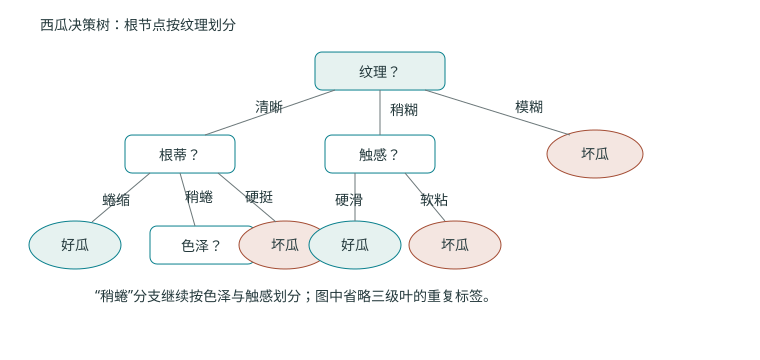
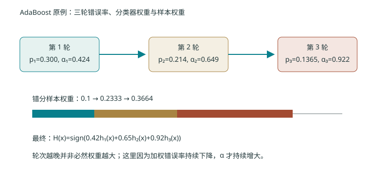

# 第四章 非线性分类：划分、邻域、组合与核

> 往年资料：S23 4–42 页（决策树）、44–59 页（近邻）；S24 3–26 页（集成）、28–49 页（SVM）。本年度对应课件尚未提供。2026-10-30 已视觉核对 S23 19、27–39 页与 S24 12、23–26 页，并恢复西瓜决策树和 AdaBoost 三轮原例；其余页仍属于往年资料待核对范围，不据此推定本年度考试内容。

本章线索：直线分不开两类时，至少有四种思路。一是**划分**——用一串“某个特征是否小于阈值”的简单问题，把空间切成矩形区域（决策树）；二是**邻域**——不拟合全局面，直接用最近样本的多数票决定类别（k 近邻）；三是**组合**——把多个弱模型按规则融合成强模型（集成、AdaBoost）；四是**核**——把样本映射到高维，使原本分不开的数据变得线性可分（SVM + 核技巧）。四种思路在“非线性”这个主题下汇合。

读本章前建议先掌握：熵与信息量的直觉（可先读第八章）、向量内积与超平面、梯度/求导、KL 散度方向。本仓库 $\log$ 默认自然对数；以 2 为底写作 $\log_2$，单位 bit。向量 $\mathbf x_i\in\mathbb R^d$ 为列向量，标签在树与近邻中按类别记号（如 $c$），在 AdaBoost 与 SVM 中为 $y_i\in\{-1,+1\}$。

---

## 4.1 决策树：一连串简单问题组成复杂边界 {#ml-04-01}

### 4.1.1 直觉：为什么“问问题”能造出曲线边界 {#ml-04-01-intuition}

直线无法分开的两类样本，可以通过“第一个特征是否小于某个阈值”“第二个特征是否属于哪一段”等条件**逐层划分**。每个内部节点问一个 yes/no 问题，每条边对应一个答案，叶子给出最终预测。

关键事实：一棵**轴对齐的二叉树**会在特征空间切出一块块矩形区域；把这些矩形边界拼起来，就得到了可以弯来弯去的非线性决策边界。所以决策树的重点**不是把树画出来**，而是决定“每一步该问哪一个问题”——也就是每一步该按哪个特征、哪个阈值来切分，才能让剩下的不确定性下降得最快。

### 4.1.2 不纯度：用一个数衡量“这一堆样本有多乱” {#ml-04-01-impurity}

设当前节点拥有样本集合 $D$，其中第 $c$ 类所占比例为 $p_c$（于是 $\sum_c p_c=1$，$p_c\ge0$）。我们要用一个标量 $U(D)$ 表示“这堆样本有多不纯”：纯节点（全是一类）时 $U=0$；越杂乱 $U$ 越大。

最常用的两个度量：

$$H(D)=-\sum_c p_c\log_2 p_c,\qquad G(D)=1-\sum_c p_c^2.$$

约定 $0\log_2 0=0$（取极限 $\lim_{p\to0^+}p\log_2p=0$）。

**维度与符号说明**
- $D$：某个节点的样本集合，大小为 $|D|$。
- $K$：类别数，$c=1,\dots,K$。
- $p_c\in[0,1]$，$\sum_c p_c=1$；这是**比例**，所以 $H$ 与 $G$ 都不依赖 $|D|$ 的绝对大小。
- 熵 $H(D)$ 的单位是 bit（因为用了 $\log_2$）；范围 $[0,\log_2 K]$。
- 基尼 $G(D)$ 的范围是 $[0,1-1/K]$；它是“随机抽两个样本、类别不同”的概率。

**过程讲解：为什么纯节点时两者为零、均匀时最大**

1. 纯节点：某一类 $p_{c^*}=1$，其余 $p_c=0$。代入熵：
   $$H(D)=-(1)\log_2(1)-\sum_{c\ne c^*}0\cdot\log_20=0-0=0.$$
   代入基尼：$G(D)=1-(1^2+0+\cdots)=0$。
2. 多类均匀：$p_c=1/K$ 对所有 $c$。熵：
   $$H(D)=-\sum_{c=1}^K\frac1K\log_2\frac1K=-K\cdot\frac1K(-\log_2K)=\log_2K,$$
   达到上界（最不纯）。基尼：
   $$G(D)=1-\sum_{c=1}^K\frac1{K^2}=1-\frac{K}{K^2}=1-\frac1K,$$
   同样最大。

> **记住**：熵和基尼都衡量“不纯”，$0$ 表示纯、$0$ 之外越大越乱。两者在二分类时高度相关，基尼可看作熵的二次近似（差异不超过约 $0.1$ bit），但基尼**不用算对数**，所以 CART 更常用基尼做分裂标准。

**小数值例子（二分类）**

取节点“4 正 4 负”，则 $p_+=p_-=0.5$。
- 熵：$H=-(0.5)\log_2 0.5-(0.5)\log_2 0.5=0.5+0.5=1$ bit。
- 基尼：$G=1-(0.5^2+0.5^2)=1-0.5=0.5$。

再取子集“3 正 1 负”，则 $p_+=0.75,\ p_-=0.25$。
- 熵：$H=-(0.75)\log_2 0.75-(0.25)\log_2 0.25$。先算 $\log_2 0.75=\ln0.75/\ln2\approx-0.28768/0.69315\approx-0.41504$，$\log_2 0.25=-2$。于是
  $$H\approx-0.75(-0.41504)-0.25(-2)=0.31128+0.5=0.81128\text{ bit}.$$
- 基尼：$G=1-(0.75^2+0.25^2)=1-(0.5625+0.0625)=1-0.625=0.375$。

### 4.1.3 信息增益：切一刀能减少多少“乱” {#ml-04-01-gain}

选定属性 $a$ 做划分，会产生若干个子集 $D_v$（$v$ 枚举该属性的不同取值或区间），子集大小 $|D_v|$，占总体的比例 $|D_v|/|D|$。**划分后的平均不纯度**用子集大小加权：

$$\operatorname{Gain}(D,a)=H(D)-\sum_v\frac{|D_v|}{|D|}\,H(D_v).$$

**过程讲解：这个公式从哪来**

1. **起点**：我们希望切分后“剩下的不确定性”尽量小。先算未划分前的不纯度 $H(D)$。
2. **按子集加权**：划分不是只产生一个子集，而是 $V$ 个。一个随机样本落入子集 $v$ 的概率就是 $|D_v|/|D|$，所以划分后的期望（平均）熵是
   $$\mathbb E_v[H(D_v)]=\sum_v\frac{|D_v|}{|D|}\,H(D_v).$$
3. **增益 = 减少量**：用“切之前的不纯度”减“切之后的平均不纯度”：
   $$\operatorname{Gain}(D,a)=H(D)-\sum_v\frac{|D_v|}{|D|}\,H(D_v).$$
4. **结论与条件**：增益非负（因为父节点的熵 $\ge$ 子集加权熵，信息不等式）；增益越大，这一刀越值得切。决策树每一步在所有候选属性里选 $\arg\max_a\operatorname{Gain}(D,a)$。成立前提是 $p_c$ 用经验频率估计、各子集互斥且并起来等于 $D$。

> **直觉**：权重按子集大小算，是因为我们关心“一个随机样本被划分后”的平均不确定性，而不是“最大的子集有多纯”。

**自编例（保留并核算）**

节点有 4 正 4 负，熵为 $1$ bit；划分为两个大小均为 4 的子集，分别 3 正 1 负与 1 正 3 负。两个子集熵都约为 $0.811278$ bit，于是加权平均不纯度
$$\sum_v\frac{|D_v|}{|D|}H(D_v)=\frac{4}{8}\cdot0.811278+\frac{4}{8}\cdot0.811278=0.811278.$$
增益
$$\operatorname{Gain}=1-0.811278=0.188722\text{ bit}.$$

**同一例的基尼视角**：父节点 $G=0.5$，两子集各 $G=0.375$，加权平均 $0.375$，基尼下降量 $=0.5-0.375=0.125$。ID3 用熵增益、CART 用基尼下降，目标一致。

### 4.1.3a 往年课件原例：17 个西瓜样本怎样长成决策树

> **来源性质**：S23 37–39 页，往年课件原例。这里保留教师展示的数据、信息增益和最终树；中间算式由编者补齐。它不是前面的自编 8 样本小例。

课件使用 6 个离散属性和二分类标签：

| 编号 | 色泽 | 根蒂 | 敲声 | 纹理 | 脐部 | 触感 | 好瓜 |
| ---: | --- | --- | --- | --- | --- | --- | --- |
| 1 | 青绿 | 蜷缩 | 浊响 | 清晰 | 凹陷 | 硬滑 | 是 |
| 2 | 乌黑 | 蜷缩 | 沉闷 | 清晰 | 凹陷 | 硬滑 | 是 |
| 3 | 乌黑 | 蜷缩 | 浊响 | 清晰 | 凹陷 | 硬滑 | 是 |
| 4 | 青绿 | 蜷缩 | 沉闷 | 清晰 | 凹陷 | 硬滑 | 是 |
| 5 | 浅白 | 蜷缩 | 浊响 | 清晰 | 凹陷 | 硬滑 | 是 |
| 6 | 青绿 | 稍蜷 | 浊响 | 清晰 | 稍凹 | 软粘 | 是 |
| 7 | 乌黑 | 稍蜷 | 浊响 | 稍糊 | 稍凹 | 软粘 | 是 |
| 8 | 乌黑 | 稍蜷 | 浊响 | 清晰 | 稍凹 | 硬滑 | 是 |
| 9 | 乌黑 | 稍蜷 | 沉闷 | 稍糊 | 稍凹 | 硬滑 | 否 |
| 10 | 青绿 | 硬挺 | 清脆 | 清晰 | 平坦 | 软粘 | 否 |
| 11 | 浅白 | 硬挺 | 清脆 | 模糊 | 平坦 | 硬滑 | 否 |
| 12 | 浅白 | 蜷缩 | 浊响 | 模糊 | 平坦 | 软粘 | 否 |
| 13 | 青绿 | 稍蜷 | 浊响 | 稍糊 | 凹陷 | 硬滑 | 否 |
| 14 | 浅白 | 稍蜷 | 沉闷 | 稍糊 | 凹陷 | 硬滑 | 否 |
| 15 | 乌黑 | 稍蜷 | 浊响 | 清晰 | 稍凹 | 软粘 | 否 |
| 16 | 浅白 | 蜷缩 | 浊响 | 模糊 | 平坦 | 硬滑 | 否 |
| 17 | 青绿 | 蜷缩 | 沉闷 | 稍糊 | 稍凹 | 硬滑 | 否 |

全体有 8 个好瓜、9 个坏瓜，因此根节点熵为

$$H(D)=-\frac8{17}\log_2\frac8{17}-\frac9{17}\log_2\frac9{17}\approx0.998.$$

以“色泽”为例，三个子集分别为青绿 6 个（3 好 3 坏）、乌黑 6 个（4 好 2 坏）、浅白 5 个（1 好 4 坏）：

$$H(D_{\text{青绿}})=1,\quad H(D_{\text{乌黑}})\approx0.918,\quad H(D_{\text{浅白}})\approx0.722,$$

$$\operatorname{Gain}(D,\text{色泽})
=0.998-\left(\frac6{17}\times1+\frac6{17}\times0.918+\frac5{17}\times0.722\right)
\approx0.109.$$

同样计算其余属性，课件给出：

| 属性 | 色泽 | 根蒂 | 敲声 | 纹理 | 脐部 | 触感 |
| --- | ---: | ---: | ---: | ---: | ---: | ---: |
| 信息增益 | 0.109 | 0.143 | 0.141 | **0.381** | 0.289 | 0.006 |

所以根节点选择“纹理”。随后在每个分支内只用该分支的样本重新计算增益，而不是继续沿用根节点的数值。

> **为什么必须逐层重算**：进入“纹理=清晰”后，样本集合已经从 17 个变成 9 个，类别比例和属性取值比例都变了。若仍用根节点的 $0.143,0.141,\ldots$ 排序，就不是在优化当前节点。

### 4.1.4 增益率与“IV=0 不能做除法” {#ml-04-01-gainratio}

信息增益有个毛病：**偏好把数据切得很碎的属性**。一个取值特别多的属性，几乎能把每个样本单独切成一个子集（每个子集纯得不能再纯），增益看着很高，但显然过拟合。

C4.5 用**增益率**修正：再除以划分自身的“内在信息量”

$$IV(a)=-\sum_v\frac{|D_v|}{|D|}\log_2\frac{|D_v|}{|D|},\qquad
\operatorname{GainRatio}(D,a)=\frac{\operatorname{Gain}(D,a)}{IV(a)}.$$

$IV(a)$ 衡量“这次划分本身有多碎”——子集越平均、数量越多，$IV$ 越大，从而压低增益率。

**过程讲解**
1. $IV(a)$ 的式子和熵一模一样，只是把“类别比例”换成了“子集大小比例”，所以它越大表示划分越分散。
2. 增益率是“单位划分代价换来的不确定性下降”，避免只为追求高增益而过度碎片化。

**IV=0 的处理（重点）**

当某个划分把所有样本放进**同一个**子集时，只有一个 $v$ 满足 $|D_v|/|D|=1$，其余为 $0$。此时
$$IV(a)=-\left(1\cdot\log_2 1\right)-\sum_{v\ne v^*}\left(0\cdot\log_2 0\right)=0.$$
分母为零，**增益率无定义，绝不能做除法**。同理，分母极小也会让比值爆炸、极不稳定。

> **常见误区**：以为“取增益率最大”就是 C4.5 的全部。其实 C4.5 的实用做法是**两步法**：先只在“信息增益高于平均水平”的候选属性里考虑，再从中选增益率最大者。这样天然过滤掉了 $IV=0$（此时增益也必然为 $0$）和那些增益太低的属性；同时它也能缓解增益率“矫枉过正、反而偏好取值少的属性”的问题。总之：增益率不是银弹，分母接近 0 时必须特殊处理。

**IV 数值例子**
- 50–50 二分（如上面两个大小均为 4 的子集）：$IV=-(0.5)\log_2 0.5-(0.5)\log_2 0.5=1$。
- 八等分（把 8 个样本切成 8 个单点子集）：$IV=-8\cdot(1/8)\log_2(1/8)=\log_2 8=3$。
  
前者增益 $0.188722$、增益率 $0.188722/1=0.188722$；后者把每个样本切到纯叶子、增益可达 $1$，但 $IV=3$、增益率仅 $1/3$——可见增益率确实压低了“高碎片化”属性的优势，但它也可能过度惩罚（经典的 C4.5 两步法正是为此而生）。

### 4.1.5 连续属性、CART 与剪枝 {#ml-04-01-cart}

- **连续属性**：排序后用“相邻不同取值的中点”作候选阈值。若有 $m$ 个不同取值，非空二分最多有 $m-1$ 个候选切点位置。课件有时按“样本值个数”描述候选问题数，那是另一种计数约定，不能直接和“有效非空划分数”混用。
- **CART 分类树**：通常选**加权基尼下降最大**的二叉划分（每个内部节点只做二分裂）。
- **过拟合与剪枝**：递归生长会把噪声也记进叶子。
  - 预剪枝：分裂前就用验证准则（如纯度增益不够就不分裂）决定是否停止。
  - 后剪枝：先长成一棵大树，再用验证集表现或“误差 + 叶子数代价”决定是否把某子树收回成叶子。
  
> **记住**：如果用训练集纯度去评判剪枝效果，就失去了“防训练集过拟合”的初衷——必须用独立的验证集（或复杂度代价准则）来定剪枝。

---

## 4.2 最近邻：让局部样本决定类别 {#ml-04-02}

### 4.2.1 直觉：不拟合全局面，只靠“身边人”投票 {#ml-04-02-intuition}

$k$ 近邻（kNN）的做法：来一个新样本 $\mathbf x$，先算它到所有训练样本的距离，取最近的 $k$ 个，再让这 $k$ 个邻居按“多数类别”投票决定 $\mathbf x$ 的类别。这里**没有任何训练阶段去拟合一个全局超平面**——边界由“存下来的样本 + 距离度量”共同决定，是“基于记忆”的方法。

- $k=1$：边界就是 Voronoi 图，对噪声极敏感（一个标错的点会直接决定一块区域）。
- $k$ 太大：会抹平局部结构，边界变平滑甚至退化为“按全体多数”预测。
- 实操中 $k$ 要通过验证集选择，并事先规定“距离并列”和“票数并列”的处理方式。

### 4.2.2 量纲：距离对尺度极度敏感 {#ml-04-02-scale}

量纲特别重要。若“行走速度”取值在 $0$–$100$，而“头发比例”在 $0$–$1$，直接套欧氏距离，几乎全在比速度，头发比例被淹没。标准化（减均值除标准差）的参数**只能从训练集估计**，再应用到验证/测试集；高维时距离还可能变得“都差不多大”，不能想当然认为“加更多属性一定更好”。

### 4.2.3 三角不等式下界加速检索 {#ml-04-02-triangle}

朴素检索每次要对全部 $N$ 个样本做约 $O(Nd)$ 的距离运算。当样本按某种结构分成若干子集（课件讨论树状子集搜索、剪辑、压缩等），可用**三角不等式**跳过显然不可能的子集。

**过程讲解：下界从哪来**

设某个子集被一个以 $\mathbf m$ 为球心、半径 $r$ 的球覆盖，即子集内任一点 $\mathbf z$ 都满足 $\|\mathbf z-\mathbf m\|\le r$。对任意查询点 $\mathbf x$，由三角不等式（任意三点满足 $\|\mathbf x-\mathbf z\|\ge \|\mathbf x-\mathbf m\|-\|\mathbf m-\mathbf z\|$）：

$$\|\mathbf x-\mathbf z\|\ \ge\ \|\mathbf x-\mathbf m\|-\|\mathbf m-\mathbf z\|\ \ge\ \|\mathbf x-\mathbf m\|-r.$$

因为距离非负，再与 $0$ 取大：

$$\min_{\mathbf z\in\text{子集}}\|\mathbf x-\mathbf z\|\ \ge\ \max\!\big(0,\ \|\mathbf x-\mathbf m\|-r\big)\ \equiv\ L_{\text{lb}}.$$

- **符号**：$r>0$ 为球半径；$\mathbf m,\mathbf x,\mathbf z\in\mathbb R^d$；$\|\cdot\|$ 为欧氏范数。
- **结论与成立条件**：若当前已找到的最近距离为 $d_{\text{nn}}$，且 $L_{\text{lb}}>d_{\text{nn}}$，那么整个子集里没有任何点能比当前最近点更近，可安全跳过该子集。前提是该球**确实覆盖**子集（否则下界不成立）。
- **局限**：高维或非度量相似性下，这种加速未必有效（“维度灾难”会让球心与边界的差距失去区分度）。

**小数值例子**

球心 $\mathbf m=(0,0)$，半径 $r=1$；查询点 $\mathbf x=(3,0)$。则 $\|\mathbf x-\mathbf m\|=3$，下界
$$L_{\text{lb}}=\max(0,3-1)=2.$$
若当前最近距离 $d_{\text{nn}}=1.5<2$，则整个球内都不可能有更近的点，直接跳过。

### 4.2.4 剪辑、压缩近邻与拒绝分类 {#ml-04-02-edited}

- **剪辑近邻（Edited NN）**：删去“和邻居标签不一致”的点，倾向减少噪声。
- **压缩近邻（Condensed NN）**：保留“对当前原型集而言会被错分”的样本，逐步压缩存储规模。
- 二者目标不同，且都可能丢掉的**稀有但真实的模式**，要谨慎。
- **拒绝分类**：当邻域支持不足（如 $k$ 个邻居里各类票数太接近、或最近距离过大）时不输出类别。必须单独报告**拒绝率**与**已接受样本的错误率**，二者不可混为一谈。

---

## 4.3 集成：组合必须保留有用差异 {#ml-04-03}

### 4.3.1 直觉：为什么“多个模型投票”可能更好 {#ml-04-03-intuition}

只有当多个模型**会犯不同的错误**时，组合才可能改善结果；若大家错得完全一样，组合毫无收益。所以集成的核心不是“模型多”，而是“模型之间保留有用差异”。

### 4.3.2 平均融合及其 KL 方向（重点推导） {#ml-04-03-fusion}

设第 $m$ 个模型给出的类后验为 $p_m(c)$，$m=1,\dots,M$，$c$ 为类别；融合结果记为 $q(c)$，满足 $\sum_c q(c)=1,\ q(c)\ge0$。

**两种融合**
- 算术平均：$q(c)=\dfrac1M\sum_{m=1}^M p_m(c)$。
- 归一化几何平均：$q(c)\propto\prod_{m=1}^M p_m(c)^{1/M}$，即 $q(c)=\dfrac{\prod_m p_m(c)^{1/M}}{\sum_{c'}\prod_m p_m(c')^{1/M}}$。

> **常见误区**：几何平均对某个模型给出的**零概率**极其敏感——一旦有模型在某类上给 $0$，几何平均也会给 $0$，即使其他模型很有把握。算术平均则不会。

**过程讲解（一）：为什么算术平均来自 $\sum_m D_{KL}(p_m\|q)$**

KL 散度方向不能省略。先证“前向”平均得到算术平均。目标：在约束 $\sum_c q(c)=1$ 下最小化
$$J_{\text{fwd}}(q)=\sum_{m=1}^M D_{KL}(p_m\|q)=\sum_m\sum_c p_m(c)\log\frac{p_m(c)}{q(c)}.$$

1. **展开**：把对数拆开，
   $$J_{\text{fwd}}=\underbrace{\sum_m\sum_c p_m(c)\log p_m(c)}_{\text{与 }q\text{ 无关}}-\sum_m\sum_c p_m(c)\log q(c).$$
   优化只看第二项（带负号）。
2. **带约束写拉格朗日**：引入乘子 $\lambda$ 处理 $\sum_c q(c)=1$，
   $$\mathcal L=-\sum_m\sum_c p_m(c)\log q(c)+\lambda\!\left(\sum_c q(c)-1\right).$$
3. **对 $q(c)$ 求导并置零**：
   $$\frac{\partial\mathcal L}{\partial q(c)}=-\frac{\sum_m p_m(c)}{q(c)}+\lambda=0
   \ \Longrightarrow\ q(c)=\frac{\sum_m p_m(c)}{\lambda}.$$
4. **用归一化定 $\lambda$**：
   $$1=\sum_c q(c)=\frac{\sum_m\sum_c p_m(c)}{\lambda}=\frac{M}{\lambda}\ \Longrightarrow\ \lambda=M.$$
5. **结论**：
   $$q(c)=\frac1M\sum_{m=1}^M p_m(c),$$
   正是**算术平均**。成立条件：$\sum_c q(c)=1$，且对所有 $c$ 有 $\lambda>0$（这里 $\lambda=M>0$ 满足）。

**过程讲解（二）：为什么归一化几何平均来自 $\sum_m D_{KL}(q\|p_m)$**

再把方向反过来——让 $q$ 去逼近各 $p_m$（“反向”平均），目标：
$$J_{\text{rev}}(q)=\sum_{m=1}^M D_{KL}(q\|p_m)=\sum_m\sum_c q(c)\log\frac{q(c)}{p_m(c)}.$$

1. **展开并提取公因式**：
   $$J_{\text{rev}}=\sum_c q(c)\sum_m\log\frac{q(c)}{p_m(c)}
   =\sum_c q(c)\Big(M\log q(c)-\sum_m\log p_m(c)\Big).$$
2. **拉格朗日**（约束 $\sum_c q(c)=1$，乘子 $\lambda$）：
   $$\mathcal L=\sum_c q(c)\Big(M\log q(c)-\sum_m\log p_m(c)\Big)+\lambda\!\left(\sum_c q(c)-1\right).$$
3. **对 $q(c)$ 求导**：注意 $\frac{d}{dq}(q\log q)=\log q+1$，
   $$\frac{\partial\mathcal L}{\partial q(c)}=M(\log q(c)+1)-\sum_m\log p_m(c)+\lambda=0.$$
4. **解出 $q(c)$**：
   $$M\log q(c)=\sum_m\log p_m(c)-M-\lambda
   \ \Longrightarrow\ \log q(c)=\frac1M\sum_m\log p_m(c)-(1+\lambda/M).$$
   指数化：
   $$q(c)=\exp\!\left(\frac1M\sum_m\log p_m(c)\right)\cdot e^{-(1+\lambda/M)}
   =\left(\prod_{m=1}^M p_m(c)\right)^{1/M}\cdot \text{常数}.$$
5. **归一化定常数**：
   $$q(c)=\frac{\prod_{m=1}^M p_m(c)^{1/M}}{\sum_{c'}\prod_{m=1}^M p_m(c')^{1/M}}.$$
   这正是**归一化几何平均**。

> **记住**：方向是关键——
> - $\min\sum_m D_{KL}(p_m\|q)$ → 算术平均（让 $q$ 被各 $p_m$ “拉向自己”的平均）；
> - $\min\sum_m D_{KL}(q\|p_m)$ → 归一化几何平均（让 $q$ 去“覆盖”各 $p_m$）。
> 丢掉方向，两套融合就分不清了。

### 4.3.3 多数投票与独立性的收益 {#ml-04-03-majority}

假设有**奇数 $M$** 个二分类器，相互独立、各自正确概率同为 $p$。要“多数正确”，即正确数 $\ge(M+1)/2$。令 $j$ 为正确分类器个数（服从二项分布 $\mathrm{Bin}(M,p)$），多数投票正确率为

$$\sum_{j=(M+1)/2}^{M}\binom Mj p^{\,j}(1-p)^{M-j}.$$

**过程讲解**
1. **假设**：$M$ 为奇数（避免平票）；各分类器独立同分布，正确概率 $p\in(0,1)$。
2. **单点概率**：恰有 $j$ 个正确的概率是 $\binom Mj p^j(1-p)^{M-j}$（选哪 $j$ 个对、各自以 $p$ 对、其余以 $1-p$ 错）。
3. **求和**：把所有“正确的个数达到多数”的情形加起来，下界为 $(M+1)/2$。

**保留数值例（核算）**：$M=3,\ p=0.7$。
$$\begin{aligned}
P(\text{正确})&=\binom32 0.7^2\cdot0.3+\binom33 0.7^3\\
&=3\cdot0.49\cdot0.3+0.343\\
&=0.441+0.343=0.784.
\end{aligned}$$
单个分类器只有 $0.7$ 正确率，三个独立投票后升到 $0.784$。

**再多看一眼（补充小例）**：取 $M=5,\ p=0.6$。
$$\begin{aligned}
P&= \binom55 0.6^5+\binom54 0.6^4\cdot0.4+\binom53 0.6^3\cdot0.4^2\\
&=0.07776+5\cdot0.1296\cdot0.4+10\cdot0.216\cdot0.16\\
&=0.07776+0.2592+0.3456=0.68256.
\end{aligned}$$
单个 $0.6$ 的弱分类器，五个独立投票后约 $0.683$——集成确实把“弱”变“强”。

> **常见误区**：独立性是理想假设。若 $M$ 个分类器完全一样（相关系数 1），投票等于只用其中一个，收益为 $0$。这也是为什么随机森林要“每棵树随机选属性”、Bagging 要“用不同自助样本”来制造差异。

### 4.3.4 Bagging 与随机森林 {#ml-04-03-bagging}

- **Bagging**：用多个**自助样本**（有放回抽样）各训一个模型，再平均/投票。自助抽样天然让不同模型看到不同数据，制造差异。
- **随机森林**：在 Bagging 基础上，每个树节点再从全部属性里**随机选一部分**作为候选分裂属性，进一步降低树间相关性。
- **记住**：随机性本身不保证每个模型都强，也不保证组合一定优于任意单棵树；要由验证集比较，而不是想当然。

---

## 4.4 AdaBoost：逐轮关注难样本 {#ml-04-04}

### 4.4.1 直觉：把注意力放在老犯错的地方 {#ml-04-04-intuition}

AdaBoost 也是加法集成，但更聪明：每一轮训练一个弱分类器后，会**提高被它错分样本的权重**、降低被正确分类样本的权重，于是下一轮弱分类器被迫去“啃”之前难分的点。最终把所有弱分类器按“它有多靠谱”加权组合。

记号：标签 $y_i\in\{-1,+1\}$，基分类器 $h_t(\mathbf x)\in\{-1,+1\}$。加法模型在第 $t$ 轮为
$$F_t(\mathbf x)=F_{t-1}(\mathbf x)+\alpha_t h_t(\mathbf x),$$
目标是最小化指数损失 $\sum_i e^{-y_iF_t(\mathbf x_i)}$。

### 4.4.2 指数损失对 $\alpha_t$ 的求导（核心推导） {#ml-04-04-alpha}

**符号与假设**
- $D_t(i)\ge0$ 为第 $t$ 轮归一化样本权重，$\sum_{i=1}^N D_t(i)=1$。它正比于前一轮的指数损失项：$D_t(i)\propto e^{-y_iF_{t-1}(\mathbf x_i)}$。
- 固定本轮弱分类器 $h_t$ 后，其**加权错误率**
  $$\epsilon_t=\sum_{i:\ h_t(\mathbf x_i)\ne y_i}D_t(i),\qquad \text{于是正确部分权重之和}=1-\epsilon_t.$$
- 我们只在 $\alpha$ 上优化（分类器已定）。

**过程讲解：把目标函数写成只关于 $\alpha$ 的式子**

1. **起点**：这轮要最小化的指数损失（把归一化常数吸收掉，不影响 $\alpha$ 的最优点）为
   $$Z_t(\alpha)=\sum_{i=1}^N D_t(i)\,e^{-\alpha\,y_i h_t(\mathbf x_i)}.$$
2. **按对错分两类**：
   - 正确样本：$y_i h_t(\mathbf x_i)=+1$，指数项 $=e^{-\alpha}$，其权重和 $=1-\epsilon_t$。
   - 错误样本：$y_i h_t(\mathbf x_i)=-1$，指数项 $=e^{+\alpha}$，其权重和 $=\epsilon_t$。
3. **化简**（这就是教材里的 $Z(\alpha)$）：
   $$Z_t(\alpha)=(1-\epsilon_t)e^{-\alpha}+\epsilon_t e^{\alpha}.$$
4. **一阶导并置零**：
   $$\frac{dZ_t}{d\alpha}=-(1-\epsilon_t)e^{-\alpha}+\epsilon_t e^{\alpha}\stackrel{!}{=}0.$$
   移项：
   $$\epsilon_t e^{\alpha}=(1-\epsilon_t)e^{-\alpha}.$$
5. **解出 $\alpha$**：两边同乘 $e^{\alpha}$，
   $$\epsilon_t e^{2\alpha}=1-\epsilon_t
   \ \Longrightarrow\ e^{2\alpha}=\frac{1-\epsilon_t}{\epsilon_t}
   \ \Longrightarrow\ 2\alpha=\log\frac{1-\epsilon_t}{\epsilon_t}.$$
   故
   $$\boxed{\alpha_t=\frac12\log\frac{1-\epsilon_t}{\epsilon_t}}.$$
6. **二阶导验证是最小值**：
   $$\frac{d^2Z_t}{d\alpha^2}=(1-\epsilon_t)e^{-\alpha}+\epsilon_t e^{\alpha}>0,$$
   所以驻点是**全局最小**。
7. **补充结论（最小值）**：把 $\alpha_t$ 代回，可得最小损失
   $$Z_t^{\min}=2\sqrt{\epsilon_t(1-\epsilon_t)}.$$
   验证：$\alpha_t$ 处 $e^{-\alpha_t}=\sqrt{\epsilon_t/(1-\epsilon_t)}$，$e^{\alpha_t}=\sqrt{(1-\epsilon_t)/\epsilon_t}$，两项相加得 $2\sqrt{\epsilon_t(1-\epsilon_t)}$。

**保留数值例（核算）**：取 $\epsilon_t=0.3$。
$$\alpha_t=\frac12\log\frac{1-0.3}{0.3}=\frac12\log\frac{0.7}{0.3}=\frac12\log\frac{7}{3}.$$
$\log(7/3)=\log(2.3333\cdots)\approx0.847297$，所以
$$\alpha_t\approx0.5\times0.847297=0.423649.$$
最小损失 $Z^{\min}=2\sqrt{0.3\times0.7}=2\sqrt{0.21}\approx2\times0.458258=0.916516$。

> **记住**：$\alpha_t>0$ 要求 $\epsilon_t<0.5$（弱分类器必须比乱猜好）。$\epsilon_t=0.5$ 时 $\alpha_t=0$，该分类器不被采用；$\epsilon_t>0.5$ 时 $\alpha_t<0$，等于“反向”使用——通常应直接丢弃并终止。

### 4.4.3 权重更新与“错分点被放大多少倍” {#ml-04-04-weight}

下一轮权重在前一轮基础上乘上per-sample的指数因子，再整体归一化：

$$D_{t+1}(i)=\frac{D_t(i)\,e^{-\alpha_t\,y_i h_t(\mathbf x_i)}}{Z_t}.$$

**过程讲解：为什么错分点的权重被放大 $e^{2\alpha_t}$ 倍**

1. **正确样本**：$y_i h_t(\mathbf x_i)=+1$，分子中因子 $=e^{-\alpha_t}$。
2. **错误样本**：$y_i h_t(\mathbf x_i)=-1$，分子中因子 $=e^{+\alpha_t}$。
3. **比值**：错误/正确的权重倍率
   $$\frac{e^{+\alpha_t}}{e^{-\alpha_t}}=e^{2\alpha_t}.$$
4. **代入 $\alpha_t$ 的闭式**：
   $$e^{2\alpha_t}=e^{\log\frac{1-\epsilon_t}{\epsilon_t}}=\frac{1-\epsilon_t}{\epsilon_t}.$$

**保留数值例（核算）**：$\epsilon_t=0.3$ 时
$$e^{2\alpha_t}=\frac{1-0.3}{0.3}=\frac{0.7}{0.3}=\frac{7}{3}\approx2.3333.$$
即**错分点相对正确点被放大 $7/3$ 倍**——这正是 AdaBoost“逐轮关注难样本”的量化表达。

### 4.4.3a 往年课件原例：三轮 AdaBoost 的数字怎样串起来

> **来源性质**：S24 23–26 页，往年课件原例。课件用 10 个二维样本和三个轴对齐弱分类器演示三轮更新。图中“0.1、0.233、0.3664”是同一比例尺度下的未归一化权重；计算每轮错误率时再除以权重总和。

初始每个样本权重为 $0.1$。第一轮弱分类器错 3 个样本：

$$p_1=3\times0.1=0.3,\qquad
\alpha_1=\frac12\ln\frac{1-p_1}{p_1}
=\frac12\ln\frac{0.7}{0.3}\approx0.4236.$$

按课件采用的等价更新写法，正确样本保持 $0.1$，错分样本乘 $(1-p_1)/p_1=7/3$，所以错分样本变成 $0.2333$。第二个弱分类器错的是 3 个仍为 $0.1$ 的样本，故归一化后的错误率是

$$p_2=3\frac{0.1}{7\times0.1+3\times0.2333}
\approx0.2144,\qquad
\alpha_2=\frac12\ln\frac{1-p_2}{p_2}\approx0.6493.$$

第二轮错分样本的新未归一化权重为

$$0.1\frac{1-0.2144}{0.2144}\approx0.3664.$$

第三个弱分类器又错 3 个原权重为 $0.1$ 的样本，而当前总权重由 $4$ 个 $0.1$、$3$ 个 $0.2333$、$3$ 个 $0.3664$ 组成：

$$p_3=3\frac{0.1}{4\times0.1+3\times0.2333+3\times0.3664}
\approx0.1365,\qquad
\alpha_3\approx\frac12\ln\frac{0.8635}{0.1365}\approx0.9223.$$

最后组合为

$$H(\mathbf x)=\operatorname{sign}\bigl(0.42h_1(\mathbf x)+0.65h_2(\mathbf x)+0.92h_3(\mathbf x)\bigr).$$

> **易混点**：$p_t$ 是按当前样本权重计算的加权错误率，不是“错了几个点除以 10”。第二、三轮虽然仍各错 3 个点，$p_2,p_3$ 却不断下降，因为它们错到的是当前权重较小的点。

### 4.4.4 终止与数值保护 {#ml-04-04-stop}

- $\epsilon_t=0$（完全可分）：理论上 $\alpha_t\to\infty$，应**终止训练**或对该轮设数值保护（如限制 $\alpha_t$ 上限）。
- $\epsilon_t\ge0.5$：不能继续当作“正权重弱分类器”处理，通常停止。
- 注意：持续把注意力压在“始终学不会的噪声点”上，也可能伤害泛化——权重更新不是越极端越好。

---

## 4.5 SVM：选择几何间隔最大的面 {#ml-04-05}

### 4.5.1 直觉：分离面有很多，挑“最宽”的那条 {#ml-04-05-intuition}

线性可分的数据通常有无数个能把两类分开的超平面。SVM 的准则是：在所有能分开两类的面里，选**离最近样本最远**的那个——也就是几何间隔最大的面。这样做直觉上最“稳”，对新样本最不容易跨错边界。

### 4.5.2 函数间隔与几何间隔 {#ml-04-05-margin}

对超平面 $g(\mathbf x)=\mathbf w^T\mathbf x+b=0$（$\mathbf w\in\mathbb R^d,\ b\in\mathbb R$），样本 $\mathbf x_i$ 的**带符号距离**（函数间隔）为
$$y_i(\mathbf w^T\mathbf x_i+b).$$
它既包含“在正确一侧”（符号），也包含“离面多远”（绝对值）。

**几何间隔**（真正的欧氏距离）是把它除以 $\|\mathbf w\|$：
$$\text{几何间隔}=\frac{y_i(\mathbf w^T\mathbf x_i+b)}{\|\mathbf w\|}.$$

**过程讲解：为什么除以 $\|\mathbf w\|$**
1. 平面上一点到超平面的欧氏距离公式就是 $|g(\mathbf x_i)|/\|\mathbf w\|$；乘上 $y_i$（标签 $\pm1$）既保留符号又给出带符号距离。
2. $\mathbf w$ 的尺度可任意缩放：把 $(\mathbf w,b)$ 换成 $(c\mathbf w,cb)$，函数间隔放大 $c$ 倍，但几何间隔不变。
3. **利用这个自由度固定最小函数间隔为 1**：把所有 $(\mathbf w,b)$ 同比例缩放，使“最危险的点”满足 $y_i(\mathbf w^T\mathbf x_i+b)=1$。

> **记住**：此时分类面到任意一侧支撑面的距离为 $1/\|\mathbf w\|$；两侧支撑面（$g=+1$ 与 $g=-1$）之间的**总宽度**为 $2/\|\mathbf w\|$。这两个量不要混用。

**为什么宽度是 $2/\|\mathbf w\|$**：两平行超平面 $\mathbf w^T\mathbf x+b=1$ 与 $\mathbf w^T\mathbf x+b=-1$ 间距公式为 $|1-(-1)|/\|\mathbf w\|=2/\|\mathbf w\|$。最大化间隔 ⇔ 最小化 $\|\mathbf w\|$（或等价于最小化 $\frac12\|\mathbf w\|^2$，便于求导）。

### 4.5.3 硬间隔原问题 {#ml-04-05-primal}

$$\min_{\mathbf w,b}\ \frac12\|\mathbf w\|^2,\qquad \text{s.t.}\quad y_i(\mathbf w^T\mathbf x_i+b)\ge1,\ \ i=1,\dots,N.$$

符号：$\mathbf w\in\mathbb R^d,\ b\in\mathbb R,\ \|\mathbf w\|^2=\mathbf w^T\mathbf w$。约束要求每个样本的函数间隔至少为 1（即都在支撑面之外、被正确分类）。

### 4.5.4 拉格朗日对偶推导（核心推导） {#ml-04-05-dual}

**过程讲解：从原问题到对偶，一步步来**

1. **写拉格朗日函数**（对每个约束引入乘子 $\alpha_i\ge0$）：
   $$L(\mathbf w,b,\boldsymbol\alpha)=\frac12\mathbf w^T\mathbf w+\sum_{i=1}^N\alpha_i\Big(1-y_i(\mathbf w^T\mathbf x_i+b)\Big).$$
2. **对 $\mathbf w$ 求偏导并置零**（$\mathbf w,\mathbf x_i\in\mathbb R^d$，注意 $\nabla_{\mathbf w}(\mathbf w^T\mathbf x_i)=\mathbf x_i$）：
   $$\nabla_{\mathbf w}L=\mathbf w-\sum_{i=1}^N\alpha_i y_i\mathbf x_i=0
   \ \Longrightarrow\ \boxed{\mathbf w=\sum_{i=1}^N\alpha_i y_i\mathbf x_i}.$$
   这把权重显式写成样本的线性组合——**支撑向量机“稀疏性”的源头**：只有 $\alpha_i>0$ 的样本（支撑向量）才出现在最终模型里。
3. **对 $b$ 求偏导并置零**：
   $$\frac{\partial L}{\partial b}=-\sum_{i=1}^N\alpha_i y_i=0
   \ \Longrightarrow\ \boxed{\sum_{i=1}^N\alpha_i y_i=0}.$$
4. **把 $\mathbf w$ 代回 $L$，消去原变量**：先展开
   $$\begin{aligned}
   L&=\frac12\mathbf w^T\mathbf w+\sum_i\alpha_i-\sum_i\alpha_i y_i(\mathbf w^T\mathbf x_i)-b\sum_i\alpha_i y_i.
   \end{aligned}$$
   最后一项因步骤 3 为 $0$。现在处理前两项：由步骤 2，$\mathbf w=\sum_j\alpha_j y_j\mathbf x_j$，故
   $$\mathbf w^T\mathbf w=\mathbf w^T\Big(\sum_j\alpha_j y_j\mathbf x_j\Big)=\sum_j\alpha_j y_j(\mathbf w^T\mathbf x_j).$$
   于是
   $$\frac12\mathbf w^T\mathbf w-\sum_i\alpha_i y_i(\mathbf w^T\mathbf x_i)
   =\frac12\sum_j\alpha_j y_j(\mathbf w^T\mathbf x_j)-\sum_i\alpha_i y_i(\mathbf w^T\mathbf x_i)
   =-\frac12\sum_i\alpha_i y_i(\mathbf w^T\mathbf x_i).$$
   再把 $\mathbf w^T\mathbf x_i=\sum_j\alpha_j y_j(\mathbf x_j^T\mathbf x_i)$ 代入：
   $$\sum_i\alpha_i y_i(\mathbf w^T\mathbf x_i)=\sum_{i,j}\alpha_i\alpha_j y_i y_j(\mathbf x_i^T\mathbf x_j).$$
   所以最终
   $$L=\sum_{i=1}^N\alpha_i-\frac12\sum_{i=1}^N\sum_{j=1}^N\alpha_i\alpha_j y_i y_j(\mathbf x_i^T\mathbf x_j).$$
5. **得到对偶（最大化该式，约束见步骤 3 与 $\alpha_i\ge0$）**：
   $$\boxed{\max_{\boldsymbol\alpha}\ \sum_{i=1}^N\alpha_i-\frac12\sum_{i,j}\alpha_i\alpha_j\,y_i y_j\,\mathbf x_i^T\mathbf x_j
   \quad\text{s.t.}\quad \alpha_i\ge0,\ \sum_i\alpha_i y_i=0.}$$

**结论与成立条件**：强对偶在凸二次规划 + 线性可分（Slater 条件）下成立，所以解原问题与解对偶等价。最优 $\mathbf w$ 由步骤 2 给出；$\alpha_i=0$ 的样本对 $\mathbf w$ 无贡献，只有支撑向量（$\alpha_i>0$）决定分界面。

### 4.5.5 互补松弛与支撑向量 {#ml-04-05-kkt}

KKT 互补松弛条件给出
$$\alpha_i\big[y_i(\mathbf w^T\mathbf x_i+b)-1\big]=0.$$
**过程讲解**：对每个样本，要么 $\alpha_i=0$（普通点，远离边界，对模型无贡献），要么方括号为 $0$ 即 $y_i(\mathbf w^T\mathbf x_i+b)=1$（正好落在支撑面上，是支撑向量）。所以**只有支撑向量对应的乘子才可能非零**，这也解释了 SVM 的稀疏性。

### 4.5.6 一个二维小数值例（把对偶算一遍） {#ml-04-05-example}

取两个样本：$\mathbf x_1=(1,0),\ y_1=+1$；$\mathbf x_2=(-1,0),\ y_2=-1$。显然线性可分（中间竖线即可分开）。

1. **KKT 约束**：$\alpha_1 y_1+\alpha_2 y_2=\alpha_1-\alpha_2=0\Rightarrow \alpha_1=\alpha_2$（记为 $\alpha$）。
2. **内积**：$x_1^Tx_1=1,\ x_2^Tx_2=1,\ x_1^Tx_2=-1$；$y_1y_2=-1$。
3. **对偶目标**：
   $$\begin{aligned}
   J(\alpha)&=\alpha_1+\alpha_2-\frac12\big[\alpha_1^2y_1^2x_1^Tx_1+2\alpha_1\alpha_2y_1y_2x_1^Tx_2+\alpha_2^2y_2^2x_2^Tx_2\big]\\
   &=2\alpha-\frac12\big[\alpha^2\cdot1+2\alpha^2(-1)(-1)+\alpha^2\cdot1\big]
   =2\alpha-\frac12(4\alpha^2)=2\alpha-2\alpha^2.
   \end{aligned}$$
4. **最大化**：$dJ/d\alpha=2-4\alpha=0\Rightarrow \alpha=1/2$。故 $\alpha_1=\alpha_2=1/2$。
5. **反推 $\mathbf w,b$**：$\mathbf w=\alpha_1y_1x_1+\alpha_2y_2x_2=\frac12(1,0)+\frac12(1,0)=(1,0)$，$\|\mathbf w\|=1$，间隔 $=1/\|\mathbf w\|=1$。由 $y_1(\mathbf w^Tx_1+b)=1$ 得 $1+b=1\Rightarrow b=0$。检验 $x_2$：$y_2(\mathbf w^Tx_2+b)=(-1)(-1+0)=1$，满足约束。
6. **强对偶核对**：对偶最大值 $J(1/2)=2(1/2)-2(1/4)=0.5$；原问题 $\frac12\|\mathbf w\|^2=0.5$，二者相等 ✓。两侧支撑面间距 $=2/\|\mathbf w\|=2$，正是 $x_1,x_2$ 在 $x$ 轴上距原点的距离之和。

### 4.5.7 软间隔：容忍噪声 {#ml-04-05-soft}

含噪声/不可分时，引入松弛变量 $\xi_i\ge0$，允许个别样本“越界”：

$$\min_{\mathbf w,b,\boldsymbol\xi}\ \frac12\|\mathbf w\|^2+C\sum_{i=1}^N\xi_i,\qquad \text{s.t.}\quad y_i(\mathbf w^T\mathbf x_i+b)\ge1-\xi_i,\ \xi_i\ge0.$$

**过程讲解**：$C>0$ 是**正则强度**（见统一符号表）——$C$ 越大越不容忍错误（越接近硬间隔），$C$ 越小越允许误分以换更宽的间隔。对偶形式与硬间隔几乎相同，只是乘子上界变为
$$0\le\alpha_i\le C.$$
（边界上的支撑向量分“在支撑面上” $\alpha_i<C$ 与“被误分/越界” $\alpha_i=C$ 两类。）

---

## 4.6 核技巧 {#ml-04-06}

### 4.6.1 直觉：升到高维，线性可分 {#ml-04-06-intuition}

很多数据在低维里是弯弯曲曲分不开的，但映射到一个更高（甚至无穷）维的特征空间 $\phi(\mathbf x)$ 后，就可能变得线性可分。问题来了：高维空间里算内积 $\phi(\mathbf x_i)^T\phi(\mathbf x_j)$ 代价极高。核技巧的妙处在于——**对偶里只出现内积**，我们不必显式构造 $\phi$，只要直接定义一个“内积函数” $k(\mathbf x_i,\mathbf x_j)$ 即可。

### 4.6.2 对偶只含内积 → 核替换 {#ml-04-06-kernel}

回看 4.5.4 的对偶目标，所有 $\mathbf x$ 都以“内积 $\mathbf x_i^T\mathbf x_j$”形式出现。定义核函数
$$k(\mathbf x,\mathbf z)=\langle\phi(\mathbf x),\phi(\mathbf z)\rangle=\phi(\mathbf x)^T\phi(\mathbf z),$$
把对偶里的 $\mathbf x_i^T\mathbf x_j$ 全部替换为 $k(\mathbf x_i,\mathbf x_j)$，得到核化对偶（形式不变，只是内积换成核）。

### 4.6.3 预测式：核形式 {#ml-04-06-predict}

训练后得到最优乘子 $\alpha_i$ 与偏置 $b$。新样本 $\mathbf x$ 的决策函数为

$$g(\mathbf x)=\sum_{i=1}^N\alpha_i y_i\,k(\mathbf x_i,\mathbf x)+b,$$

判定 $\hat y=\operatorname{sign}(g(\mathbf x))$。

**过程讲解：这式从哪来**
1. 4.5.4 给出 $\mathbf w=\sum_i\alpha_i y_i\mathbf x_i$；在特征空间应是 $\mathbf w=\sum_i\alpha_i y_i\phi(\mathbf x_i)$。
2. 于是 $g(\mathbf x)=\mathbf w^T\phi(\mathbf x)+b=\sum_i\alpha_i y_i\,\phi(\mathbf x_i)^T\phi(\mathbf x)+b$。
3. 用核定义 $\phi(\mathbf x_i)^T\phi(\mathbf x)=k(\mathbf x_i,\mathbf x)$，即得上式。全程**不需要写出 $\phi$**。

**小数值例子（线性核）**：线性核 $k(\mathbf u,\mathbf v)=\mathbf u^T\mathbf v$，则上式退化回 $g(\mathbf x)=\sum_i\alpha_i y_i\mathbf x_i^T\mathbf x+b=\mathbf w^T\mathbf x+b$，与 4.5 一致（此时 $\phi$ 就是恒等映射）。这验证了核形式是原 SVM 的自然推广。

### 4.6.4 什么函数才“合法”：Gram 矩阵半正定 {#ml-04-06-gram}

并非任意“相似度函数”都是合法核。判定准则（Mercer）：对任意**有限**样本集合 $\{\mathbf x_1,\dots,\mathbf x_N\}$，由其构成的 **Gram 矩阵** $K\in\mathbb R^{N\times N}$，

$$K_{ij}=k(\mathbf x_i,\mathbf x_j),$$

必须是**对称半正定（PSD）**的，即对任意实向量 $\mathbf c\in\mathbb R^N$ 满足
$$\mathbf c^T K\mathbf c=\sum_{i,j}c_i c_j\,k(\mathbf x_i,\mathbf x_j)\ge0.$$

**过程讲解**
1. **为什么必须对称**：$k(\mathbf x_i,\mathbf x_j)=\phi(\mathbf x_i)^T\phi(\mathbf x_j)=\phi(\mathbf x_j)^T\phi(\mathbf x_i)=k(\mathbf x_j,\mathbf x_i)$，故 $K$ 对称。
2. **为什么必须半正定**：对任意 $\mathbf c$，
   $$\mathbf c^T K\mathbf c=\sum_{i,j}c_i c_j\,\phi(\mathbf x_i)^T\phi(\mathbf x_j)
   =\Big\|\sum_i c_i\phi(\mathbf x_i)\Big\|^2\ge0,$$
   这是特征空间里一个向量的平方范数，必然非负。
3. **结论**：若某个相似函数对任意有限样本都让 Gram 矩阵对称半正定，它就是合法核，可以当作某个（可能无穷维）$\phi$ 的内积来用。反之，不满足此条件的“相似度”不能直接套进核 SVM。

### 4.6.5 RBF 核与调参 {#ml-04-06-rbf}

最常用的非线性核——径向基（高斯）核：
$$k(\mathbf x,\mathbf z)=\exp\!\left(-\frac{\|\mathbf x-\mathbf z\|^2}{2s^2}\right),\qquad s>0.$$

**过程讲解**
- 它对应一个**无穷维**特征映射 $\phi$（可借泰勒展开 $\exp(\cdot)=\sum_{m\ge0}(\cdot)^m/m!$ 理解），且已被证明对任意 $s>0$ 都满足 Gram 矩阵 PSD，是合法核。
- 参数 $s$（或写作 $\gamma=1/(2s^2)$）控制“局部性”：$s$ 小→核只在很近的点有响应（容易过拟合）；$s$ 大→更平滑（可能欠拟合）。
- **调参**：核参数 $s$（或 $\gamma$）与软间隔的 $C$ 一起决定拟合松紧，都必须通过**训练集内部的验证**（如交叉验证）来确定，绝不能拿测试集去挑参数。

> **延伸练习**：相关动手题见 [练习](../exercises.md)。
