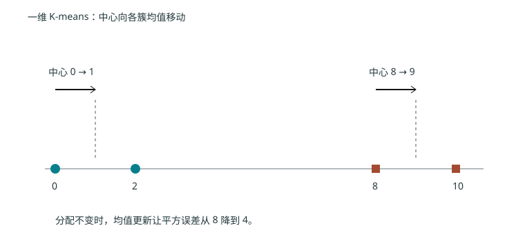

# 第六章 聚类：相似结构由什么决定

> 往年资料：S25 4–17 页（定义与评价）、19–30 页（序贯）、32–47 页（层次）、49–74 页（K 均值与调整）。本章阈值例和手算数据为自编。

> **读前提示（编者补充）**。聚类是无监督学习的代表：我们**没有**样本的类别标签，只根据"相似性"把数据分成若干组。本章先说清"一类"的严格定义，再讲两类构建方法（序贯/层次、K 均值），最后说清如何评价结果。凡是编者补充的推导与自编数值例，文中会标"编者推导"或"自编例"，以便与课件内容区分；来源块已给出 S25 的页码范围，本章未逐页核对，也未新增任何具体页码事实。

---

## 6.1 没有标签时，"一类"是什么 {#ml-06-01}

### 6.1.1 聚类的任务与动机

分类（有监督）是"给定标签，学一个映射"；聚类（无监督）是"没有标签，只按数据自身结构分组"。我们想回答的是：**在不借助外部答案的情况下，数据里是否天然分成几团？每一团内部为何相似、团与团之间为何不同？**

现实里"相似"由三件事共同决定：

1. **特征怎么选**（用颜色还是用形状？用原始像素还是用纹理？）；
2. **距离怎么量**（欧氏距离、曼哈顿距离、余弦相似度……）；
3. **聚合规则怎么定**（最近点对、最远点对、类心距离……）。

这三件事不同，得到的"一类"就不同。因此**不存在脱离任务的唯一"真实划分"**——按颜色聚类与按形状聚类可能都合理。

> **记住**：聚类结果的好坏，最终要回到业务/实验目标来判断，不能只因为"算法跑出来了"就认为它正确。

### 6.1.2 硬划分的严格定义（编者推导）

本书采用的"一类"是**硬划分（hard partition）**：把全部 $N$ 个样本分成 $K$ 个簇 $C_1,\ldots,C_K$，满足三条：

$$
C_k\neq\varnothing,\quad \forall k=1,\ldots,K \tag{非空}
$$

$$
C_k\cap C_{k'}=\varnothing,\quad k\neq k' \tag{两两不交}
$$

$$
\bigcup_{k=1}^{K} C_k=\{\mathbf x_1,\ldots,\mathbf x_N\} \tag{覆盖全部}
$$

- **假设与符号**：$\mathbf x_i\in\mathbb R^d$ 是第 $i$ 个样本列向量（$i=1,\ldots,N$）；$C_k$ 是第 $k$ 个簇的样本集合；$K$ 为簇数（正整数，$1\le K\le N$）。
- **逐条含义**：
  - "非空"表示每个簇至少要有一个点——空簇在硬划分里不被允许（这一点在第 6.3、6.4 节会反复用到）。
  - "两两不交"表示每个样本**只能属于一个簇**（这就是"硬"的含义；软划分允许一个样本以概率属于多个簇，本书不展开）。
  - "覆盖全部"表示不能丢样本，所有点都必须被分到某个簇。
- **等价写法**：用指示变量 $r_i\in\{1,\ldots,K\}$ 表示样本 $i$ 所属簇；或用 0–1 指示矩阵 $z_{ik}\in\{0,1\}$，满足 $\sum_{k=1}^K z_{ik}=1$（每个样本恰好分给一个簇）。后文 K 均值用 $r_i$，层次聚类用集合 $C_k$。

### 6.1.3 簇编号没有语义（置换不变性）

簇的编号 $1,2,\ldots,K$ 只是占位符。把"簇 1 与簇 2 改名"不应改变任何评价结论——这只是对编号做了一 shuffled 置换。

**过程讲解（形式化）**
- *假设*：设 $\pi:\{1,\ldots,K\}\to\{1,\ldots,K\}$ 是任意置换（双射）。
- *起始式*：原划分 $\{C_1,\ldots,C_K\}$，改名后划分 $\{C_{\pi(1)},\ldots,C_{\pi(K)}\}$。
- *结论*：任何合理的聚类评价指标（Rand、轮廓系数、目标函数 $J$ 等）在满足 $\sum_k z_{ik}=1$ 的约束下，只依赖于"哪些样本同簇"，而**不**依赖于这些簇被标成几号。因此**评价必须对该置换不变**，否则指标本身就有缺陷。

> **常见误区**：把簇编号当成"类别含义"（例如以为簇 1 一定是"猫"）。硬划分里的编号与语义无关，跨次运行得到不同编号是正常现象。

### 6.1.4 类间距离（链接）的四种定义

"两簇有多近"有不止一种说法，它们表达不同的"接近"概念（层次聚类会用到，见 6.2）：

$$
d_{\text{SL}}(A,B)=\min_{\mathbf x\in A,\ \mathbf y\in B}\|\mathbf x-\mathbf y\| \tag{单链接/最近}
$$

$$
d_{\text{CL}}(A,B)=\max_{\mathbf x\in A,\ \mathbf y\in B}\|\mathbf x-\mathbf y\| \tag{全链接/最远}
$$

$$
d_{\text{AL}}(A,B)=\frac{1}{|A||B|}\sum_{\mathbf x\in A}\sum_{\mathbf y\in B}\|\mathbf x-\mathbf y\| \tag{平均链接}
$$

$$
d_{\text{CEN}}(A,B)=\|\boldsymbol\mu_A-\boldsymbol\mu_B\|,\quad \boldsymbol\mu_A=\frac1{|A|}\sum_{\mathbf x\in A}\mathbf x \tag{类心链接}
$$

- **符号/维度**：$A,B$ 为两簇；$\mathbf x,\mathbf y\in\mathbb R^d$；$\boldsymbol\mu_A,\boldsymbol\mu_B\in\mathbb R^d$。
- **直觉**：单链接看"最近一对"、全链接看"最远一对"、平均链接看"所有点对的平均"、类心链接看"两个中心的距离"。
- 这四种定义将在 6.2 节的层次聚类中决定"每次合并哪两簇"，结果可能**完全不同**。

---

## 6.2 序贯方法与层次聚类 {#ml-06-02}

### 6.2.1 序贯法（逐点扫描）

序贯法**逐个**处理样本：当前样本若与某个已有簇"足够接近"就加入该簇，否则以它为中心新建一簇。

- **直觉**：像排队分组——你走到队尾时，只会和已经存在的组比较，决定插队还是另起一组。
- **对顺序与阈值敏感**：先到的样本"定下"了簇的形状，后到的只能将就。换一个输入顺序可能得到不同结果。
- **双阈值法**：用较小阈值 $\tau_{\text{in}}$ 决定"接受"（加入现有簇），用较大阈值 $\tau_{\text{out}}$ 决定"新建"（自成新簇），中间区域 $\tau_{\text{in}}<\text{距离}<\tau_{\text{out}}$ 延后处理。这样能减少"边界点"的仓促决定。
- **补救**：允许簇间合并与样本重新分配，可缓解早期决策难以撤回的问题，但必须事先规定明确的更新规则。

> **常见误区**：认为序贯法"跑一遍就够"。由于顺序敏感，实践中常多次以不同顺序或不同随机种子重跑，再比较。

### 6.2.2 凝聚与分裂层次聚类

- **凝聚（自底向上）**：一开始让每个样本各自成簇（共 $N$ 个簇），每次合并"距离最近"的两簇，直到剩下一个簇或满足停止条件。得到的是**嵌套划分**，可在树状图不同高度"切开"得到 $K$ 个簇。
- **分裂（自顶向下）**：从整体一簇出发，逐步拆分成两个最不相似的子簇。

两者都输出一棵能切出任意 $K$ 的树，区别只在构建方向。

### 6.2.3 链接准则的详细对比（编者推导）

每次合并选使类间距离最小的两簇。用 6.1.4 的四种定义，得到不同算法：

| 准则 | 类间距离 | 倾向的簇形状 | 典型问题 |
| --- | --- | --- | --- |
| 单链接 | 最近点对 | 细长"链"、易桥接远处点 |  chaining（一条链串起所有点） |
| 全链接 | 最远点对 | 紧凑、近似球形 | 对离群点敏感 |
| 平均链接 | 点对平均 | 折中，较稳健 | 计算量略大 |
| 类心链接 | 类心距离 | 受簇大小影响 | 可能出现逆转移（inversion） |

**过程讲解（为何单链接易成链）**
- *假设*：存在三团 $A,B,C$，其中 $A$ 与 $B$ 各自紧密，但 $A$ 中某点离 $B$ 中某点极近，而 $B$ 与 $C$ 也仅由一对近点相连。
- *起始式*：单链接距离只取 $\min$，故 $d_{\text{SL}}(A,B)$ 可能很小、$d_{\text{SL}}(B,C)$ 也可能很小。
- *结论*：单链接会优先合并这两对"近点"，从而把 $A,B,C$ 串成一条贯穿的链，即使 $A$ 与 $C$ 整体相距很远。这就是 chaining 现象。全链接用 $\max$ 则会拒绝这种"靠一对近点牵强合并"，倾向紧凑簇。

### 6.2.4 合并后的距离更新（Lance–Williams 公式，编者推导）

凝聚法每次只合并两簇，之后**不必重算所有点对距离**——只需更新"新簇与其余各簇"的距离。这由 Lance–Williams 递推统一表达：

$$
d(C_i\cup C_j,\ C_k)
=\alpha_i\,d(C_i,C_k)+\alpha_j\,d(C_j,C_k)
+\beta\,d(C_i,C_j)
+\gamma\,|d(C_i,C_k)-d(C_j,C_k)|
\tag{LW}
$$

- **符号**：$C_i,C_j$ 为刚合并的两簇，$C_k$ 为其余某簇；$d(\cdot,\cdot)$ 是所用链接准则下的类间距离。
- **逐步说明**：合并后新簇 $C_i\cup C_j$ 与 $C_k$ 的距离，可由合并前的三个距离 $d(C_i,C_k),d(C_j,C_k),d(C_i,C_j)$ 线性（加一项绝对值）组合得到。于是每次合并只更新 $O(K)$ 个值，整体比"每次重算全部"快得多。
- **三种链接的参数表**：

| 准则 | $\alpha_i$ | $\alpha_j$ | $\beta$ | $\gamma$ |
| --- | --- | --- | --- | --- |
| 单链接 | $1/2$ | $1/2$ | $0$ | $-1/2$ |
| 全链接 | $1/2$ | $1/2$ | $0$ | $+1/2$ |
| 平均链接(UPGMA) | $n_i/(n_i+n_j)$ | $n_j/(n_i+n_j)$ | $0$ | $0$ |

其中 $n_i=|C_i|,\ n_j=|C_j|$。注意平均链接用到簇大小（未加权的 UPGMA），而单/全链接与大小无关。该公式是聚类算法的标准结论，作为编者补充给出，便于理解"距离为何能复用"。

### 6.2.5 一维手算例：点 0、1、4、5（自编例，已核算）

取一维点 $\{0,1,4,5\}$，欧氏距离即绝对值差。初始两两距离：

$$
d(0,1)=1,\ d(0,4)=4,\ d(0,5)=5,\ d(1,4)=3,\ d(1,5)=4,\ d(4,5)=1.
$$

**单链接**过程：
1. 最小距离是 $1$，先合并 $\{0,1\}$（也可先合并 $\{4,5\}$，平局次序可互换）；此时簇为 $\{0,1\},\{4\},\{5\}$。
2. 更新单链接距离：$d(\{0,1\},\{4\})=\min(4,3)=3$，$d(\{0,1\},\{5\})=\min(5,4)=4$，$d(\{4\},\{5\})=1$。
3. 再合并 $\{4,5\}$（距离 $1$）；簇为 $\{0,1\},\{4,5\}$。
4. 最后 $d(\{0,1\},\{4,5\})=\min(4,5,3,4)=3$，在高度 $3$ 合并。

→ **单链接最终合并高度为 3**（即跨簇最短距离为 3）。

**全链接**过程：前两步同上合并出 $\{0,1\},\{4,5\}$；但全链接取最远点对：
$$
d_{\text{CL}}(\{0,1\},\{4,5\})=\max(4,5,3,4)=5.
$$
→ **全链接最终合并高度为 5**。

> **记住**：相同数据、不同链接，树状图的"高度"含义不同——单链接高度是"最近一对"，全链接高度是"最远一对"。比较聚类结果时务必先确认用了哪种链接。

---

## 6.3 K-means 的两步为何都不会增加目标 {#ml-06-03}

### 6.3.1 问题与平方欧氏目标

K 均值要在给定簇数 $K$ 下，找到使"样本到所属中心距离平方和"最小的硬划分。

**设定（符号/维度）**
- 样本 $\mathbf x_i\in\mathbb R^d$，$i=1,\ldots,N$；
- 簇中心 $\boldsymbol\mu_k\in\mathbb R^d$，$k=1,\ldots,K$；
- 每个样本所属簇 $r_i\in\{1,\ldots,K\}$（即 6.1 的硬划分指示）。

目标函数（平方欧氏准则）：

$$
J=\sum_{i=1}^N\|\mathbf x_i-\boldsymbol\mu_{r_i}\|^2. \tag{6.1}
$$

- **直觉（一维小例）**：假设一维点 $\{0,2,8,10\}$，两个中心。若把 $0,2$ 归到中心 $\mu_1=1$，$8,10$ 归到 $\mu_2=9$，则误差是 $(0-1)^2+(2-1)^2+(8-9)^2+(10-9)^2=1+1+1+1=4$。$J$ 衡量"整体有多散"。K 均值就是不断调 $r_i$ 和 $\mu_k$ 把 $J$ 压小。

### 6.3.2 步一：固定中心，贪心分配最近（编者推导）

- *假设*：中心 $\boldsymbol\mu_1,\ldots,\boldsymbol\mu_K$ 暂时固定不变。
- *起始式*：第 $i$ 项误差为 $J_i=\|\mathbf x_i-\boldsymbol\mu_{r_i}\|^2$，总目标 $J=\sum_i J_i$。
- *逐步推导*：由于中心已定，对样本 $i$ 而言，选择不同的 $r_i$ **只影响它自己的那一项** $J_i$，与其它样本无关。因此可对每个 $i$ 独立地取最优：
  $$
  r_i\;\leftarrow\;\arg\min_{k\in\{1,\ldots,K\}}\|\mathbf x_i-\boldsymbol\mu_k\|^2. \tag{6.2}
  $$
- *结论与条件*：这样重新分配后，每一项 $J_i$ 都取到它在"固定中心"下的最小值，故新 $J\le$ 旧 $J$。该步**单调不增**，对任意维度、任意距离（只要取最近即可）都成立。

### 6.3.3 步二：固定分配，求最优中心（编者推导，含导数）

- *假设*：分配 $r_i$（即哪些样本属于 $C_k$）固定不变，仅优化中心 $\boldsymbol\mu_k$。
- *观察*：不同簇的中心彼此独立——改 $\boldsymbol\mu_k$ 只影响 $C_k$ 内样本的项。故可对每个 $k$ 单独最小化
  $$
  J_k=\sum_{i\in C_k}\|\mathbf x_i-\boldsymbol\mu_k\|^2. \tag{6.3}
  $$
- *起始式（展开范数）*：把 $\|\cdot\|^2$ 写成内积，
  $$
  J_k=\sum_{i\in C_k}(\mathbf x_i-\boldsymbol\mu_k)^\top(\mathbf x_i-\boldsymbol\mu_k)
  =\sum_{i\in C_k}\Big(\mathbf x_i^\top\mathbf x_i-2\mathbf x_i^\top\boldsymbol\mu_k+\boldsymbol\mu_k^\top\boldsymbol\mu_k\Big).
  $$
- *逐步求导*：对向量 $\boldsymbol\mu_k$ 求梯度（用 $\nabla_{\boldsymbol\mu_k}(\boldsymbol\mu_k^\top\boldsymbol\mu_k)=2\boldsymbol\mu_k$，$\nabla_{\boldsymbol\mu_k}(\mathbf x_i^\top\boldsymbol\mu_k)=\mathbf x_i$）：
  $$
  \nabla_{\boldsymbol\mu_k}J_k
  =\sum_{i\in C_k}\big(-2\mathbf x_i+2\boldsymbol\mu_k\big)
  =2\sum_{i\in C_k}(\boldsymbol\mu_k-\mathbf x_i). \tag{6.4}
  $$
- *令梯度为零*：
  $$
  2\sum_{i\in C_k}(\boldsymbol\mu_k-\mathbf x_i)=0
  \;\Longrightarrow\;
  |C_k|\,\boldsymbol\mu_k=\sum_{i\in C_k}\mathbf x_i
  \;\Longrightarrow\;
  \boldsymbol\mu_k=\frac{1}{|C_k|}\sum_{i\in C_k}\mathbf x_i. \tag{6.5}
  $$
- *二阶验证（确认是最小而非最大）*：再求 Hessian，$\nabla^2_{\boldsymbol\mu_k}J_k=2|C_k|\,I$（$I$ 为 $d\times d$ 单位阵），正定，故 (6.5) 给出的是**最小值**。
- *结论与条件*：在分配固定时，把中心取为簇内样本算术平均，可使该簇误差最小，因而总 $J$ 单调不增。前提是 $C_k\neq\varnothing$（即 $|C_k|\ge1$）；若 $C_k=\varnothing$ 则 (6.5) 分母为 0，均值无定义——这就是"空簇"问题（见 6.3.6）。

### 6.3.4 两步行交替 ⇒ 单调不增（编者推导）

一次完整迭代 = 先做步一（重分配）再做步二（更新中心）。由 6.3.2 与 6.3.3：

$$
J^{(t)}\xrightarrow{\text{步一}} J^{(t+1/2)}\le J^{(t)}
\xrightarrow{\text{步二}} J^{(t+1)}\le J^{(t+1/2)}.
$$

因此 $J^{(t+1)}\le J^{(t)}$，即**每次迭代目标不增**。

- **收敛性**：因 $J\ge0$ 有下界，且单调不增，序列 $\{J^{(t)}\}$ 必收敛到某极限。停在"两步都不再改善"的**局部稳定点**。
- **非凸与局部最优**：目标 (6.1) 关于 $(\boldsymbol\mu,r)$ 整体**非凸**（例如一维两个点选哪个中心是组合问题）。单调不增**只保证到局部最优，不保证全局最优**。不同初始化可能得到不同 $J^*$。

### 6.3.5 一维手算例：点 0、2、8、10（自编例，已核算）

初始中心 $\mu_1=0,\ \mu_2=8$。

**第一轮分配（步一，取最近中心）**
- 点 0：$\|0-0\|^2=0<\|0-8\|^2=64$ → 归簇 1。
- 点 2：$\|2-0\|^2=4<\|2-8\|^2=36$ → 归簇 1。
- 点 8：$\|8-8\|^2=0<\|8-0\|^2=64$ → 归簇 2。
- 点 10：$\|10-8\|^2=4<\|10-0\|^2=100$ → 归簇 2。

分配得 $C_1=\{0,2\},\ C_2=\{8,10\}$。目标：
$$
J=0^2+2^2+0^2+2^2=0+4+0+4=8. \tag{首轮 J=8}
$$

**第一轮更新（步二，取均值）**
$$
\mu_1=\frac{0+2}{2}=1,\qquad \mu_2=\frac{8+10}{2}=9.
$$

**第二轮分配+更新**
- 点 0：$\|0-1\|^2=1<\|0-9\|^2=81$ → 簇 1。
- 点 2：$\|2-1\|^2=1<\|2-9\|^2=49$ → 簇 1。
- 点 8：$\|8-9\|^2=1<\|8-1\|^2=49$ → 簇 2。
- 点 10：$\|10-9\|^2=1<\|10-1\|^2=81$ → 簇 2。

分配不变，故中心不变。目标：
$$
J=1^2+1^2+1^2+1^2=4. \tag{次轮 J=4}
$$

→ 目标从 **8 降到 4**，且下一轮不再变化，算法停滞在局部稳定点。该例印证 6.3.2–6.3.4 的"单调不增"。

### 6.3.6 空簇、距离度量与"均值"的匹配（编者补充）

**空簇**：若某次分配使 $C_k=\varnothing$，则 (6.5) 分母 $|C_k|=0$，均值无定义，目标里也没有该项。处理方式需**事先规定**，例如：把该中心重新播种到"当前误差最大的样本"上，或把它并入最近的非空簇，或丢弃该簇（此时实际簇数减少）。硬划分要求每簇非空，因此空簇必须被显式处理。

**距离换了，中心也要换（编者推导）**
- 步二的导数证明依赖 $\|\mathbf x_i-\boldsymbol\mu_k\|^2$，即**平方欧氏距离**。
- 若改用 $L_1$ 距离 $\sum_j|x_{ij}-\mu_{kj}|$，则对每个坐标独立地，使绝对偏差和最小的是该坐标的**中位数**，而非算术均值。
- *结论*：任意把距离换成 $L_1$ 却仍用算术均值更新中心，会**失去** 6.3.3 的"该步最小化目标"证明，算法不再保证单调不增。匹配关系为：平方欧氏 ↔ 均值；$L_1$ ↔ 中位数；$L_\infty$ ↔ 各坐标中点（按范围）。

> **常见误区**：以为"K 均值 = 随便定个距离 + 取平均"。距离是平方欧氏时算术均值才最优；换距离必须换中心更新规则。

---

## 6.4 单点转移的精确变化 {#ml-06-04}

### 6.4.1 为什么需要它：两种准则并不相同

步一（6.2）的"贪心最近"只看**当前**中心：把点分给离它最近的旧中心。但移动一个点会**改变两个簇的中心**，移动后新的误差未必由"旧中心谁更近"决定。S25 后部讨论的正是这种"更新两个中心后再比较"的单点转移准则。

设从含 $n_a>1$ 个点的簇 $a$ 移出点 $\mathbf x$，放入含 $n_b\ge1$ 个点的簇 $b$。下面的公式给出目标变化的**精确值** $\Delta J$，而不是近似。

### 6.4.2 新均值与误差恒等式（编者推导）

- *假设*：$a$ 原有 $n_a$ 个点、均值 $\boldsymbol\mu_a$；$b$ 原有 $n_b$ 个点、均值 $\boldsymbol\mu_b$。移出 $\mathbf x$ 后，$a$ 变 $a'$（大小 $n_a-1$），$b$ 变 $b'$（大小 $n_b+1$）。
- *起始式（新均值）*：由均值定义 $\sum_{i\in a}\mathbf x_i=n_a\boldsymbol\mu_a$，移除 $\mathbf x$ 后
  $$
  \boldsymbol\mu_{a'}=\frac{n_a\boldsymbol\mu_a-\mathbf x}{\,n_a-1\,},\qquad
  \boldsymbol\mu_{b'}=\frac{n_b\boldsymbol\mu_b+\mathbf x}{\,n_b+1\,}. \tag{6.6}
  $$
- *误差平方和恒等式*：对任意簇 $C$（大小 $n$，均值 $\boldsymbol\mu_C$），有
  $$
  \sum_{i\in C}\|\mathbf x_i-\boldsymbol\mu_C\|^2
  =\sum_{i\in C}\|\mathbf x_i\|^2-n\,\|\boldsymbol\mu_C\|^2. \tag{6.7}
  $$
  *推导*：展开 $\|\mathbf x_i-\boldsymbol\mu_C\|^2=\|\mathbf x_i\|^2-2\mathbf x_i^\top\boldsymbol\mu_C+\|\boldsymbol\mu_C\|^2$，对 $i\in C$ 求和，注意 $\sum_{i\in C}\mathbf x_i=n\boldsymbol\mu_C$，则中间项 $-2(n\boldsymbol\mu_C)^\top\boldsymbol\mu_C=-2n\|\boldsymbol\mu_C\|^2$，与末项 $n\|\boldsymbol\mu_C\|^2$ 合并得 $-n\|\boldsymbol\mu_C\|^2$。得证。

### 6.4.3 "加入簇 $b$"那一项的推导（编者推导）

记 $S_b=\sum_{i\in b}\|\mathbf x_i\|^2$。簇 $b$ 移动**前后**的误差分别为
$$
E_b^{\text{old}}=S_b-n_b\|\boldsymbol\mu_b\|^2,\qquad
E_b^{\text{new}}=S_b+\|\mathbf x\|^2-(n_b+1)\|\boldsymbol\mu_{b'}\|^2.
$$
加入导致的变化：
$$
\Delta J_b=E_b^{\text{new}}-E_b^{\text{old}}
=\|\mathbf x\|^2-(n_b+1)\|\boldsymbol\mu_{b'}\|^2+n_b\|\boldsymbol\mu_b\|^2. \tag{6.8}
$$
代入 (6.6) 的 $\boldsymbol\mu_{b'}$：
$$
(n_b+1)\|\boldsymbol\mu_{b'}\|^2
=\frac{1}{n_b+1}\|n_b\boldsymbol\mu_b+\mathbf x\|^2
=\frac{1}{n_b+1}\Big(n_b^2\|\boldsymbol\mu_b\|^2+2n_b\boldsymbol\mu_b^\top\mathbf x+\|\mathbf x\|^2\Big).
$$
代回 (6.8) 并按 $\|\mathbf x\|^2,\ \boldsymbol\mu_b^\top\mathbf x,\ \|\boldsymbol\mu_b\|^2$ 分组：
$$
\Delta J_b
=\|\mathbf x\|^2-\frac{\|\mathbf x\|^2+2n_b\boldsymbol\mu_b^\top\mathbf x+n_b^2\|\boldsymbol\mu_b\|^2}{n_b+1}+n_b\|\boldsymbol\mu_b\|^2.
$$
提取系数：
- $\|\mathbf x\|^2$ 项：$1-\frac{1}{n_b+1}=\frac{n_b}{n_b+1}$；
- $\boldsymbol\mu_b^\top\mathbf x$ 项：$-\frac{2n_b}{n_b+1}+0=-\frac{2n_b}{n_b+1}$，即 $-\frac{2n_b}{n_b+1}\boldsymbol\mu_b^\top\mathbf x$；
- $\|\boldsymbol\mu_b\|^2$ 项：$-\frac{n_b^2}{n_b+1}+n_b=\frac{-n_b^2+n_b(n_b+1)}{n_b+1}=\frac{n_b}{n_b+1}$。

于是
$$
\Delta J_b=\frac{n_b}{n_b+1}\Big(\|\mathbf x\|^2-2\boldsymbol\mu_b^\top\mathbf x+\|\boldsymbol\mu_b\|^2\Big)
=\frac{n_b}{n_b+1}\|\mathbf x-\boldsymbol\mu_b\|^2. \tag{6.9}
$$

### 6.4.4 "移出簇 $a$"那一项的推导（编者推导）

完全对称地，用 (6.7) 计算簇 $a$ 移出前后的误差差：
$$
\Delta J_a=E_a^{\text{new}}-E_a^{\text{old}}
=-\|\mathbf x\|^2-(n_a-1)\|\boldsymbol\mu_{a'}\|^2+n_a\|\boldsymbol\mu_a\|^2. \tag{6.10}
$$
代入 $\boldsymbol\mu_{a'}=\frac{n_a\boldsymbol\mu_a-\mathbf x}{n_a-1}$，同理分组可得
$$
\Delta J_a=-\frac{n_a}{n_a-1}\|\mathbf x-\boldsymbol\mu_a\|^2. \tag{6.11}
$$
（验证要点：把 $\|\mathbf x-\boldsymbol\mu_a\|^2=\|\mathbf x\|^2-2\boldsymbol\mu_a^\top\mathbf x+\|\boldsymbol\mu_a\|^2$ 乘上 $-\frac{n_a}{n_a-1}$ 后，各项系数恰好与 (6.10) 展开一致。）

### 6.4.5 合并得到 $\Delta J$（结论）

总变化 = 加入 $b$ 的增量 + 移出 $a$ 的减量：

$$
\boxed{\;
\Delta J
=\frac{n_b}{n_b+1}\|\mathbf x-\boldsymbol\mu_b\|^2
-\frac{n_a}{n_a-1}\|\mathbf x-\boldsymbol\mu_a\|^2
\;} \tag{6.12}
$$

- **结论**：只有当 $\Delta J<0$ 时，这次单点转移才**改善**目标。
- **成立条件**：$n_a>1$（保证移出后 $a$ 仍非空、且 (6.11) 分母非零），$n_b\ge1$。
- **$n_a=1$ 不可用**：此时 $a$ 只有一个点，移出后变成空簇，违反硬划分"非空"；公式 (6.11) 中 $\frac{n_a}{n_a-1}=\frac{1}{0}$ 无定义。因此 S25 强调该式只适用于 $n_a>1$。
- **两种准则差异的解释**：$\Delta J<0$ 与"$\mathbf x$ 离 $\boldsymbol\mu_b$ 比离 $\boldsymbol\mu_a$ 近"不是一回事——前者还受两簇大小 $n_a,n_b$ 加权（项前系数 $\frac{n_a}{n_a-1}$ 与 $\frac{n_b}{n_b+1}$），且用的是**更新后的中心**。这正是为什么"最近中心分配"不等于"更新中心后最优转移"。

### 6.4.6 一维验证例（自编例，已核算）

**例 A（有害转移）**：簇 $a=\{2,4\}$，$\mu_a=3$，$n_a=2$；簇 $b=\{10\}$，$\mu_b=10$，$n_b=1$。考虑把 $x=4$ 从 $a$ 移到 $b$。

- 用 (6.12)：
  $$
  \Delta J=\frac{1}{2}\|4-10\|^2-\frac{2}{1}\|4-3\|^2
  =\frac12\cdot36-2\cdot1=18-2=16.
  $$
- 直接核算：移动前 $E_a=(2-3)^2+(4-3)^2=2$，$E_b=0$，合计 $2$；移动后 $a'=\{2\}$ 误差 $0$，$b'=\{10,4\}$ 均值 $7$，误差 $(10-7)^2+(4-7)^2=9+9=18$，合计 $18$。$\Delta J=18-2=16$，与公式一致且为正 → 不转移。

**例 B（有益转移）**：簇 $a=\{2,4\}$，$\mu_a=3$，$n_a=2$；簇 $b=\{3.5\}$，$\mu_b=3.5$，$n_b=1$。把 $x=4$ 从 $a$ 移到 $b$。

- 用 (6.12)：
  $$
  \Delta J=\frac{1}{2}\|4-3.5\|^2-\frac{2}{1}\|4-3\|^2
  =\frac12\cdot0.25-2\cdot1=0.125-2=-1.875<0.
  $$
- 直接核算：移动前合计 $2$；移动后 $a'=\{2\}$ 误差 $0$，$b'=\{3.5,4\}$ 均值 $3.75$，误差 $(3.5-3.75)^2+(4-3.75)^2=0.125$，合计 $0.125$。$\Delta J=0.125-2=-1.875$，一致且为负 → 应转移。

> **记住**：$\Delta J$ 的符号才决定转不转移；光看"哪个旧中心更近"会漏掉簇大小与中心更新带来的效应。

---

## 6.5 如何评价结果 {#ml-06-05}

### 6.5.1 有外部标签：比较样本对（外部指标）

若有参考标签，最直观的想法是看"两样本是否同簇"在两种划分下是否一致。

**Rand 指数（编者推导）**
- 全部样本对共 $\binom{N}{2}=\frac{N(N-1)}2$ 对。
- 记：
  - $a$：在参考划分与聚类结果中**都同簇**的对数；
  - $d$：在两者中**都异簇**的对数；
  - $b$：参考同簇、聚类异簇；$c$：参考异簇、聚类同簇。
- *起始式*：一致的对数 $=a+d$，故
  $$
  \text{Rand}=\frac{a+d}{\binom{N}{2}}=\frac{a+d}{a+b+c+d}. \tag{6.13}
  $$
- *结论与性质*：Rand $\in[0,1]$，越大越一致；$\text{Rand}=1$ 表示两划分完全相同（允许簇编号置换）。它**对簇编号置换不变**（见 6.1.3），因为只统计"同/异簇"是否一致，不关心编号。
- 课件还列出 Jaccard 指数 $\frac{a}{a+b+c}$、Fowlkes–Mallows 指数 $\frac{a}{\sqrt{(a+b)(a+c)}}$ 等外部指标，思路都是用列联表统计四类对数。

**一维验证例（自编例，已核算）**：4 个样本，参考标签 $\{1,2\}$ 属类 A、$\{3,4\}$ 属类 B；聚类结果簇 $C_1=\{1,2,3\}$、$C_2=\{4\}$。列联表：

| 参考 \ 聚类 | $C_1$ | $C_2$ | 合计 |
| --- | --- | --- | --- |
| A | 2 | 0 | 2 |
| B | 1 | 1 | 2 |
| 合计 | 3 | 1 | 4 |

逐对判断（共 $\binom42=6$ 对）：
- (1,2)：参考同、聚类同 → $a$；
- (3,4)：参考异、聚类异 → $d$；
- (1,3)、(2,3)：参考异、聚类同 → $b$（共 2）；
- (1,4)、(2,4)：参考异、聚类异 → $d$（共 2）。

于是 $a=1,\ d=3,\ b=2,\ c=0$，$\text{Rand}=\frac{1+3}{6}=\frac23$。该例说明 Rand 能区分"部分一致"的聚类。

### 6.5.2 无参考标签：轮廓系数（内部指标，编者推导）

内部指标只用量到的几何结构，不依赖外部标签。轮廓系数对每个点 $i$ 评估"它待在当前簇有多合适"。

**定义（符号/维度）**：设 $i$ 属于簇 $C_{r_i}$，其它簇记为 $k\neq r_i$，$\mathbf x_j\in\mathbb R^d$。
- 簇内不相识距离：
  $$
  a_i=\frac{1}{|C_{r_i}|-1}\sum_{j\in C_{r_i},\ j\neq i}\|\mathbf x_i-\mathbf x_j\|. \tag{6.14}
  $$
- 到其它各簇的平均距离（取最小）：
  $$
  b_i=\min_{k\neq r_i}\left(\frac{1}{|C_k|}\sum_{j\in C_k}\|\mathbf x_i-\mathbf x_j\|\right). \tag{6.15}
  $$
- 轮廓系数：
  $$
  s_i=\frac{b_i-a_i}{\max(a_i,b_i)}. \tag{6.16}
  $$

**过程讲解**
- *假设*：$a_i$ 衡量"我与同簇伙伴有多近"，$b_i$ 衡量"我与最近的别的簇有多近"。
- *逐项含义*：若 $s_i\approx1$，说明 $b_i\gg a_i$，点远离其它簇、紧贴本簇，分得好；若 $s_i\approx0$，说明 $a_i\approx b_i$，点在边界；若 $s_i<0$，说明 $b_i<a_i$，点其实离别的簇更近，可能分错。
- *范围*：由构造知 $-1\le s_i\le1$。
- *结论与条件*：整体轮廓系数取所有 $s_i$ 的平均，用以比较不同 $K$ 或不同算法的紧凑—分离折中。**单点簇**时 $|C_{r_i}|-1=0$，(6.14) 无定义，需另定约定（如令该点 $s_i=0$ 或单独处理）。
- *局限*：内部指标只衡量"某种几何偏好"，**不能证明语义正确**——分得的簇在几何上紧凑，未必对应真实的类别含义。

**一维验证例（自编例，已核算）**：簇 $A=\{1,2,3\}$，簇 $B=\{10,11\}$。取点 $i=2\in A$。
- $a_i=\frac{|2-1|+|2-3|}{2}=\frac{1+1}{2}=1$。
- 到簇 $B$ 的平均距离 $=\frac{|2-10|+|2-11|}{2}=\frac{8+9}{2}=8.5$，故 $b_i=8.5$。
- $s_i=\frac{8.5-1}{\max(1,8.5)}=\frac{7.5}{8.5}\approx0.882$。接近 1，说明该点分得很好。
（同理点 $10\in B$：$a_i=1$，$b_i=\frac{9+8+7}{3}=8$，$s_i=\frac{8-1}{8}=0.875$。）

### 6.5.3 如何选 $K$

$K$ 不是算法自动决定的。常用做法：
- **肘部法**：画 $J$ 随 $K$ 的曲线，$J$ 随 $K$ 增大单调下降，"拐点"处近似最优 $K$（但拐点常不明显）。
- **稳定性**：多次不同初始化，看哪些簇稳定出现。
- **领域含义与验证目标**：结合业务可解释性与下游任务判断。
- 内部指标（轮廓系数等）可在无标签时辅助比较不同 $K$，但如前所述，不能替代语义正确性判断。

---

## 6.6 收敛、初始化与常见陷阱 {#ml-06-06}

### 6.6.1 收敛到什么、不保证什么（编者补充）

- K 均值每轮 $J$ 单调不增且 $J\ge0$，故 $\{J^{(t)}\}$ 收敛（6.3.4）。但收敛点是**局部稳定点**：在"重分配"和"更新中心"两步上都不再改善，未必是全局最小。
- 目标 (6.1) 关于"谁归哪簇"是组合问题、整体非凸，所以**不同初始化可能得到不同 $J^*$ 与不同划分**。

### 6.6.2 初始化与多起点（编者补充）

- **随机种子**：结果依赖初始中心；本项目手算实验用确定性小数据，不依赖单次随机运行来下结论（见学习指南）。
- **多起点重启**：跑若干次不同随机初始化，保留最小 $J$ 的结果，是实践中减小局部最优影响的常用办法。
- **K-means++ 直觉（编者补充）**：首中心随机取；之后每个新中心都以"与已选中心距离越大、被选概率越高"的方式采样。这样让初始中心彼此分散，通常比纯随机更快接近好解。其严格概率保证超出本章范围。

### 6.6.3 空簇的处理约定（编者补充）

硬划分要求每簇非空。若分配后出现空簇（见 6.3.6），须事先规定处理，例如：把该中心重新播种到当前误差最大的样本、或并入最近的非空簇、或丢弃该簇（实际簇数减少）。**不能**让分母为 0 的均值公式悄悄运行。

### 6.6.4 常见误区汇总（编者补充）

1. **距离换了还用算术均值**：只有平方欧氏对应均值；$L_1$ 应换中位数（6.3.6）。
2. **把簇编号当语义**：编号可任意置换，不与类别挂钩（6.1.3）。
3. **用内部指标当真相**：轮廓系数等只衡量几何偏好，不证明语义正确（6.5.2）。
4. **认为 K 均值给全局最优**：它只到局部稳定点，依赖初始化（6.3.4、6.6.1）。
5. **忽视特征缩放**：欧氏距离对量纲敏感，先标准化常能显著改变结果（与学习指南"单位、缩放会影响算法"一致）。
6. **单点转移直接用 $n_a=1$ 的公式**：此时会产生空簇且分母为 0，公式 (6.12) 不适用（6.4.5）。

> **本章小结**：聚类先定义"硬划分"（非空、不交、覆盖），再用距离与聚合规则构建簇。序贯/层次法靠链接准则合并，K 均值靠"重分配 + 更新均值"两步把平方误差单调压低；单点转移的 $\Delta J$ 公式说明"更新中心后最优"与"最近中心"并不同。评价时，有标签用 Rand 等外部指标，无标签用轮廓系数等内部指标，但内部指标不能替代语义判断。
