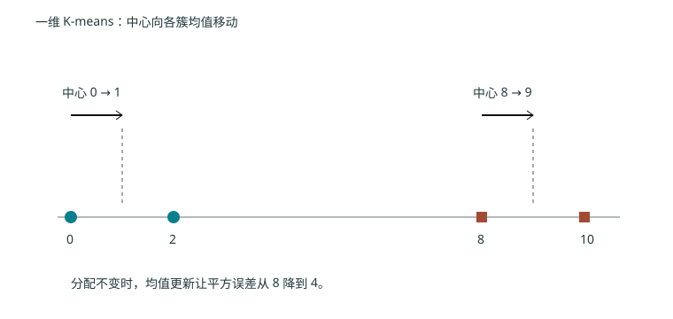

# 第六章 聚类：相似结构由什么决定

> 往年资料：S25 4–17 页（定义与评价）、19–30 页（序贯）、32–47 页（层次）、49–74 页（K 均值与调整）。本章阈值例和手算数据为自编。

## 6.1 没有标签时，“一类”是什么 {#ml-06-01}

聚类是寻找数据内部结构，而不是按已知标签训练分类器。硬划分 $C_1,\ldots,C_K$ 要求每簇非空、两两不交、并集为全部数据。簇编号没有语义：把簇 1 与簇 2 改名不应改变评价。

特征、距离和聚合规则共同决定结果。按颜色聚类与按形状聚类可能都合理；没有脱离任务的唯一“真实划分”。类间距离可取最短、最长、平均点对距离或类心距离，它们表达不同的接近概念。

## 6.2 序贯方法与层次聚类 {#ml-06-02}

序贯法逐个处理样本：若与现有簇足够接近就加入，否则建立新簇。计算简单，但对输入顺序与阈值敏感。双阈值法用较小阈值决定接受、较大阈值决定新建，中间区域延后处理。增加簇合并和重新分配可以缓解早期决策难以撤回的问题，但必须规定更新规则。

凝聚层次聚类从每个样本单独成簇开始，每次合并距离最近的两簇；分裂法从整体出发逐步拆分。得到的是嵌套划分，可在树状图不同高度切开。

单链接取两簇最短点对距离，易形成细长链；全链接取最长距离，倾向于紧凑簇；平均链接使用所有跨簇点对的平均。每次合并后仅更新新簇与其余簇的距离，其他距离可以复用。

自编例：一维点 0、1、4、5。欧氏单链接先合并 0 与 1、4 与 5（平局次序可互换），最后跨簇最短距离为 3。若使用全链接，最终合并高度为 5。相同数据、不同链接，树的高度含义不同。

## 6.3 K-means 的两步为何都不会增加目标 {#ml-06-03}

令 $\boldsymbol\mu_k\in\mathbb R^d$ 为簇中心，$r_i\in\{1,\ldots,K\}$ 为样本所属簇。平方欧氏目标是

$$J=\sum_{i=1}^N\|\mathbf x_i-\boldsymbol\mu_{r_i}\|^2.$$

固定中心，各个样本独立选最近中心，每项不增加。固定分配，簇 $C_k$ 的目标对中心求导为 $2\sum_{i\in C_k}(\boldsymbol\mu_k-\mathbf x_i)=0$，故

$$\boldsymbol\mu_k=\frac1{|C_k|}\sum_{i\in C_k}\mathbf x_i.$$

两步交替使目标单调不增，但目标非凸，只能保证到局部稳定解；不是全局最优保证。空簇时均值无定义，需要重新初始化或其他明确处理。距离换成 $L_1$ 后应更新中位数，任意更换距离却保留算术均值，会失去上述证明。

自编手算：点 $0,2,8,10$，初始中心 0、8。第一次分配为 $\{0,2\}$ 和 $\{8,10\}$，目标为 8；中心更新为 1、9 后目标为 4，下一轮不再变化。

下图只展示这个单次中心更新；横轴是真实一维位置，簇身份用形状和颜色共同区分。

## 6.4 单点转移的精确变化 {#ml-06-04}

S25 后部讨论更新中心后的单点转移，而不是仅比较原中心距离。设从含 $n_a>1$ 个点的簇 $a$ 移出 $\mathbf x$，放入含 $n_b\ge1$ 个点的簇 $b$。把新均值代入误差平方和，可以得到

$$\Delta J=\frac{n_b}{n_b+1}\|\mathbf x-\boldsymbol\mu_b\|^2-\frac{n_a}{n_a-1}\|\mathbf x-\boldsymbol\mu_a\|^2.$$

第一项是加入新簇增加的误差，第二项是移出旧簇减少的误差。只有 $\Delta J<0$ 才改善目标。$n_a=1$ 时不能使用该式，因为会产生空簇。这解释了为什么“离另一个当前中心较近”与“更新两个中心后误差下降”并非完全相同的转移准则。

## 6.5 如何评价结果 {#ml-06-05}

有外部标签时，可比较样本对是否同簇。例如 $a$ 对在两种划分都同簇，$d$ 对在两者都异簇，Rand 指数为 $(a+d)/\binom N2$。它不受簇编号置换影响。课件也列出 Jaccard、Fowlkes–Mallows 等外部指标。

没有参考标签时可用内部紧凑性和分离度。轮廓系数的编者解释：$a_i$ 是点到同簇其他点的平均距离，$b_i$ 是到最近其他簇的平均距离，$s_i=(b_i-a_i)/\max(a_i,b_i)$，单点簇需另定约定。内部指标衡量某种几何偏好，不能证明语义正确；$K$ 应结合稳定性、领域含义和验证目标判断。
