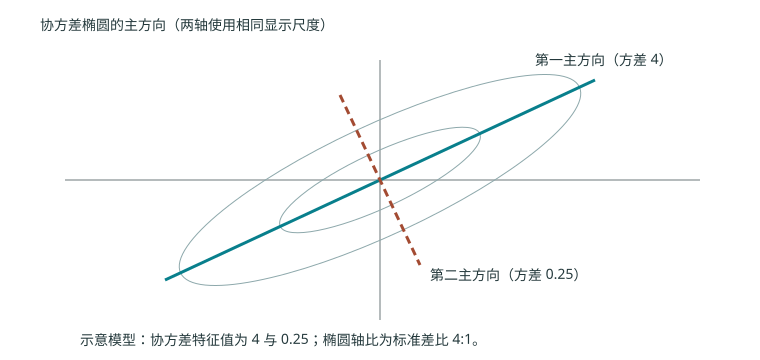

# 第七章 特征选择与降维：保留什么，舍弃什么

> 往年资料：S11 5–48 页（选择）；S12 4–43 页（线性降维与 PCA）、44–54 页（KPCA、LLE、NMF）。课件中的行列约定不统一，本章统一样本按行。部分概率距离与原表数值尚未逐项核验，见来源覆盖记录。

## 7.1 选择原特征还是构造新特征 {#ml-07-01}

高维数据可能包含无关、冗余、噪声特征，但“取值经常为零”并不能证明一个特征无用，稀有事件可能恰恰最有辨识力。

特征选择保留原始坐标子集，便于解释；特征提取用变换构造新坐标，例如把多个像素组合成一个投影分量。两者都可以降维，但输出的含义不同。监督特征选择利用标签，PCA 通常只利用输入分布。

## 7.2 子集生成与评价必须区分 {#ml-07-02}

从 $d$ 个特征选 $q$ 个，共有 $\binom dq$ 个子集。穷举可找给定评价准则下的最优子集，但代价通常很大。前向序贯 SFS 从空集开始，每次加入最有利的特征；后向 SBS 从全集开始删除。广义版本一次增删多个；L-R 方法允许在增加后删除或反过来，缓解早期选择无法撤销的问题。贪婪搜索仍无全局最优保证。

| 框架 | 子集如何评分 | 适用考虑 |
| --- | --- | --- |
| Filter | 类间散度、概率可分性、互信息等数据统计 | 通常较快，但所选指标未必等于目标模型效果 |
| Wrapper | 用指定模型的内部验证表现 | 贴近最终目标，但反复训练成本高 |
| Embedded | 在模型训练中联合选择，如 LASSO | 依赖模型与正则准则 |

Filter 不等于“每个特征独立排名”；也可以对整个子集计算统计量。单变量排序尤其可能漏掉交互：XOR 的两个均匀二元特征单独与标签独立，合起来却完全决定标签。

S11 列出 Bhattacharyya、Chernoff 等概率距离。以两类密度 $p,q$ 为例，Bhattacharyya 距离为 $-\log\int\sqrt{p(x)q(x)}dx$，完全重合时为零，支撑完全不交时趋于无穷。名称、尺度与最优方向各不相同，不能把所有指标都当作欧氏距离。

Relief 的思路是对抽取样本找同类近邻 hit 与异类近邻 miss：特征若在同类间变化小、异类间变化大，其评分应增加。具体差异函数必须与连续或离散特征类型匹配；抽样、归一化和多类扩展需要明确设定。

## 7.3 PCA 从最大投影方差推出 {#ml-07-03}

设 $X\in\mathbb R^{N\times d}$ 已按训练均值中心化，即每列均值为零，定义 $S=X^TX/N$。一维方向 $\mathbf w\in\mathbb R^d$ 投影为 $X\mathbf w$，投影方差为

$$\frac1N\|X\mathbf w\|^2=\mathbf w^TS\mathbf w.$$

如果不限制长度，扩大 $\mathbf w$ 就能任意增大该值，因此规定 $\mathbf w^T\mathbf w=1$。拉格朗日函数 $\mathbf w^TS\mathbf w-\lambda(\mathbf w^T\mathbf w-1)$ 的驻点满足 $S\mathbf w=\lambda\mathbf w$。目标值正是 $\lambda$，所以第一主方向选择最大特征值对应的单位特征向量。

依次选相互正交的方向，令 $W\in\mathbb R^{d\times q}$ 的列为前 $q$ 个单位特征向量，则

$$Z=XW\in\mathbb R^{N\times q},\qquad\widehat X=ZW^T.$$

对原始样本重构时还要加回均值。解释方差比例为 $\sum_{j=1}^q\lambda_j/\sum_{j=1}^d\lambda_j$，分母为零时数据没有变异，该比值无定义。

自编例：中心化点 $(-2,0),(-1,0),(1,0),(2,0)$ 的 $S=\operatorname{diag}(2.5,0)$，第一主方向沿横轴，一维投影无重构损失。但若标签只由一个小方差方向决定，最大方差并不保证分类最有用。

观察下图：PCA 选取方差较大的方向，而不是某条预先规定的坐标轴。

## 7.4 中心化、标准化、SVD 与 LDA {#ml-07-04}

中心化只减均值；按标准差缩放还要除以各列标准差。课件部分页面把减均值称为“标准化”，本书明确区分。单位不同而又希望平等比较时可先缩放；若幅值本身有意义，就不一定应该缩放。

若 $X=U\Sigma V^T$ 是 SVD，$X^TX=V\Sigma^T\Sigma V^T$。所以主方向为 $V$ 的列，协方差特征值为奇异值平方除以 $N$。不能把奇异值本身误当方差。

PCA 不使用标签。LDA 通过 $S_B\mathbf w=\lambda S_W\mathbf w$ 保留分类相关方向，详细二分类推导见[第三章](03-linear.md#ml-03-05)。$K$ 类的类间散度秩至多为 $K-1$，所以判别方向最多为 $\min(d,K-1)$ 个；这不是 PCA 的维数上限。

## 7.5 KPCA、LLE 和非负矩阵分解 {#ml-07-05}

核 PCA 在隐式特征空间做 PCA。设 $K_{ij}=k(\mathbf x_i,\mathbf x_j)$，先中心化 $K_c=HKH$，其中 $H=I-\mathbf1\mathbf1^T/N$。对 $K_c\mathbf v=\lambda\mathbf v$ 且 $\lambda>0$、$\|\mathbf v\|=1$，训练数据该主分量坐标为 $\sqrt\lambda\mathbf v$。新点也要按训练样本完成核中心化，不能直接拿未中心化核向量投影。

LLE 先用近邻线性重构每个点，最小化 $\sum_i\|\mathbf x_i-\sum_jw_{ij}\mathbf x_j\|^2$ 且 $\sum_jw_{ij}=1$，非近邻权重固定为零；再在低维保留同一权重。仅最小化低维重构损失会让所有点塌缩为常数，因此还需零均值、单位协方差等约束；求 $(I-W)^T(I-W)$ 的小特征值方向时排除平凡常数方向。

非负矩阵分解对 $X\ge0$ 寻找 $X\approx AB$，$A\in\mathbb R_+^{N\times q}$、$B\in\mathbb R_+^{q\times d}$。可采用平方 Frobenius 误差或广义 KL 目标，但二者更新不同。非负约束常产生加性部件表示，优化非凸，解通常不唯一。

任何降维和特征选择都必须在训练折内拟合；对全数据先做 PCA 再交叉验证，会让验证数据的分布信息进入训练。
