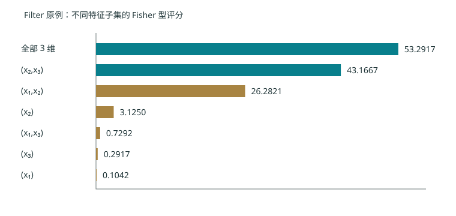
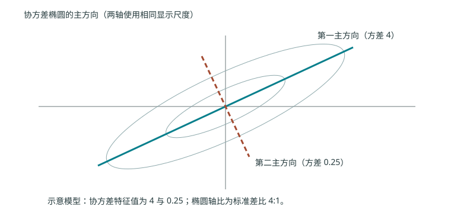

# 第七章 特征选择与降维：保留什么，舍弃什么

> 往年资料：S11 5–48 页（选择）；S12 4–43 页（线性降维与 PCA）、44–54 页（KPCA、LLE、NMF）。2026-10-30 已视觉核对 S11 5–8、15、40–45 页和 S12 36–38 页，并恢复三维 Filter 子集评价原例；本年度对应课件尚未提供。课件中的行列约定不统一，本章统一样本按行；其余概率距离与原表数值仍待逐项核验。

> **本章怎么读**：先建立直觉（“为什么高维会有问题、要保留/丢掉什么”），再读正式推导。本章所有非平凡公式都配有“过程讲解”：先讲假设、符号、维度，再写起始式，逐步展示代数中间步骤，最后说明结论与成立条件。统一符号见[学习指南](../guide.md)；本书 $X$ 按**行**放样本，与部分按列放样本的课件差一个转置。

---

## 7.1 选择原特征还是构造新特征 {#ml-07-01}

### 7.1.1 为什么高维会带来麻烦（直觉）

高维数据常常包含三类“没用”的特征：

- **无关特征**：与目标完全无关，只会引入噪声；
- **冗余特征**：与已有特征高度相关，信息重复；
- **噪声特征**：本身是随机扰动。

但有一个**常见误区**必须澄清：

> **记住**：某个特征“取值经常为零”或“方差很小”，**并不能证明它无用**。稀有事件往往最有辨识力——例如欺诈检测中，欺诈样本极少，其指示特征在绝大多数时刻为 0，但恰恰是最关键的特征。判断是否保留，要看它与标签/任务的关系，而不是单纯看它“动得勤不勤”。

维度过高还会带来两个实际困难：
1. **计算与存储**：模型复杂度、训练时间随维度上升；
2. **统计可靠性下降**：样本数固定时，维度越高，单位体积内样本越稀疏（“维度灾难”），估计出的模型越不可靠。

所以我们要回答一个核心问题：**保留什么，舍弃什么？**

### 7.1.2 两条路线：特征选择 vs 特征提取

| 路线 | 做法 | 输出含义 | 典型例子 |
| --- | --- | --- | --- |
| **特征选择** | 从原始 $d$ 个坐标里挑出 $q$ 个保留 | 仍是原始坐标，可解释 | 去掉“身高”换成只用“体重” |
| **特征提取（构造）** | 用变换把原始特征组合成新的 $q$ 个坐标 | 新坐标，通常是原特征的线性/非线性组合 | 把多个像素组合成一个投影分量（PCA 分量） |

两者**都能降维**，但输出的含义不同：

- 选择：保留的是“看得懂”的原始变量，便于向业务方解释（“我们用了年龄、收入两个特征”）。
- 提取：得到的是“合成变量”，解释性通常较差（“第一主成分”是各列的加权混合）。

**监督性差异**：特征选择可以利用标签（选“对分类最有帮助”的特征）；而 PCA 这类经典提取方法通常**只利用输入分布**（只看 $X$ 的形状，不看 $y$）。需要利用标签的提取方法见 7.4 的 LDA、7.5 的 KPCA 等。

### 7.1.3 一个小例子：噪声轴该不该留

设二维数据共有 4 个点（已中心化）：

$$(2,0.0),\ (1,-0.1),\ (-1,0.1),\ (-2,0.1)$$

横向（第 1 维）跨度约 $[-2,2]$，纵向（第 2 维）只在 $[-0.1,0.1]$ 抖动，几乎是常数。

- 若用**特征选择**：第 2 维方差极小，很可能被直接丢弃；保留第 1 维。
- 若用**PCA 提取**（见 7.3）：会自动找到沿横向的长轴作为第一主方向，把“横向信息”压缩到一维。

两种路线都“降到了一维”，但选择得到的是原始横坐标，提取得到的是长轴投影——含义不同，后续可解释性也不同。

---

## 7.2 子集生成与评价必须区分 {#ml-07-02}

### 7.2.1 子集选择有多少种可能（复杂度 $C(d,q)$）

**过程讲解：数一数子集个数**

- **假设与符号**：$d$ 个原始特征，要选出恰好 $q$ 个（$0<q<d$）。
- **起始式**：从 $d$ 个里挑 $q$ 个的组合数记为

$$C(d,q)=\binom{d}{q}=\frac{d!}{q!\ (d-q)!}.$$

- **逐步含义**：
  1. 第一个位置有 $d$ 种选法，第二个有 $d-1$ 种……共 $d(d-1)\cdots(d-q+1)=\frac{d!}{(d-q)!}$ 种有序排列；
  2. 但选出的 $q$ 个特征**没有顺序**（集合），同一集合被重复排了 $q!$ 次；
  3. 除以 $q!$ 得到无序子集数 $\binom{d}{q}$。
- **结论与增长**：子集总数（任意大小）为 $2^d-1$。当 $d=20,q=2$ 时 $\binom{20}{2}=190$ 还可穷举；当 $d=100,q=10$ 时 $\binom{100}{10}\approx1.73\times10^{13}$，**穷举完全不可行**。
- **成立条件**：这里指“恰好选 $q$ 个”的固定规模搜索；若允许任意大小，还要对所有 $q$ 求和，仍是 $2^d-1$ 量级。

**常见误区**：很多人以为“特征才几十个，穷举一下没关系”。事实上 $2^{20}\approx10^6$ 尚可，$2^{30}\approx10^9$ 已很吃力，$2^{50}$ 远超现实。所以大数据维下必须靠**启发式搜索**。

### 7.2.2 贪心搜索：SFS / SBS / 广义版本（逐步）

既然不能穷举，就用贪心：**每次只做局部最优**，但**不保证全局最优**。

**（a）前向序贯 SFS（Sequential Forward Selection）**

- 从空集 $F=\varnothing$ 开始。
- 每一步：对**尚未入选**的每个候选特征 $f$，计算“把 $f$ 加入 $F$ 后”的评价得分，选让得分提升最多的那个加入。
- 重复 $q$ 次，得到 $q$ 个特征。

> **过程讲解（SFS 第 $t$ 步）**：设当前已选集合 $F_{t-1}$（大小 $t-1$），候选集 $\overline F$。要解
> $$\hat f=\arg\max_{f\in\overline F}\ \mathrm{Score}(F_{t-1}\cup\{f\}).$$
> 这一步只需评估 $|\overline F|=d-(t-1)$ 个特征，总共约 $\sum_{t=1}^q(d-t+1)\approx dq$ 次评价，远小于 $\binom{d}{q}$。

**（b）后向序贯 SBS（Sequential Backward Selection）**：从全集 $F=\{1,\dots,d\}$ 开始，每一步删掉“删掉后得分下降最少”的特征，直到剩 $q$ 个。SBS 适合“特征间有强冗余”的情形（先拥有全部信息再逐步裁剪）。

**（c）广义/可逆版本（Plus-$L$-Minus-$R$，L-R）**：SFS 一旦选了某特征就**永远不能反悔**，早期错选会一直拖累结果。L-R 方法允许“增加 $L$ 个后，再删除 $R$ 个”，或反过来（删除后再加回），从而缓解“早期选择无法撤销”的问题。

**记住**：贪心搜索**没有全局最优保证**。它可能陷入次优子集——这与梯度下降可能停在非凸函数的局部极小是类似的思想。

### 7.2.3 Filter / Wrapper / Embedded 三种评价框架

| 框架 | 子集如何评分 | 适用考虑 |
| --- | --- | --- |
| **Filter**（过滤式） | 用数据本身的统计量：类间散度、概率可分性、互信息等 | 通常较快、与后续模型无关，但所选指标**未必等于**目标模型的最终效果 |
| **Wrapper**（包裹式） | 用指定模型在内部验证集上的表现（如交叉验证准确率） | 最贴近最终目标，但每评估一个子集就要**重训一次模型**，成本高 |
| **Embedded**（嵌入式） | 在模型训练过程中联合完成选择，如 LASSO 的 $L_1$ 正则、决策树的特征分裂 | 依赖具体模型与正则准则，兼顾效率与目标 |

**Filter 不是“每个特征独立排名”**：Filter 也可以对**整个子集**计算统计量（例如用子集的协方差矩阵算类间散度）。但最常见的“单变量排序滤子”有个经典陷阱：

> **常见误区（XOR 交互）**：两个**均匀二元**特征 $A,B$ 各自都与标签独立，但标签 $y=A\oplus B$（异或）却完全由二者**共同**决定。单变量 Filter 会同时丢掉 $A$ 和 $B$，漏掉关键交互。这说明：Filter 排名好 ≠ 子集最终效果好，必要时用 Wrapper 或能捕捉交互的模型兜底。

### 7.2.3a 往年课件原例：三维数据的 Filter 子集评分

> **来源性质**：S11 40–43 页，往年课件原例。课件用两类、每类 3 个三维样本，比较单特征、双特征和全部三特征的 Fisher 型评分。

两类数据为

$$
W_1=\begin{bmatrix}1&2&4\\3&3&5\\4&4&7\end{bmatrix},\qquad
W_2=\begin{bmatrix}2&7&6\\5&8&8\\6&9&9\end{bmatrix},
$$

每行一个样本，三列分别是 $x_1,x_2,x_3$。课件采用

$$J_2=\operatorname{tr}(S_W^{-1}S_B)$$

评价子集，其中 $S_W$ 是子集坐标下的类内散度矩阵，$S_B$ 是类间散度矩阵。若子集只有一维，式子退化为“类均值差平方 / 两类方差之和”。

课件列出的评分为：

| 子集 | $J_2$ |
| --- | ---: |
| $(x_1,x_2,x_3)$ | **53.2917** |
| $(x_2,x_3)$ | **43.1667** |
| $(x_1,x_2)$ | 26.2821 |
| $(x_2)$ | 3.1250 |
| $(x_1,x_3)$ | 0.7292 |
| $(x_3)$ | 0.2917 |
| $(x_1)$ | 0.1042 |

**逐步读结论**：

1. 单特征排名是 $J_2(x_2)>J_2(x_3)>J_2(x_1)$，所以若只能留一维，应选 $x_2$。
2. 若保留两维，不能只凭单变量排名猜结果，必须直接评价候选子集。本题 $(x_2,x_3)$ 的 43.1667 明显大于 $(x_1,x_2)$ 的 26.2821。
3. 三维全部保留时分数最高，但这不自动意味着泛化最好；维数增加也提高了模型复杂度，Wrapper 还要用验证误差检查。

> **数值约定**：散度矩阵是否除以样本数会改变 $J_2$ 的整体尺度，但在同一约定下比较子集的排序不变。复算时必须让所有候选子集采用同一归一化方式。

### 7.2.4 Bhattacharyya 距离：概率可分性的一种度量

S11 列出了 Bhattacharyya、Chernoff 等多种概率距离。它们的**名称、尺度、最优方向各不相同，不能都当成欧氏距离**。下面只细讲 Bhattacharyya，因为它是教材里最常被引用的一种。

**过程讲解：定义与基本性质**

- **假设与符号**：两类的概率密度（或质量）函数 $p(x), q(x)$，定义在同一样本空间上。
- **起始式**：Bhattacharyya 系数（Bhattacharyya coefficient）

$$BC(p,q)=\int \sqrt{p(x)\,q(x)}\,dx\qquad\text{（离散情形把积分换成求和）}.$$

- **逐步含义**：
  1. 被积函数 $\sqrt{p(x)q(x)}$ 同时被两类“同时有大概率”的区域拉高；两类越重叠，$BC$ 越接近 1。
  2. 由柯西-施瓦茨不等式可证 $0\le BC(p,q)\le 1$（离散时同理，因 $\sum\sqrt{pq}\le\sqrt{\sum p\sum q}=1$）。
  3. 取负对数得到 Bhattacharyya 距离

  $$D_B(p,q)=-\log BC(p,q)=-\log\int\sqrt{p(x)q(x)}\,dx.$$

- **结论与范围**：$D_B\in[0,+\infty)$。
  - 两类**完全重合**（$p=q$）时 $BC=1$，$D_B=0$；
  - 支撑**完全不交**时 $BC=0$，$D_B\to+\infty$。
- **成立条件**：积分/求和在整个样本空间上进行；$\log$ 默认自然对数（见统一符号表）。

**一维离散数值小例（自编例，未与 S11 原表核对）**：设两类在 $\{0,1\}$ 上的分布为

$$p=(0.5,\ 0.5),\qquad q=(0.9,\ 0.1).$$

则

$$BC=\sqrt{0.5\times0.9}+\sqrt{0.5\times0.1}=\sqrt{0.45}+\sqrt{0.05}\approx0.6708+0.2236=0.8944,$$

$$D_B=-\ln(0.8944)\approx0.1116.$$

可以看到两类有重叠（$q$ 在 0 处概率更高），所以 $D_B$ 是一个较小但为正的数。

> **补充（标准结果，自编补充，未与 S11 原表逐项核对）**：当 $p,q$ 均为高斯分布 $p=\mathcal N(\boldsymbol\mu_1,\Sigma_1),\ q=\mathcal N(\boldsymbol\mu_2,\Sigma_2)$ 时，Bhattacharyya 距离有闭式

$$D_B=\frac18(\boldsymbol\mu_1-\boldsymbol\mu_2)^T\Sigma^{-1}(\boldsymbol\mu_1-\boldsymbol\mu_2)+\frac12\ln\frac{\det\Sigma}{\sqrt{\det\Sigma_1\det\Sigma_2}},\qquad \Sigma=\frac{\Sigma_1+\Sigma_2}{2}.$$

> 该式是教科书标准结果；本章不声称已与 S11 具体页码数值逐项核验（见顶部来源说明）。

**Chernoff 距离**（一并提及）：更一般的形式为

$$D_C(\lambda)=-\log\int p(x)^\lambda q(x)^{1-\lambda}dx,\qquad \lambda\in(0,1).$$

当 $\lambda=\tfrac12$ 时即为 Bhattacharyya 距离，所以 Bhattacharyya 是 Chernoff 在 $\lambda=1/2$ 处的特例。

### 7.2.5 Relief：用“近邻”给特征打分的直观方法

Relief 的思路很贴近直觉：对抽到的每个样本，找**同类最近邻（hit）**和**异类最近邻（miss）**。一个“好特征”应当满足：

- 在**同类**样本间变化小（hit 在该特征上接近）；
- 在**异类**样本间变化大（miss 在该特征上远离）。

于是该特征的评分应增加。对连续特征 $m$，一次更新大致是

$$W_m\leftarrow W_m-\frac{\mathrm{diff}(x_{i,m},x_{\mathrm{hit},m})}{R_m}+\frac{\mathrm{diff}(x_{i,m},x_{\mathrm{miss},m})}{R_m},$$

其中 $R_m$ 是第 $m$ 个特征的取值跨度（用于归一化），$\mathrm{diff}$ 取绝对差。**注意**：具体差异函数必须与连续/离散特征类型匹配；抽样方式、归一化、多类扩展都需要明确设定，Relief 本身只是一种启发式，不是最优准则。

**Relief 迷你例（自编例）**：两个特征、三个样本

| 样本 | 特征 $x$ | 特征 $y$ | 标签 |
| --- | --- | --- | --- |
| A | 0 | 0 | + |
| B | 1 | 0 | − |
| C | 0 | 5 | + |

考察样本 A（标签 +）：
- 同类最近邻是 C：特征 $x$ 差为 $|0-0|=0$，特征 $y$ 差为 $|0-5|=5$；
- 异类最近邻是 B：特征 $x$ 差为 $|0-1|=1$，特征 $y$ 差为 $|0-0|=0$。

按上面的更新方向：
- 特征 $x$ 的增量 $\propto -0+1=+1$（有判别力，得分上升）；
- 特征 $y$ 的增量 $\propto -5+0=-5$（同类反而差很多，得分下降）。

Relief 会**更看重 $x$ 而非 $y$**——这与“$y$ 在同类间剧烈变化、在异类间相同”的事实一致。

---

## 7.3 PCA 从最大投影方差推出 {#ml-07-03}

PCA（主成分分析）的目标：**找一组互相垂直的方向，让数据投影到这些方向后的方差最大**。方差大意味着“沿这个方向数据铺得开、信息多”。

### 7.3.1 第一主方向的完整推导

**过程讲解（最大化投影方差）**

- **假设与符号**
  - $X\in\mathbb R^{N\times d}$：行放样本，共 $N$ 个、维度 $d$。
  - 已按训练均值**中心化**：每列均值为 0，即 $\frac1N\mathbf 1^TX=\mathbf 0$（$\mathbf 1$ 为全 1 向量）。
  - $S=\dfrac1N X^TX\in\mathbb R^{d\times d}$：按 $N$ 归一化的样本协方差矩阵，对称半正定。
  - 方向向量 $\mathbf w\in\mathbb R^d$，要求单位长度 $\mathbf w^T\mathbf w=1$。
- **步骤 1（写投影坐标）**：第 $i$ 个样本投影为 $(X\mathbf w)_i=\mathbf x_i^T\mathbf w$；全体投影是列向量 $X\mathbf w\in\mathbb R^N$。
- **步骤 2（写投影方差）**：因已中心化，投影后均值也为 0，故方差等于均值平方：

$$\frac1N\|X\mathbf w\|^2=\frac1N(X\mathbf w)^T(X\mathbf w)=\frac1N\mathbf w^TX^TX\mathbf w=\mathbf w^T\!\left(\frac{X^TX}{N}\right)\!\mathbf w=\mathbf w^TS\mathbf w.$$

- **步骤 3（为什么必须加约束）**：若不限制长度，把 $\mathbf w$ 放大 $c$ 倍，方差就变成 $c^2\mathbf w^TS\mathbf w$，可任意增大——但这**不是方向变了，只是长度变了**。因此固定 $\|\mathbf w\|=1$。
- **步骤 4（构造拉格朗日函数）**：最大化 $f(\mathbf w)=\mathbf w^TS\mathbf w$，约束 $g(\mathbf w)=\mathbf w^T\mathbf w-1=0$：

$$\mathcal L(\mathbf w,\lambda)=\mathbf w^TS\mathbf w-\lambda(\mathbf w^T\mathbf w-1).$$

- **步骤 5（对 $\mathbf w$ 求梯度并令为 0）**：先展开 $\mathbf w^TS\mathbf w=\sum_{a,b}w_aS_{ab}w_b$。对第 $c$ 个分量求偏导（利用 $S$ 对称，$S_{ac}=S_{ca}$）：

$$\frac{\partial}{\partial w_c}(\mathbf w^TS\mathbf w)=\sum_b S_{cb}w_b+\sum_a w_aS_{ac}=(S\mathbf w)_c+(S\mathbf w)_c=2(S\mathbf w)_c.$$

故 $\nabla_{\mathbf w}(\mathbf w^TS\mathbf w)=2S\mathbf w$；同理 $\nabla_{\mathbf w}(\mathbf w^T\mathbf w)=2\mathbf w$。令梯度为 0：

$$2S\mathbf w-2\lambda\mathbf w=\mathbf 0\quad\Longrightarrow\quad S\mathbf w=\lambda\mathbf w.$$

- **步骤 6（解释结论）**：驻点处 $\mathbf w$ 是 $S$ 的**单位特征向量**，$\lambda$ 是其特征值。代回目标：

$$\mathbf w^TS\mathbf w=\mathbf w^T(\lambda\mathbf w)=\lambda\,\mathbf w^T\mathbf w=\lambda.$$

所以**最大方差方向 = 最大特征值对应的单位特征向量**，该方向携带的方差正是 $\lambda_1$。
- **步骤 7（多方向）**：第二主方向在与第一方向正交的子空间里重复上述最大化，得到第二大特征值对应的特征向量；依次得到全部（秩数以内）主方向。
- **步骤 8（取前 $q$ 个并投影/重构）**：令 $W\in\mathbb R^{d\times q}$ 的列为前 $q$ 个**单位、互相正交**的特征向量，则

$$Z=XW\in\mathbb R^{N\times q},\qquad \widehat X=ZW^T=XWW^T.$$

> 若原始数据**未**中心化，重构时还要把样本均值加回去：$\widehat{\mathbf x}_i=\widehat{\mathbf x}_i^{(\text{中心化})}+\boldsymbol\mu$。

- **成立条件**：$X$ 已中心化。若改用 $\frac1{N-1}X^TX$（无偏样本协方差），**主方向完全相同**，特征值仅差 $N/(N-1)$ 的比例因子，不影响方向排序与解释方差比例。

### 7.3.2 解释方差比例

第 $j$ 个主成分对应的方差是特征值 $\lambda_j$。前 $q$ 个主成分解释的方差比例为

$$\text{ExplainedRatio}(q)=\frac{\sum_{j=1}^q\lambda_j}{\sum_{j=1}^d\lambda_j}.$$

- 分母 $\sum_{j=1}^d\lambda_j=\operatorname{tr}(S)$ 等于**所有原始特征方差之和**（因 $S$ 已中心化，对角线就是各特征方差）。
- **常见误区**：分母为零（所有样本完全相同，无任何变异）时该比值**无定义**；实际中若某特征恒为常数，要先剔除或单独处理。
- 实践上常选最小的 $q$ 使比例达到例如 90%–95%，以此在“保信息”和“降维”间折中。

### 7.3.3 已有例题（保留并核验）

**自编例**：已中心化点 $(-2,0),(-1,0),(1,0),(2,0)$。

核验 $S$：设计矩阵（行放样本）

$$X=\begin{bmatrix}-2&0\\-1&0\\1&0\\2&0\end{bmatrix},\quad X^TX=\begin{bmatrix}10&0\\0&0\end{bmatrix},\quad N=4,$$

故

$$S=\frac1N X^TX=\operatorname{diag}(2.5,\ 0).$$

- 特征值 $\lambda_1=2.5,\ \lambda_2=0$。第一主方向是对应 $\lambda_1$ 的单位特征向量 $(1,0)^T$，即沿横轴。
- 取第一主成分 $Z=X(1,0)^T=(-2,-1,1,2)^T$，重构 $\widehat X=ZW^T$ 恰好还原原数据，**一维投影无重构损失**。
- **但注意结论的局限**：该数据集在纵轴（第 2 维）方差为 0，完全不含信息。然而“最大方差方向”并不保证“对分类最有用”——**若标签只由某个小方差方向决定**（例如标签实际取决于纵坐标，而这里纵坐标恒为 0，是退化情形），最大方差方向未必是最佳判别方向。这正是 PCA 与 7.4 的 LDA 的根本区别之一。

### 7.3.4 第二个数值小例：非退化情形

为展示 PCA 如何挑出“长轴”，看四个已中心化点：

$$(2,0.1),\ (1,-0.1),\ (-1,0.1),\ (-2,-0.1).$$

设计矩阵

$$X=\begin{bmatrix}2&0.1\\1&-0.1\\-1&0.1\\-2&-0.1\end{bmatrix},\quad X^TX=\begin{bmatrix}10&0.2\\0.2&0.04\end{bmatrix},$$

$$S=\frac1N X^TX=\begin{bmatrix}2.5&0.05\\0.05&0.01\end{bmatrix}\quad(N=4).$$

- 迹 $\operatorname{tr}(S)=2.51$，行列式 $\det(S)=2.5\times0.01-0.05^2=0.0225$。
- 特征值：$\lambda_{1,2}=\frac{2.51\pm\sqrt{2.51^2-4\times0.0225}}{2}=\frac{2.51\pm\sqrt{6.2101}}{2}\approx\frac{2.51\pm2.492}{2}$，即 $\lambda_1\approx2.501,\ \lambda_2\approx0.009$。
- 第一主成分解释方差比例 $\approx 2.501/2.51\approx 99.6\%$——几乎全部信息都在横向长轴上，纵向只是微小抖动。这正是 PCA “沿最大铺开方向投影” 的直观体现。

观察下图：PCA 选取的是方差较大的方向（斜向/长轴），而不是某条预先规定的坐标轴。

---

## 7.4 中心化、标准化、SVD 与 LDA {#ml-07-04}

### 7.4.1 中心化 ≠ 标准化（务必区分）

- **中心化（centering）**：每列减去该列均值，使均值变为 0。只改变位置，不改变尺度。
- **标准化（standardization / z-score）**：先中心化，再除以该列标准差，使每列均值 0、方差 1。

> **常见误区**：部分课件把“减均值”也叫“标准化”。本书**明确区分**二者——标准化一定包含减均值，但减均值不等于标准化。

**何时用哪种？**
- 单位不同又希望平等比较（如“身高(米)”与“体重(千克)”）时，可先标准化，避免量纲大的特征在距离/方差中占主导。
- 若幅值本身就有意义（如“像素亮度 0–255”的某种物理含义），就不一定该缩放。
- **PCA 对缩放敏感**：标准化与否，主方向可能完全不同。务必在训练流程内、用训练集统计量来做，见 7.6。

### 7.4.2 SVD 与 PCA 的联系（逐步推导）

**过程讲解：从 SVD 得到主方向**

- **假设与符号**：$X\in\mathbb R^{N\times d}$ 已中心化，其**截断**奇异值分解为

$$X=U\Sigma V^T,$$

其中 $U\in\mathbb R^{N\times r},\ \Sigma\in\mathbb R^{r\times r}$（对角，奇异值 $\sigma_1\ge\sigma_2\ge\cdots>0$），$V\in\mathbb R^{d\times r}$，且 $U^TU=I,\ V^TV=I$，$r=\operatorname{rank}(X)$。
- **步骤 1（写出 $X^TX$）**：

$$X^TX=(U\Sigma V^T)^T(U\Sigma V^T)=V\Sigma^T U^T U\Sigma V^T.$$

- **步骤 2（用正交性化简）**：因为 $U^TU=I$，所以

$$X^TX=V\Sigma^T\Sigma V^T.$$

- **步骤 3（认出特征分解）**：$\Sigma^T\Sigma$ 是 $r\times r$ 对角矩阵，对角元为 $\sigma_j^2$。于是

$$X^TX=V\operatorname{diag}(\sigma_1^2,\dots,\sigma_r^2)V^T.$$

- **步骤 4（与 $S$ 对照）**：$S=\frac1N X^TX$，故

$$S=V\operatorname{diag}\!\left(\frac{\sigma_1^2}{N},\dots,\frac{\sigma_r^2}{N}\right)V^T.$$

- **结论**：
  1. **主方向 = $V$ 的列**（单位特征向量）；
  2. **协方差特征值 $\lambda_j=\sigma_j^2/N$**；
  3. 前 $q$ 个主成分方向就是 $V$ 的前 $q$ 列，与 7.3 用 $S$ 直接做特征分解完全一致。

> **记住（SVD 奇异值 ≠ 方差）**：奇异值 $\sigma_j$ 的**平方除以 $N$** 才是方差 $\lambda_j$。直接用 $\sigma_j$ 当“方差”是常见错误。以 7.3.3 的例子验证：$X^TX=\operatorname{diag}(10,0)$，故奇异值 $\sigma_1=\sqrt{10}\approx3.162$，而方差为 $\lambda_1=10/4=2.5$——“奇异值 3.162”和“方差 2.5”显然不是一回事。

### 7.4.3 LDA：利用标签的降维，与 PCA 的区别

线性判别分析（LDA）通过解广义特征值问题寻找判别方向：

$$S_B\mathbf w=\lambda S_W\mathbf w,$$

其中 $S_W$（类内散度）度量“同类样本有多紧凑”，$S_B$（类间散度）度量“不同类的均值离得多远”。详细二分类推导见[第三章](03-linear.md#ml-03-05)。

**关键事实：判别方向数 $\le \min(d,K-1)$**

**过程讲解（为什么最多 $K-1$ 个方向）**

- **假设与符号**：$K$ 个类别，第 $k$ 类均值 $\boldsymbol\mu_k$，总体均值 $\boldsymbol\mu$，$S_B=\sum_{k=1}^K n_k(\boldsymbol\mu_k-\boldsymbol\mu)(\boldsymbol\mu_k-\boldsymbol\mu)^T$。
- **步骤 1**：$S_B$ 是 $K$ 个**秩至多 1** 的外积矩阵之和，故 $\operatorname{rank}(S_B)\le K$。
- **步骤 2**：但这些外积都落在“各类均值相对总体均值的差向量”张成的空间里，而 $\sum_k n_k(\boldsymbol\mu_k-\boldsymbol\mu)=\mathbf 0$，所以这些差向量**至多只有 $K-1$ 个线性无关**。
- **步骤 3**：因此 $\operatorname{rank}(S_B)\le K-1$，广义特征值问题 $S_B\mathbf w=\lambda S_W\mathbf w$ **最多只有 $K-1$ 个非零特征值**，即最多 $K-1$ 个非零判别方向。
- **结论**：LDA 可用方向数上界为 $\min(d,\ K-1)$。这**不是** PCA 的维数上限——PCA 在 $S$ 满秩时最多可有 $d$ 个主方向。

**PCA vs LDA 的核心区别（先睹，详见 7.6 对照表）**：

| | PCA | LDA |
| --- | --- | --- |
| 是否用标签 | 否（无监督） | 是（监督） |
| 优化目标 | 最大投影方差 | 类间/类内散度比最大 |
| 方向数上限 | $\le \operatorname{rank}(S)\le d$ | $\le\min(d,K-1)$ |
| 适合场景 | 去相关、压缩、可视化 | 分类前的判别降维 |

---

## 7.5 KPCA、LLE 和非负矩阵分解 {#ml-07-05}

### 7.5.1 核 PCA（KPCA）：在隐式特征空间做 PCA

KPCA 的思想：把样本通过非线性映射 $\Phi(\cdot)$ 送到高维（甚至无限维）特征空间，再在那个空间里做普通 PCA。我们**不需要显式写出 $\Phi$**，只需核函数 $k(\mathbf x_i,\mathbf x_j)=\langle\Phi(\mathbf x_i),\Phi(\mathbf x_j)\rangle$。

**过程讲解（核矩阵中心化 $K_c=HKH$）**

- **假设与符号**：核矩阵 $K\in\mathbb R^{N\times N}$，$K_{ij}=k(\mathbf x_i,\mathbf x_j)$；$\mathbf 1\in\mathbb R^N$ 为全 1 向量，$\mathbf 1\mathbf 1^T$ 是 $N\times N$ 全 1 矩阵；

$$H=I_N-\frac1N\mathbf 1\mathbf 1^T.$$

- **步骤 1（为什么中心化在特征空间也要做）**：PCA 要求数据中心化。在特征空间，中心化后的映射为 $\Phi_c(\mathbf x_i)=\Phi(\mathbf x_i)-\frac1N\sum_{j=1}^N\Phi(\mathbf x_j)$。
- **步骤 2（写出中心化核矩阵）**：中心化后的 Gram 矩阵为

$$K_c=(H\Phi)(H\Phi)^T=H\,\Phi\Phi^T\,H.$$

而 $\Phi\Phi^T$ 的 $(i,j)$ 元正是 $\langle\Phi(\mathbf x_i),\Phi(\mathbf x_j)\rangle=K_{ij}$，故

$$K_c=HKH.$$

- **步骤 3（验证 $H$ 的性质，说明中心化可一步完成）**：
  - 对称性：$H^T=(I-\frac1N\mathbf 1\mathbf 1^T)^T=I-\frac1N\mathbf 1\mathbf 1^T=H$。
  - 幂等性：令 $M=\frac1N\mathbf 1\mathbf 1^T$，则 $M^2=\frac1{N^2}\mathbf 1(\mathbf 1^T\mathbf 1)\mathbf 1^T=\frac1{N^2}\mathbf 1\,(N)\,\mathbf 1^T=M$，于是

  $$H^2=(I-M)^2=I-2M+M^2=I-2M+M=I-M=H.$$

  所以 $HKH$ 只做一次居中操作，结果仍是“已中心化”的核矩阵。
- **步骤 4（实用展开式）**：把 $K_c=HKH=(I-M)K(I-M)=K-MK-KM+MKM$ 写成分量：

$$K_c(i,j)=K(i,j)-\frac1N\sum_{l=1}^N K(l,j)-\frac1N\sum_{l=1}^N K(i,l)+\frac1{N^2}\sum_{l,m=1}^N K(l,m).$$

即“原核 − 行平均 − 列平均 + 总平均”。这一式只用原始 $K$ 就能算，不必碰 $\Phi$。
- **步骤 5（求主分量与训练投影）**：对中心化核矩阵做特征分解

$$K_c\mathbf v=\lambda\mathbf v,\qquad \lambda>0,\ \|\mathbf v\|=1.$$

（这里的 $\lambda$ 是 $K_c$ 的特征值，与 7.3 中 $S$ 的特征值 $\lambda$ 含义不同，注意区分。）训练数据在该主分量上的坐标为

$$\mathbf z=\sqrt{\lambda}\,\mathbf v\in\mathbb R^N.$$

- **步骤 6（新样本也必须中心化）**：对测试点 $\mathbf x$，其与训练样本的核向量为 $\mathbf k(\mathbf x)=[k(\mathbf x_1,\mathbf x),\dots,k(\mathbf x_N,\mathbf x)]^T$。**不能直接拿未中心化的 $\mathbf k$ 投影**，而要先按训练集统计做同样的中心化：

$$k_c(\mathbf x_i)=k(\mathbf x_i,\mathbf x)-\frac1N\sum_{l=1}^N k(\mathbf x_l,\mathbf x)-\frac1N\sum_{l=1}^N K(i,l)+\frac1{N^2}\sum_{l,m=1}^N K(l,m).$$

得到中心化核向量 $\mathbf k_c(\mathbf x)\in\mathbb R^N$ 后，投影坐标为

$$z(\mathbf x)=\frac{1}{\sqrt{\lambda}}\,\mathbf v^T\mathbf k_c(\mathbf x).$$

> **常见误区**：省略“新点中心化”是 KPCA 最常见的实现错误——训练时减的是训练集均值，测试点必须用**同一套**训练统计来中心化，否则投影不再在同一坐标系。

### 7.5.2 局部线性嵌入（LLE）：保持局部重构关系

LLE 假设：每个点都可由它的近邻**线性重构**；降维后要**保持同一组权重**，从而保持局部几何。

**过程讲解（第一步：求重构权重）**

- **假设与符号**：对每个 $\mathbf x_i$，取近邻集合 $N(i)$；权重 $w_{ij}$ 在非近邻处固定为 0，且每行满足 $\sum_j w_{ij}=1$。
- **步骤 1（写重构误差）**：

$$\varepsilon(W)=\sum_{i=1}^N\left\|\mathbf x_i-\sum_{j\in N(i)}w_{ij}\mathbf x_j\right\|^2.$$

- **步骤 2（化简）**：令 $\mathbf z_j=\mathbf x_j-\mathbf x_i$，则

$$\mathbf x_i-\sum_j w_{ij}\mathbf x_j=\mathbf x_i-\Big(\sum_j w_{ij}\Big)\mathbf x_i-\sum_j w_{ij}\mathbf z_j=-\sum_j w_{ij}\mathbf z_j$$

（用到 $\sum_j w_{ij}=1$）。于是误差化为

$$\varepsilon_i=\left\|\sum_{j\in N(i)}w_{ij}\mathbf z_j\right\|^2=\mathbf w_i^T G_i\mathbf w_i,$$

其中 $(G_i)_{jl}=(\mathbf x_j-\mathbf x_i)^T(\mathbf x_l-\mathbf x_i)$ 是局部 $k\times k$ Gram 矩阵。
- **步骤 3（带约束最小化）**：对 $\mathbf w_i$ 最小化 $\mathbf w_i^T G_i\mathbf w_i$，约束 $\mathbf 1^T\mathbf w_i=1$。拉格朗日函数

$$\mathcal L=\mathbf w_i^T G_i\mathbf w_i-\mu(\mathbf 1^T\mathbf w_i-1).$$

求梯度：$2G_i\mathbf w_i-\mu\mathbf 1=\mathbf 0\Rightarrow G_i\mathbf w_i=\frac{\mu}{2}\mathbf 1$。记 $\alpha=\mu/2$，得 $\mathbf w_i=\alpha G_i^{-1}\mathbf 1$。代入约束：

$$\mathbf 1^T\mathbf w_i=\alpha\,\mathbf 1^T G_i^{-1}\mathbf 1=1\quad\Longrightarrow\quad \alpha=\frac{1}{\mathbf 1^T G_i^{-1}\mathbf 1}.$$

- **结论（闭式解）**：

$$\mathbf w_i=\frac{G_i^{-1}\mathbf 1}{\mathbf 1^T G_i^{-1}\mathbf 1}.$$

（若 $G_i$ 奇异，通常用正则化 $G_i+\varepsilon I$ 处理。）

**过程讲解（第二步：在低维保持权重）**

- **步骤 4（写低维保持目标）**：设低维坐标 $Y\in\mathbb R^{N\times q}$（行放点），希望

$$\min_Y\sum_{i=1}^N\left\|\mathbf y_i-\sum_j w_{ij}\mathbf y_j\right\|^2=\operatorname{tr}\big(Y^T(I-W)^T(I-W)Y\big).$$

记 $M=(I-W)^T(I-W)\in\mathbb R^{d\times d}$（注意此处 $W$ 是 $N\times N$ 的权重矩阵，非 7.3 的投影矩阵）。
- **步骤 5（为什么需要额外约束）**：若不加约束，令所有 $\mathbf y_i$ 等于同一常数 $\mathbf c$，则 $\mathbf y_i-\sum_j w_{ij}\mathbf y_j=\mathbf c-\mathbf c\sum_j w_{ij}=\mathbf 0$，损失为 0——所有点**塌缩成一个点**，毫无意义。因此必须加“零均值、单位协方差”类约束（常写作 $Y^TY=N I$ 或对坐标做正交归一）。
- **步骤 6（取特征向量）**：在约束下，最小化 $\operatorname{tr}(Y^TMY)$ 的解 $Y$ 由 $M$ 的**最小特征值**对应的特征向量给出。但要**排除平凡常数方向**：因为全 1 向量是 $M$ 的零特征值特征向量（对应塌缩解）。所以最终取 $M$ 的**最小 $q$ 个非零特征值**对应的特征向量（即第 2 到第 $q+1$ 小特征值方向）作为低维嵌入。

> **记住**：LLE 是**无监督、流形式**的降维，擅长保持“局部邻域结构”；它对近邻数 $k$ 敏感，且对噪声、数据采样密度不均较脆弱。

### 7.5.3 非负矩阵分解（NMF）：加性部件表示

对非负数据 $X\ge 0$（$X\in\mathbb R_+^{N\times d}$），寻找

$$X\approx AB,\qquad A\in\mathbb R_+^{N\times q},\ B\in\mathbb R_+^{q\times d},$$

其中“非负”指所有元素 $\ge 0$。

- **目标函数（两种常见选择）**：
  - **Frobenius 误差**：$\min_{A,B\ge0}\|X-AB\|_F^2$；
  - **广义 KL 散度**：$\min_{A,B\ge0}D_{KL}(X\|AB)$。
  - **记住**：二者**更新公式不同**，不能混用；教材/代码务必确认用的是哪一种。
- **为什么“非负”有用（直觉）**：非负约束下，原数据被表示成若干**非负基的加权和**（如一张脸 = “鼻子部件”+“眼睛部件”+… 的正向叠加），这比 PCA 的“可正可负”组合更接近“部件相加”的人类直觉，因此常产生**加性部件表示**，便于解释。
- **常见误区**：NMF 的优化是**非凸**的，初始值不同常得到不同解；解通常**不唯一**（缩放/置换等价）。它不是 PCA 的“非负版等价物”，而是另一条建模路线。

### 7.5.4 任何降维都必须在训练折内拟合（数据泄漏警告）

> **记住**：标准化、PCA、特征选择、KPCA 等的参数（均值、标准差、$W$、$K_c$ 的中心化统计、被选特征子集……）都**只能从训练数据学习**。若先对**全数据**做 PCA 再划分训练/验证去交叉验证，验证集的分布信息会“漏”进训练，评估结果过于乐观。正确流程：在每一个训练折内独立拟合变换，再应用到验证/测试折。

---

## 7.6 方法对照与选择指南 {#ml-07-06}

### 7.6.1 一张速查表

| 方法 | 监督？ | 核心思想 | 输出 | 方向/部件数上限 | 典型用途 |
| --- | --- | --- | --- | --- | --- |
| 特征选择（Filter/Wrapper/Embedded） | 可监督 | 挑原始坐标子集 | 原始特征子集 | $q$（人为设定） | 可解释性优先、预处理 |
| PCA | 否 | 最大投影方差 | 正交主成分 | $\le\operatorname{rank}(S)\le d$ | 去相关、压缩、可视化 |
| LDA | 是 | 类间/类内散度比最大 | 判别方向 | $\le\min(d,K-1)$ | 分类前降维 |
| KPCA | 可监督（核可含标签信息） | 特征空间 PCA | 非线性主成分 | 同 PCA（核空间） | 线性 PCA 不够时的非线性结构 |
| LLE | 否 | 保持局部线性重构权重 | 流形坐标 | $q$（人为设定） | 流形/非线性结构可视化 |
| NMF | 否 | 非负加性组合 | 非负基与系数 | $q$（人为设定） | _parts-based_ 可解释表示（如图像） |

### 7.6.2 怎么选（决策要点）

1. **要可解释、保留原始变量含义** → 用特征选择（Filter 快、Wrapper 准、Embedded 兼顾）。
2. **无标签、想压缩/去相关/先看数据主轴** → PCA（必要时先标准化）。
3. **有标签、目标是分类降维** → LDA；注意方向数受 $\min(d,K-1)$ 限制。
4. **线性方法抓不住结构（如环形、瑞士卷）** → 试 KPCA（选核）或 LLE（选近邻数 $k$）。
5. **数据天然非负、想要“部件相加”式解释** → NMF。
6. **维度灾难来自无关/冗余特征且模型对维度敏感** → 先做选择或 PCA 再训练。

### 7.6.3 流程顺序红线（再强调）

- 中心化/标准化、PCA/KPCA 拟合、特征选择——**全部只在训练折内完成**；
- 新样本（测试/部署）用**训练阶段学到的同一套参数**做同样变换；
- 随机性实验固定种子；手算示例用确定性小数据，不靠一次随机运行下结论。

> 相关练习与自测见[练习](../exercises.md)；回到来源页段时，请分清“课件已讲内容”与“编者补充推导”。
