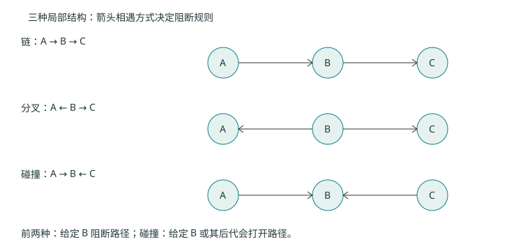

# 第九章 概率图模型：把联合分布拆成局部关系

> 往年资料：S14（69 页）与 S15（80 页）。主题包括有向／无向图、学习、推断、HMM、CRF。本章先建立核心推导；原课件草坪表、结构学习图例及全部采样图仍待视觉复核，不宣称逐页完整覆盖。

## 9.1 图首先是一组分解与独立性假设 {#ml-09-01}

$d$ 个二元变量的任意联合分布需要 $2^d-1$ 个自由参数。图模型通过局部关系减少参数、组织推断。节点是随机变量，边表达模型允许的直接依赖；仅从有向箭头不能自动推断现实因果。

贝叶斯网络采用有向无环图，按拓扑顺序分解

$$p(x_1,\ldots,x_d)=\prod_{i=1}^dp(x_i\mid\operatorname{pa}(x_i)).$$

$\operatorname{pa}(x_i)$ 是父节点取值集合。朴素贝叶斯是类别节点指向各特征的特殊网络：$p(c,\mathbf x)=p(c)\prod_jp(x_j\mid c)$。

## 9.2 三种局部结构与 d 分离 {#ml-09-02}

在链 $A\to B\to C$ 与分叉 $A\leftarrow B\to C$ 中，给定中间节点 $B$ 会阻断这条路径。碰撞结构 $A\to B\leftarrow C$ 则相反：未观测碰撞点及其后代时路径阻断，给定碰撞点或其后代会打开路径。这解释了“知道共同结果以后，两个原因可能相关”。

自编碰撞例：两个独立公平二元变量 $A,C$，令 $B=A\lor C$。原先 $P(A=1)=1/2$；已知 $B=1$ 后三个可能组合等概率，$P(A=1\mid B=1)=2/3$；再知道 $C=1$ 后，$P(A=1\mid B=1,C=1)=1/2$。知道一个原因，改变了对另一个原因的推断。

一般图中要检查所有路径：非碰撞节点被条件化会阻断，碰撞节点及其后代均未被条件化也会阻断。当所有路径均阻断时，才得到 d 分离蕴含的条件独立。单一路径的结论不能替代整张图的检查。

## 9.3 马尔可夫随机场 {#ml-09-03}

无向图把联合分布写成团上的非负势函数乘积：

$$p(\mathbf x)=\frac1Z\prod_{C}\psi_C(\mathbf x_C),\qquad Z=\sum_{\mathbf x}\prod_C\psi_C(\mathbf x_C).$$

势函数不必是概率，也不必各自归一化；$Z$ 才让整个分布归一化，连续变量时改为积分。给定分隔两部分的节点后，两部分条件独立。严格正分布下，图的马尔可夫性质与团分解有标准等价关系；有零概率配置时需谨慎处理前提。

贝叶斯网络的局部条件表各自归一化，MRF 的归一化通常是全局计算，可能很昂贵。二者能表达的独立性结构也不完全相同。

## 9.4 学习、精确推断与采样 {#ml-09-04}

学习是由数据确定参数或图结构；推断是模型确定后计算边缘、条件分布或最可能配置。不能把“求参数”与“给观测求隐变量”混为同一步。

变量消去通过重新排列求和与乘法避免枚举全部变量。若 $p(a,b,c)=p(a)p(b\mid a)p(c\mid b)$，求 $p(c)$ 可先算 $m(b)=\sum_ap(a)p(b\mid a)$，再算 $\sum_bm(b)p(c\mid b)$。更大图的中间因子可能很大，复杂度取决于消去顺序和图结构，不只是节点数。

树上的和积／信念传播可把局部消息组织为精确边缘计算；带环消息迭代通常只作为近似，不保证精确或收敛。前向采样按拓扑顺序生成；若先观察罕见证据再拒绝不匹配样本，效率可能很低。Gibbs 每次从一个变量在其余变量给定下的条件分布采样，需要讨论链的可达性、收敛及相关样本的有效数量。

隐变量参数学习常用 EM。由恒等式

$$\log p_\theta(x)=E_q\log\frac{p_\theta(x,z)}{q(z)}+D_{KL}(q(z)\|p_\theta(z\mid x))$$

得到下界。E 步取当前后验 $q=p_{\theta^{old}}(z\mid x)$ 使下界贴紧；M 步提高对参数的下界。在准确 E 步和有效 M 步下观测似然不降，但仍可能停在局部最优。近似步骤不自动继承同样保证。

## 9.5 HMM：用动态规划求序列概率 {#ml-09-05}

隐藏状态 $z_t\in\{1,\ldots,K\}$，观测 $x_t$。初始概率 $\pi_j=P(z_1=j)$，转移 $a_{ij}=P(z_t=j\mid z_{t-1}=i)$，发射 $b_j(x)=p(x_t=x\mid z_t=j)$。一阶状态依赖和给定状态后的观测独立性给出

$$p(\mathbf x,\mathbf z)=\pi_{z_1}b_{z_1}(x_1)\prod_{t=2}^Ta_{z_{t-1},z_t}b_{z_t}(x_t).$$

前向量 $\alpha_t(j)=p(x_{1:t},z_t=j)$ 把所有以状态 $j$ 结束的路径加起来：

$$\alpha_1(j)=\pi_jb_j(x_1),\qquad\alpha_t(j)=b_j(x_t)\sum_i\alpha_{t-1}(i)a_{ij}.$$

最终 $p(\mathbf x)=\sum_j\alpha_T(j)$。后向量 $\beta_t(i)=p(x_{t+1:T}\mid z_t=i)$ 满足 $\beta_T(i)=1$ 与 $\beta_t(i)=\sum_ja_{ij}b_j(x_{t+1})\beta_{t+1}(j)$。故状态后验与 $\alpha_t(j)\beta_t(j)$ 成正比。

寻找**整条最可能路径**时，将前向递推中的求和改为最大值并保存回溯指针，即 Viterbi。逐时刻选择边缘后验最大状态不保证形成最可能的整体路径。长序列需要缩放或 log-sum-exp 避免下溢。

EM 学习中使用 $\gamma_t(i)=P(z_t=i\mid\mathbf x)$ 与 $\xi_t(i,j)=P(z_t=i,z_{t+1}=j\mid\mathbf x)$。更新 $\pi_i=\gamma_1(i)$，$a_{ij}=\sum_{t<T}\xi_t(i,j)/\sum_{t<T}\gamma_t(i)$；离散发射概率为状态相关期望计数的归一化。分母为零、多个序列和连续发射模型需要各自处理。

## 9.6 CRF：直接建模条件序列分布 {#ml-09-06}

HMM 建模联合分布 $p(\mathbf x,\mathbf y)$；CRF 直接建模标签序列给定观测的条件分布。线性链形式可以写成

$$p(\mathbf y\mid\mathbf x)=\frac1{Z(\mathbf x)}\exp\left[\sum_t\sum_jw_jf_j(y_{t-1},y_t,\mathbf x,t)\right].$$

特征可依赖整个观测序列，而标签之间仍按链组织。$Z(\mathbf x)$ 对所有标签序列求和；链结构允许用动态规划计算。训练梯度同样为经验特征计数减模型期望计数，解码用 Viterbi 型算法。不能由 HMM 的局部发射假设推断“每个标签只和本词有关”：HMM 的全序列后验仍受到其他位置观测和转移约束影响。
