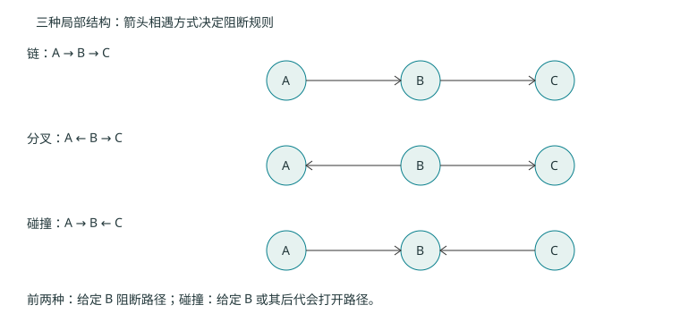

# 第九章 概率图模型：把联合分布拆成局部关系

> 往年资料：S14（69 页）与 S15（80 页）。主题包括有向／无向图、学习、推断、HMM、CRF。本章先建立核心推导；原课件草坪表、结构学习图例及全部采样图仍待视觉复核，不宣称逐页完整覆盖。

> **本章读法**：先建立直觉，再亲手写一次推导。建议先读 §9.1 的分解动机、§9.2 的三种局部结构与碰撞例，然后依次攻克 §9.4 的 EM 下界、§9.5 的 HMM 前向递推与 Viterbi。涉及第二章的贝叶斯公式与第八章的熵，遇到记不清的符号先回看对应章节。

---

## 9.1 图首先是一组分解与独立性假设 {#ml-09-01}

### 9.1.1 为什么要引入图：参数爆炸与局部关系

**直觉**。假设我们有 $d$ 个**二元**随机变量（每个只能取 0 或 1）。它们最一般的联合分布 $p(x_1,\ldots,x_d)$ 需要列出所有 $2^d$ 种取值组合的概率，并且这些概率之和必须为 1，因此自由参数是

$$2^d-1.$$

当 $d=3$ 时需要 $2^3-1=7$ 个参数；$d=10$ 时需要 1023 个；$d=20$ 时超过一百万。直接估计这样庞大的表既不可行，也没有泛化能力。

**图模型的核心想法**是用一张图表达"谁直接依赖谁"，从而把联合分布拆成许多**只涉及少数变量**的局部因子。参数总量从指数级降到与图大小相关的量级，同时"图里的边"与"独立性假设"一一对应，推断也能按图结构组织。

> **记住**：节点 = 随机变量；有向边表达"允许的直接依赖方向"；无向边表达"允许的直接耦合"。**仅从箭头不能自动推出现实因果**——图是建模者的假设，不是自然法则。

### 9.1.2 贝叶斯网络分解：从链式法则到局部条件

**符号与假设**。

- 图是**有向无环图（DAG）**：有方向、无环路。
- 变量已按某个**拓扑顺序**排好：若 $x_i$ 指向 $x_j$（存在路径），则 $i<j$。即父节点一定排在子节点前面。
- $\operatorname{pa}(x_i)$ 表示节点 $x_i$ 的**父节点取值集合**（parents）。
- 模型假设：每个变量在给定其父节点后，与所有"更早出现但不是父节点"的变量**条件独立**。

**起始式（无条件分解的链式法则）**。对任意顺序的变量，概率永远可以写

$$p(x_1,\ldots,x_d)=p(x_1)\,p(x_2\mid x_1)\,p(x_3\mid x_1,x_2)\cdots p(x_d\mid x_1,\ldots,x_{d-1}).$$

这是链式法则（第二章贝叶斯公式的多次应用），不依赖任何假设。

**逐步代入独立性假设**。因为拓扑序保证 $x_i$ 只依赖其前面的变量，而模型进一步假设它**只依赖父节点** $\operatorname{pa}(x_i)$、不依赖其余更早变量，于是有

$$p(x_i\mid x_1,\ldots,x_{i-1})=p(x_i\mid \operatorname{pa}(x_i)).$$

把它逐个代入上面的链式法则，得到贝叶斯网络的标准分解：

$$p(x_1,\ldots,x_d)=\prod_{i=1}^d p(x_i\mid\operatorname{pa}(x_i)). \tag{1}$$

**结论与成立条件**。式 (1) 成立需要：① 图有向无环；② 拓扑序存在；③ 每个变量在给定父节点后与其非后代的所有更早变量条件独立（这正是"局部马尔可夫性"）。连续变量时把概率质量换成密度即可，形式不变。

### 9.1.3 一个小数值例子：参数从 7 降到 5

设三个二元变量 $A,B,C$，构成链 $A\to B\to C$。若用完全表需要 $2^3-1=7$ 个参数。用分解

$$p(a,b,c)=p(a)\,p(b\mid a)\,p(c\mid b).$$

参数计数（离散、二元、每行条件概率归一化减 1）：

- $p(a)$：2 个取值，和为 1，故 $2-1=1$ 个自由参数；
- $p(b\mid a)$：父节点 $a$ 有 2 种取值，每种对应一个 2 维条件分布，共 $2\times(2-1)=2$ 个参数；
- $p(c\mid b)$：同理 2 个参数。

总计 $1+2+2=5<7$。图结构每去掉/增加一条边，都会改变可表达的分布族与参数数量——这正是"用结构换取参数效率"。

### 9.1.4 朴素贝叶斯：贝叶斯网络的一个特例

类别节点 $c$ 指向每个特征 $x_j$，特征之间在给定类别后相互独立：

$$p(c,\mathbf x)=p(c)\prod_{j=1}^d p(x_j\mid c).$$

这正是第二章朴素贝叶斯的图表示：$\operatorname{pa}(x_j)=\{c\}$。它用"特征在类内独立"这一（通常过强但实用）假设，把原本需要 $K(2^d-1)$ 量级参数的表压成了线性规模。

> **常见误区**：朴素贝叶斯的"朴素"不是说特征相互独立，而是说"给定类别后特征相互独立"。在预测时，后验仍会把所有特征组合起来，所以预测并不"简单"。

---

## 9.2 三种局部结构与 d 分离 {#ml-09-02}

**直觉**：我们说"图表达了独立性"，但具体怎么从图上读出"哪些变量在给定某些证据后独立"？答案叫 **d 分离（d-separation，d 表示 directional/dependency）**。判断规则只需看图里的**局部结构**并沿所有路径传播。

### 9.2.1 三种基本结构

设路径上三个相邻节点，只可能有三种局部形状：

| 结构 | 图示 | 给定中间节点时的效果 |
| --- | --- | --- |
| **链 (chain)** | $A\to B\to C$ | 给定 $B$，阻断 $A$ 与 $C$ 之间的联系 |
| **分叉 (fork / common cause)** | $A\leftarrow B\to C$ | 给定 $B$（共同原因），阻断 $A$ 与 $C$ |
| **碰撞 (collider / common effect)** | $A\to B\leftarrow C$ | 未观测 $B$ 及其后代时阻断；**给定 $B$ 或其后代会打开**路径 |

为什么链和分叉"条件化中间节点就阻断"？因为 $B$ 是 $A$ 影响 $C$ 的唯一"管道"，一旦把 $B$ 固定（条件化），管道被堵住。碰撞结构则反过来：$A$ 与 $C$ 原本互不相干，但一旦你**知道共同结果 $B$**，关于一个原因的信息就会改变对另一个原因的推断——这就是"知道共同结果以后，两个原因可能相关"。

$$
\begin{aligned}
&\text{链 }A\to B\to C: && A\perp\!\!\!\perp C\mid B \\[2pt]
&\text{分叉 }A\leftarrow B\to C: && A\perp\!\!\!\perp C\mid B \\[2pt]
&\text{碰撞 }A\to B\leftarrow C: && A\perp\!\!\!\perp C\quad\text{（未观测 }B\text{ 时）};\quad A\not\perp\!\!\!\perp C\mid B
\end{aligned}
$$

### 9.2.2 碰撞例：一步步算清三个数字

> **自编碰撞例**。取两个独立公平二元变量 $A,C\sim\text{Bernoulli}(1/2)$，定义共同结果 $B=A\lor C$（逻辑或，即"至少有一个为 1 则 $B=1$"）。

先把四个等概率组合列成表（每种概率都是 $1/4$）：

| $A$ | $C$ | $B=A\lor C$ | 概率 |
| --- | --- | --- | --- |
| 0 | 0 | 0 | $1/4$ |
| 1 | 0 | 1 | $1/4$ |
| 0 | 1 | 1 | $1/4$ |
| 1 | 1 | 1 | $1/4$ |

**步骤 1：先验**。$P(A=1)=1/2$（第一行与第二行之和 $=1/4+1/4=1/2$）。此时 $A$ 与 $C$ 独立。

**步骤 2：已知 $B=1$**。在表中筛出 $B=1$ 的三行（1,0）、(0,1)、(1,1)，它们总概率 $3/4$，且由于原来等概率，条件化后三者**等概率**各为 $(1/4)/(3/4)=1/3$。其中 $A=1$ 的是 (1,0) 与 (1,1) 两行：

$$P(A=1\mid B=1)=\frac{P(A=1,B=1)}{P(B=1)}=\frac{1/4+1/4}{3/4}=\frac{2/4}{3/4}=\frac{2}{3}.$$

注意：原本 $P(A=1)=1/2$，现在升到 $2/3$。说明"看到共同结果 $B=1$"后，我们对原因 $A$ 的判断变了——这正是碰撞结构"未观测时独立、观测后相关"的体现。

**步骤 3：再知 $C=1$**。在已经 $B=1$ 的前提下，进一步筛选 $C=1$ 的行，剩 (0,1) 与 (1,1) 两行，各占 $1/3$（在条件 $B=1$ 下）。其中 $A=1$ 的只有 (1,1)：

$$P(A=1\mid B=1,C=1)=\frac{P(A=1,B=1,C=1)}{P(B=1,C=1)}=\frac{1/4}{1/4+1/4}=\frac{1/2}{1}=\frac{1}{2}.$$

数字从 $2/3$ 又**回到 $1/2$**。直觉：当 $C=1$ 已经解释了"为什么 $B=1$"时，$A$ 是否为 1 就又变得无关紧要了——第二个原因把第一个原因对结果的"解释责任"抢走了一半。

> **记住**：碰撞结构 $A\to B\leftarrow C$ 的诡异之处在于——"不观测 $B$ 时 $A,C$ 独立，观测 $B$ 后反而相关"。这是很多悖论（如"必然混淆"）的根源，务必亲手算一遍上例。

### 9.2.3 从局部到整张图：d 分离的完整判据

对一般图，要沿连接 $X$ 与 $Y$ 的**每一条**路径检查：

- 路径上每个**非碰撞**节点若被条件化（出现在证据集合里），则该路径被**阻断**；
- 路径上每个**碰撞**节点及其**后代**若都**未被**条件化，则该路径被阻断；
- 一旦某条路径上出现"未被阻断"的节点序列，该路径就**畅通**。

**定义**：若在所有连接 $X$ 与 $Y$ 的路径都被证据 $Z$ 阻断时，称 $X$ 与 $Y$ 被 $Z$ **d 分离**，记为 $X\perp\!\!\!\perp Y\mid Z$，并据此推出 $p(X,Y\mid Z)=p(X\mid Z)\,p(Y\mid Z)$。

> **常见误区**：只检查一条路径、或只检查局部三个节点就下结论，是错的。必须遍历**所有**路径；一条畅通的路径就足以破坏独立性。d 分离是"图上能推出的所有条件独立"，但现实里某些分布可能比图允许的独立性更多（图是上界）。

---

## 9.3 马尔可夫随机场 {#ml-09-03}

**直觉**：贝叶斯网络用**有向**箭头和"条件概率"建模，父子关系天然不对称。但很多场景（图像相邻像素、蛋白质相互作用网络）关系本身是对称的"耦合"，没有天然的因果方向。这时用**无向图**更自然：把联合分布写成"团（clique，完全子图）上的非负势函数"的乘积，再整体归一化。

### 9.3.1 团势分解与归一化常数 $Z$

**符号与假设**。

- $\mathbf x=(x_1,\ldots,x_d)$ 是全体变量；无向边表示局部耦合。
- **团 $C$** 是一组两两相连的节点；$\mathbf x_C$ 是这些节点的取值。
- **势函数（potential）$\psi_C(\mathbf x_C)$** 是定义在团上的任意**非负**函数，衡量该团取某组值的"兼容性/能量"高低。
- $Z$ 是归一化常数（配分函数，partition function）。

**起始式（未归一化的乘积）**。先把所有团的势乘起来，得到一个非负但不一定和为 1 的量：

$$\tilde p(\mathbf x)=\prod_{C}\psi_C(\mathbf x_C).$$

**归一化（求 $Z$）**。要让它成为合法概率，必须把所有可能取值的概率加起来等于 1。因此

$$Z=\sum_{\mathbf x}\tilde p(\mathbf x)=\sum_{\mathbf x}\prod_{C}\psi_C(\mathbf x_C),$$

于是最终分布为

$$p(\mathbf x)=\frac1Z\prod_{C}\psi_C(\mathbf x_C),\qquad Z=\sum_{\mathbf x}\prod_C\psi_C(\mathbf x_C). \tag{2}$$

（连续变量时把求和 $\sum_{\mathbf x}$ 改成积分 $\int d\mathbf x$。）

**结论与成立条件**。式 (2) 对**任意**非负势函数都给出合法概率分布，无需势函数各自归一化。代价是 $Z$ 通常需要对全部 $2^d$ 种（离散）或整个空间（连续）求和/积分，可能非常昂贵——这叫"配分函数难算"。

> **常见误区**：势函数 $\psi_C$ **不是概率**，不必 $\le 1$，也不必各自归一化。只有乘上 $1/Z$ 之后的 $p(\mathbf x)$ 才是概率。势常常写成 $\psi_C=\exp(-E_C)$（能量越低势越高），但本章先用一般势函数，避免与第八、十章的能量概念混淆。

### 9.3.2 一个小数值例子：两个变量的 MRF

设 $x_1,x_2\in\{0,1\}$，只有一个团 $C=\{1,2\}$。给势函数赋值：

| $(x_1,x_2)$ | $\psi(x_1,x_2)$ |
| --- | --- |
| (0,0) | 1 |
| (0,1) | 2 |
| (1,0) | 2 |
| (1,1) | 1 |

**步骤**：先算 $Z=1+2+2+1=6$。再逐格除以 $Z$ 得到概率：

$$p(0,0)=\frac16,\quad p(0,1)=\frac26,\quad p(1,0)=\frac26,\quad p(1,1)=\frac16.$$

可见 $\psi$ 越大概率越大，但 $\psi$ 本身（如 2）可以大于 1，而最终每个概率都 $\le 1$ 且和为 1。势函数表达了"相邻变量取值组合的偏好"，不要求局部归一。

### 9.3.3 无向图里的条件独立与有向/无向对比

给定一组节点把图分成不相连的两部分，则这两部分在给定这组节点后**条件独立**（全局马尔可夫性）。

**有向 vs 无向的关键区别**：

- 贝叶斯网络的每个局部条件表 $p(x_i\mid\operatorname{pa}(x_i))$ **各自归一化**（每行和为 1），归一化是局部的、便宜的；
- MRF 的归一化是**全局**的，集中在 $Z$ 上，往往昂贵；
- 二者能表达的**独立性结构并不完全相同**。例如链 $A\to B\to C$ 与无向三角 $A-B-C$ 表达的独立集合不同；有向碰撞 $A\to B\leftarrow C$ 对应的无向图需要把 $A,B,C$ 全连成一个团（因为观测 $B$ 会引入相关性），而朴素地把有向边换成无向边会丢失碰撞特性——这正是"道德图（moral graph）"要补边的原因（属结构学习，待视觉复核）。

> **严格性提示**：式 (2) 的团分解与图的马尔可夫性之间的标准等价关系，要求分布**严格正**（所有取值概率 $>0$）。若图上存在零概率配置，等价性需要更细致的前提，不能直接套用。

---

## 9.4 学习、精确推断与采样 {#ml-09-04}

**直觉**：拿到图模型后有两件不同的事常被混淆：

- **学习（learning）**：模型结构或参数未知，由数据去确定；
- **推断（inference）**：模型（结构+参数）已定，求边缘分布、条件分布，或最可能的隐变量配置。

> **记住**：永远先分清"这一步是在求参数，还是给定观测求隐变量"。二者数学不同、算法不同，混为一谈是初学者最常见的错误。

### 9.4.1 变量消去：重排求和避免全枚举

**问题**。给定分解 $p(a,b,c)=p(a)\,p(b\mid a)\,p(c\mid b)$，求边缘 $p(c)$。

**朴素做法**需对所有 $a,b$ 枚举（指数级）。**变量消去**利用求和与乘积可重排，把求和"贴着"相关因子做掉：

**起始式**。
$$p(c)=\sum_{a,b}p(a,b,c)=\sum_{a,b}p(a)\,p(b\mid a)\,p(c\mid b).$$

**步骤 1：先消去 $a$**。把只含 $a$ 的因子聚成关于 $b$ 的中间量：

$$m(b)=\sum_{a}p(a)\,p(b\mid a). \tag{3}$$

这里对 $a$ 求和，结果 $m(b)$ 只依赖 $b$，维度从 $(a,b)$ 降到 $b$。

**步骤 2：再消去 $b$**。
$$p(c)=\sum_b m(b)\,p(c\mid b). \tag{4}$$

**结论**。通过先算式 (3) 再代入式 (4)，我们**从未同时枚举 $a$ 和 $b$**，而是分两步各自求和。更大图的思路相同：选择合适的**消去顺序**，每步只把"当前因子里能消去的变量"求和掉，生成中间因子（message）。

> **记住**：复杂度取决于**消去顺序与图结构**，不只取决于节点数。糟糕的顺序会产生巨大的中间因子（"中间因子爆炸"）；好的顺序是精确推断的核心难题之一（属图消去顺序，待视觉复核）。

### 9.4.2 和积/信念传播与采样（概述）

- **树上的和积（sum-product）/信念传播**：把变量消去组织成节点间传递的"消息"，在树上可精确算得所有边缘，复杂度仅线性于边数。
- **带环图**：消息在环上反复迭代（loopy belief propagation）通常**只是近似**，既不保证精确也不保证收敛。
- **前向采样**：按拓扑顺序逐节点从条件分布采样生成样本；若先观测到罕见证据再用"拒绝采样"丢弃不匹配样本，效率可能极低。
- **Gibbs 采样**：每次从一个变量在其余变量给定下的条件分布 $p(x_i\mid \mathbf x_{-i})$ 采样。需讨论马尔可夫链的可达性、收敛（混合时间）以及样本间的自相关（有效样本量下降）。

### 9.4.3 EM 算法：从恒等式推出下界

这是本章最重要的推导之一。情形：**数据含隐变量 $z$**，观测为 $x$，参数 $\theta$ 待估。目标是最大化对数似然 $\log p_\theta(x)$。

#### （a）先写恒等式

对任一取正值的分布 $q(z)$（只要满足 $q(z)>0$ 处 $p_\theta(z\mid x)>0$），利用 $p_\theta(x)=\dfrac{p_\theta(x,z)}{p_\theta(z\mid x)}$（对任意具体 $z$ 成立，因为 $p_\theta(x,z)=p_\theta(x)\,p_\theta(z\mid x)$），有

$$\log p_\theta(x)=\log\frac{p_\theta(x,z)}{p_\theta(z\mid x)}.$$

把分母换写成 $q(z)$ 的"拆项"形式（加一项减一项同一个 $q(z)$）：

$$\log p_\theta(x)=\log\frac{p_\theta(x,z)}{q(z)}-\log\frac{p_\theta(z\mid x)}{q(z)}. \tag{5}$$

#### （b）两边对 $q(z)$ 取期望

左边与 $z$ 无关，期望仍是自己。右边第一项的期望记为 $\mathcal L(q,\theta)$，第二项正好是 KL 散度：

$$
\begin{aligned}
\log p_\theta(x)
&= \mathbb E_{q(z)}\!\left[\log\frac{p_\theta(x,z)}{q(z)}\right]
   -\mathbb E_{q(z)}\!\left[\log\frac{p_\theta(z\mid x)}{q(z)}\right] \\[4pt]
&= \underbrace{\mathbb E_{q(z)}\!\left[\log p_\theta(x,z)\right]+\mathbb H[q]}_{\mathcal L(q,\theta)}
   \;+\; \underbrace{D_{\mathrm{KL}}\!\big(q(z)\,\|\,p_\theta(z\mid x)\big)}_{\ge 0}. \tag{6}
\end{aligned}
$$

其中 $\mathbb H[q]=-\mathbb E_q[\log q(z)]$ 是 $q$ 的熵（与 $\theta$ 无关），KL 散度定义 $D_{\mathrm{KL}}(q\|p)=\mathbb E_q[\log(q/p)]\ge 0$，等号当且仅当 $q(z)=p_\theta(z\mid x)$。

**关键结论**：因为 KL 项非负，

$$\log p_\theta(x)\;\ge\;\mathcal L(q,\theta). \tag{7}$$

即 $\mathcal L$ 是 $\log p_\theta(x)$ 的一个**下界（ELBO，证据下界）**。这就是"EM 下界"的来历——它不靠 Jensen 不等式的"凑凸性"，而是靠上面这段**恒等式 + 期望 + KL 非负**的等价拆分。

> **常见误区**：不要把 ELBO 记成 $\mathbb E_q[\log p_\theta(x\mid z)]$ 漏掉 $\log p_\theta(z)$。完整是 $\mathbb E_q[\log p_\theta(x,z)]=\mathbb E_q[\log p_\theta(x\mid z)]+\mathbb E_q[\log p_\theta(z)]$。在贝叶斯混合/高斯混合里 $z$ 的先验项不可省。

#### （c）E 步：把下界"贴紧"

选定当前参数 $\theta^{\text{old}}$，令

$$q(z)=p_{\theta^{\text{old}}}(z\mid x).$$

代入式 (6)：此时 $D_{\mathrm{KL}}(p_{\theta^{\text{old}}}(z\mid x)\,\|\,p_{\theta^{\text{old}}}(z\mid x))=0$，于是

$$\mathcal L\big(p_{\theta^{\text{old}}}(\cdot\mid x),\theta^{\text{old}}\big)=\log p_{\theta^{\text{old}}}(x).$$

下界**贴紧**到真实对数似然（缝隙为零）。所以 E 步本质是"用当前参数算出隐变量的后验"，并把它固定为 $q$。

#### （d）M 步：抬高下界（从而抬高似然）

M 步在 $q$ 固定（=E 步得到的后验）下，最大化 $\mathcal L(q,\theta)$ 关于 $\theta$：

$$\theta^{\text{new}}=\arg\max_\theta \mathcal L(q,\theta).$$

为什么这能让真实似然不降？因为在 E 步后 $\log p_\theta(x)=\mathcal L+D_{\mathrm{KL}}$ 且 KL=0；M 步抬高了 $\mathcal L$，而新的 KL 仍 $\ge 0$，所以

$$\log p_{\theta^{\text{new}}}(x)=\mathcal L^{\text{new}}+D_{\mathrm{KL}}^{\text{new}}\ge \mathcal L^{\text{new}}\ge \mathcal L^{\text{old}}=\log p_{\theta^{\text{old}}}(x).$$

即**每轮 EM 观测似然单调不降**。

**结论与边界**：该保证依赖"E 步得到**精确**后验、M 步**精确**最大化"。若用近似推断（变分、采样）或近似优化，则单调保证不再自动成立。EM 仍可能停在**局部最优**或鞍点——下界抬高不等于到达全局最大。

> **记住（EM 一句话）**：E 步把下界贴到当前似然（算后验），M 步沿下界抬高参数；反复迭代，似然单调上升但未必到顶。

---

## 9.5 HMM：用动态规划求序列概率 {#ml-09-05}

**直觉**：隐马尔可夫模型（HMM）是一个有向图模型，状态随时间推进，但状态本身不可见，只能看到它"发射"出的观测。因为序列有顺序结构，可以用**动态规划**把指数级的"枚举所有状态路径"压成线性时间的递推。

### 9.5.1 模型设定与联合分布

**符号与维度**。

- 隐藏状态 $z_t\in\{1,\ldots,K\}$，离散、$K$ 个取值；$t=1,\ldots,T$。
- 观测 $x_t$，可为离散或连续。
- 初始概率 $\pi_j=P(z_1=j)$，$\sum_j\pi_j=1$，维度 $K$。
- 转移概率 $a_{ij}=P(z_t=j\mid z_{t-1}=i)$，维度 $K\times K$，每行和为 1。
- 发射概率 $b_j(x)=p(x_t=x\mid z_t=j)$，每个状态一个分布。

**两个建模假设**：① 一阶马尔可夫性 $p(z_t\mid z_{t-1},\ldots,z_1)=p(z_t\mid z_{t-1})$；② 给定当前状态后观测独立于历史 $p(x_t\mid z_t, \text{history})=p(x_t\mid z_t)$。

**起始式（链式法则展开联合）**。

$$p(\mathbf x,\mathbf z)=p(z_1)\,p(x_1\mid z_1)\prod_{t=2}^T p(z_t\mid z_{t-1})\,p(x_t\mid z_t).$$

代入符号 $\pi, a, b$ 即得 HMM 联合：

$$p(\mathbf x,\mathbf z)=\pi_{z_1}\,b_{z_1}(x_1)\prod_{t=2}^Ta_{z_{t-1},z_t}\,b_{z_t}(x_t). \tag{8}$$

**结论**。式 (8) 把"全序列联合"写成"初始×发射×转移×发射…"的连乘，每项只依赖相邻状态——这正是 §9.1 有向分解的具体实例。

### 9.5.2 前向算法 $\alpha$：一步步推出递推

**定义**。

$$\alpha_t(j)=p(x_{1:t},\,z_t=j),$$

即"前 $t$ 个观测为 $x_1,\ldots,x_t$，且第 $t$ 时刻状态恰为 $j$"的概率。它把**所有以状态 $j$ 在时刻 $t$ 结束的状态路径**的概率都加了起来。

**初始步（$t=1$）**。

$$\alpha_1(j)=p(x_1,z_1=j)=p(z_1=j)\,p(x_1\mid z_1=j)=\pi_j\,b_j(x_1). \tag{9}$$

**递推步（$t>1$）——核心推导**。从定义出发，对上一时刻状态 $i$ 求和：

$$
\begin{aligned}
\alpha_t(j)
&=p(x_{1:t},\,z_t=j) \\
&=\sum_{i} p(x_{1:t},\,z_{t-1}=i,\,z_t=j) &&\text{（对 }i\text{ 边际化）} \\[2pt]
&=\sum_{i} p(x_{1:t-1},\,z_{t-1}=i)\;
        p(z_t=j\mid x_{1:t-1},\,z_{t-1}=i)\;
        p(x_t\mid x_{1:t-1},\,z_{t-1}=i,\,z_t=j) &&\text{（链式法则）} \\[2pt]
&=\sum_{i} \alpha_{t-1}(i)\; a_{ij}\; b_j(x_t). &&\text{（马尔可夫假设化简）}
\end{aligned}
$$

化简的两处关键：
- $p(z_t=j\mid x_{1:t-1},z_{t-1}=i)=p(z_t=j\mid z_{t-1}=i)=a_{ij}$（未来状态只依赖上一状态）；
- $p(x_t\mid \cdots,z_t=j)=p(x_t\mid z_t=j)=b_j(x_t)$（发射只依赖当前状态）。

提取与 $i$ 无关的公因子 $b_j(x_t)$，得到标准前向递推：

$$\alpha_1(j)=\pi_j\,b_j(x_1),\qquad
\alpha_t(j)=b_j(x_t)\sum_{i=1}^K\alpha_{t-1}(i)\,a_{ij}. \tag{10}$$

**终止步**。全序列观测概率把所有终态加起来：

$$p(\mathbf x)=\sum_{j=1}^K\alpha_T(j). \tag{11}$$

#### 前向数值小例（K=2，T=2）

设状态 $z\in\{1,2\}$，观测 $x\in\{0,1\}$。

- $\pi=(0.6,\,0.4)$；
- 转移 $A=\begin{pmatrix}0.7&0.3\\0.4&0.6\end{pmatrix}$，即 $a_{11}=0.7,\,a_{12}=0.3,\,a_{21}=0.4,\,a_{22}=0.6$；
- 发射：状态 1 偏好 0，$b_1(0)=0.9,\,b_1(1)=0.1$；状态 2 偏好 1，$b_2(0)=0.2,\,b_2(1)=0.8$。

观测序列 $x_1=0,\,x_2=1$。

**$t=1$**（式 9）：
$$\alpha_1(1)=0.6\times0.9=0.54,\qquad \alpha_1(2)=0.4\times0.2=0.08.$$

**$t=2$**（式 10）：
$$
\begin{aligned}
\alpha_2(1)&=b_1(1)\big[\alpha_1(1)a_{11}+\alpha_1(2)a_{21}\big]
=0.1\,[0.54\times0.7+0.08\times0.4]
=0.1\,[0.378+0.032]=0.1\times0.41=0.041,\\[4pt]
\alpha_2(2)&=b_2(1)\big[\alpha_1(1)a_{12}+\alpha_1(2)a_{22}\big]
=0.8\,[0.54\times0.3+0.08\times0.6]
=0.8\,[0.162+0.048]=0.8\times0.21=0.168.
\end{aligned}
$$

**终止**（式 11）：
$$p(\mathbf x)=\alpha_2(1)+\alpha_2(2)=0.041+0.168=0.209.$$

每一步都只做了 $O(K)$ 的求和，而非枚举 $K^T=4$ 条（这里恰巧相等，但 $T$ 大时差距巨大）路径。

> **常见误区**：长序列下 $\alpha$ 会指数级下溢到 0。实际实现要每步做**缩放**（除以当前总和）或用 **log-sum-exp**（$\log\sum_j e^{\log\alpha_j}$）避免数值溢出/下溢。

### 9.5.3 后向算法 $\beta$ 与状态后验 $\propto\alpha\beta$

**定义**。

$$\beta_t(i)=p(x_{t+1:T}\mid z_t=i),$$

即"已知第 $t$ 时刻状态为 $i$，之后观测为 $x_{t+1},\ldots,x_T$"的概率（只含未来）。

**边界**。$t=T$ 时没有未来观测，空事件概率为 1：

$$\beta_T(i)=1. \tag{12}$$

**递推步——推导**。

$$
\begin{aligned}
\beta_t(i)
&=p(x_{t+1:T}\mid z_t=i) \\
&=\sum_{j} p(x_{t+1:T},\,z_{t+1}=j\mid z_t=i) &&\text{（对下一状态 }j\text{ 边际化）} \\[2pt]
&=\sum_{j} p(x_{t+1},\,z_{t+1}=j\mid z_t=i)\,
        p(x_{t+2:T}\mid z_t=i,\,z_{t+1}=j,\,x_{t+1}) \\[2pt]
&=\sum_{j} a_{ij}\,b_j(x_{t+1})\,\beta_{t+1}(j). &&\text{（马尔可夫假设）}
\end{aligned}
$$

最后一步：$p(x_{t+1},z_{t+1}=j\mid z_t=i)=p(z_{t+1}=j\mid z_t=i)\,p(x_{t+1}\mid z_{t+1}=j)=a_{ij}b_j(x_{t+1})$；而给定 $z_{t+1}=j$ 后未来与过去无关，故 $p(x_{t+2:T}\mid\cdots)=\beta_{t+1}(j)$。

$$\beta_t(i)=\sum_{j=1}^K a_{ij}\,b_j(x_{t+1})\,\beta_{t+1}(j),\qquad \beta_T(i)=1. \tag{13}$$

**状态后验为什么 $\propto\alpha\beta$**。

$$
\begin{aligned}
p(x_{1:t},\,z_t=j,\,x_{t+1:T})
&=p(x_{1:t},\,z_t=j)\;p(x_{t+1:T}\mid z_t=j) &&\text{（给定 }z_t=j\text{，未来独立于过去）} \\[2pt]
&=\alpha_t(j)\,\beta_t(j).
\end{aligned}
$$

再除以 $p(\mathbf x)=\sum_j\alpha_T(j)$ 得后验：

$$p(z_t=j\mid\mathbf x)=\frac{\alpha_t(j)\,\beta_t(j)}{\sum_{k}\alpha_T(k)}. \tag{14}$$

所以**状态后验正比于 $\alpha_t(j)\beta_t(j)$**，比例常数只与 $t$ 无关地与全序列概率有关。$\alpha$ 携带过去、$\beta$ 携带未来，二者相乘即得该时刻的完整信息。

### 9.5.4 Viterbi：把"求和"换成"取最大值"并回溯

**问题**：不是求概率，而是求**整条最可能的状态路径** $\hat{\mathbf z}=\arg\max_{\mathbf z}p(\mathbf z,\mathbf x)$。

**直觉**：前向递推把"所有路径概率求和"，若把求和 $\sum$ 改成最大值 $\max$，就得到"到时刻 $t$ 以状态 $j$ 结尾的**最优子路径**概率"，再在终点取最大并沿保存的指针回溯，即得全局最优路径。

**定义与递推**。

$$\delta_t(j)=\max_{z_{1:t-1}} p(z_t=j,\,z_{1:t-1},\,x_{1:t}),$$

$$\delta_1(j)=\pi_j\,b_j(x_1),\qquad
\delta_t(j)=\max_{1\le i\le K}\big[\delta_{t-1}(i)\,a_{ij}\big]\;b_j(x_t). \tag{15}$$

同时保存**回溯指针**：

$$\psi_t(j)=\arg\max_{1\le i\le K}\big[\delta_{t-1}(i)\,a_{ij}\big]. \tag{16}$$

**终止与回溯**。

$$\hat z_T=\arg\max_j\delta_T(j),\qquad
\hat z_{t-1}=\psi_t(\hat z_t),\; t=T,T-1,\ldots,2. \tag{17}$$

> **常见误区**：**逐时刻选边缘后验最大的状态**（即分别取 $\arg\max_j p(z_t=j\mid\mathbf x)$）**不保证**构成最可能的整体路径！因为各时刻最优状态之间可能违反转移约束 $a_{ij}$。Viterbi 之所以正确，是因为它最大化的是**整条路径的联合概率**，并用指针保证相邻状态合法衔接。

### 9.5.5 用 EM 学习 HMM 参数

E 步（§9.4.3）在本模型下产出两个统计量：

- 单点后验 $\gamma_t(i)=P(z_t=i\mid\mathbf x)$，由式 (14) 直接得到；
- 两点后验 $\xi_t(i,j)=P(z_t=i,\,z_{t+1}=j\mid\mathbf x)$，同样可由 $\alpha,\beta$ 与 $a,b$ 组合而成。

M 步用这些期望计数更新参数（归一化即得最大似然估计）：

$$\pi_i=\gamma_1(i),\qquad
a_{ij}=\frac{\sum_{t<T}\xi_t(i,j)}{\sum_{t<T}\gamma_t(i)}. \tag{18}$$

离散发射概率则按状态相关的期望计数归一化得到；连续发射可改用高斯并做相应均值/方差更新。

> **边界提示**：分母为 0（某状态从未被分配到正概率）、多条序列（对序列求和）、连续发射（高斯/混合）都需各自单独处理，不能套用上式而不检查。

---

## 9.6 CRF：直接建模条件序列分布 {#ml-09-06}

**直觉**：HMM 先建模**联合** $p(\mathbf x,\mathbf y)$，再用贝叶斯公式得 $p(\mathbf y\mid\mathbf x)$。但我们要的往往只是"给定观测 $\mathbf x$ 的标签分布"。CRF（条件随机场）直接建模**条件分布** $p(\mathbf y\mid\mathbf x)$，绕开了对复杂观测 $p(\mathbf x)$ 的建模，也避免了 HMM 中"每个状态发射必须独立"的强假设。

### 9.6.1 线性链 CRF 的形式

**符号**。$\mathbf y=(y_1,\ldots,y_T)$ 是标签序列，$y_t$ 取某标签集合中的值；$\mathbf x$ 是整段观测（如一句话的词向量）。特征函数 $f_j(y_{t-1},y_t,\mathbf x,t)$ 衡量"在位置 $t$、上一标签 $y_{t-1}$、当前标签 $y_t$ 下，这条特征是否成立/多强烈"，权重 $w_j$ 待学。

**起始式（未归一化条件得分）**。把所有位置、所有特征加权求和作为"对数得分"：

$$\Phi(\mathbf y,\mathbf x)=\sum_{t=1}^T\sum_{j}w_j\,f_j(y_{t-1},y_t,\mathbf x,t).$$

把它指数化并整体归一化，得到条件分布：

$$p(\mathbf y\mid\mathbf x)=\frac{1}{Z(\mathbf x)}\,
\exp\!\left[\sum_{t}\sum_{j}w_j\,f_j(y_{t-1},y_t,\mathbf x,t)\right]. \tag{19}$$

其中归一化常数只针对**标签序列**求和（观测 $\mathbf x$ 固定，故只写 $Z(\mathbf x)$）：

$$Z(\mathbf x)=\sum_{\mathbf y}\exp\!\left[\sum_{t}\sum_{j}w_j\,f_j(y_{t-1},y_t,\mathbf x,t)\right]. \tag{20}$$

**结论与要点**。
- 式 (19) 是"给定 $\mathbf x$ 的条件概率"，因此**不需要**对观测 $\mathbf x$ 建模，也不需要 HMM 的局部发射独立性假设。
- 特征 $f_j$ 可以**依赖整个观测序列** $\mathbf x$（如"当前词是'苹果'且标签为水果"），而标签之间仍按链式 $y_{t-1}\to y_t$ 组织。
- $Z(\mathbf x)$ 要对**所有**标签序列求和，看似 $K^T$ 爆炸，但因链式结构可用类似前向的**动态规划**在 $O(TK^2)$ 内算得。

### 9.6.2 $Z(\mathbf x)$ 的动态规划（与前向同构）

把式 (20) 中指数里的求和按时间拆开，定义"到时刻 $t$、以标签 $i$ 结尾的部分序列得分"的前向量 $F_t(i)$，递推：

$$F_1(i)=\exp\!\Big(\sum_j w_j f_j(\text{start},i,\mathbf x,1)\Big),\qquad
F_t(i)=\sum_{k}F_{t-1}(k)\,\exp\!\Big(\sum_j w_j f_j(k,i,\mathbf x,t)\Big).$$

则 $Z(\mathbf x)=\sum_i F_T(i)$。可见 CRF 的归一化与前向算法**结构同构**——区别只在 HMM 的转移/发射是概率（已归一），而 CRF 这里是未归一的特征指数。

### 9.6.3 训练梯度与解码

对参数 $w_j$ 求对数条件似然 $\log p(\mathbf y\mid\mathbf x)=\Phi(\mathbf y,\mathbf x)-\log Z(\mathbf x)$ 的梯度：

$$\frac{\partial\log p(\mathbf y\mid\mathbf x)}{\partial w_j}
=\underbrace{\sum_t f_j(y_{t-1},y_t,\mathbf x,t)}_{\text{经验特征计数（数据）}}
\;-\;
\underbrace{\sum_{\mathbf y}p(\mathbf y\mid\mathbf x)\sum_t f_j(y_{t-1},y_t,\mathbf x,t)}_{\text{模型期望特征计数}}. \tag{21}$$

即"**经验计数减模型期望计数**"，与最大熵/逻辑回归的梯度形式一致，可用前向-后向（上面的 $F_t$）高效计算模型期望。

**解码**：求 $\arg\max_{\mathbf y}p(\mathbf y\mid\mathbf x)$ 等价于在指数（未归一）得分上取最大，因 $Z(\mathbf x)$ 与 $\mathbf y$ 无关。这正是一个 **Viterbi 型**算法（把概率乘积换成指数得分求和、把乘号换成加号），回溯方式同 §9.5.4。

> **常见误区**：不能由 HMM 的"局部发射"假设推断"CRF 里每个标签只和本词有关"。CRF 的特征本就可看全句；而且即便在 HMM 中，**整条序列的联合后验**仍受其他位置的观测与转移约束共同影响——"局部发射"是生成模型里的方便假设，不是解码时的局部性。

---

## 9.7 本章速查与常见误区 {#ml-09-07}

**公式速查**。

- 贝叶斯网络：$p=\prod_i p(x_i\mid\operatorname{pa}(x_i))$（有向、局部归一）。
- MRF：$p=(1/Z)\prod_C\psi_C$（无向、全局归一，$Z$ 难算）。
- d 分离：链/分叉条件化中间节点→阻断；碰撞条件化→打开。
- EM 下界：$\log p_\theta(x)=\mathcal L(q,\theta)+D_{\mathrm{KL}}(q\|p_{\theta}(z\mid x))\ge\mathcal L$。
- HMM 前向：$\alpha_t(j)=b_j(x_t)\sum_i\alpha_{t-1}(i)a_{ij}$；后向：$\beta_t(i)=\sum_j a_{ij}b_j(x_{t+1})\beta_{t+1}(j)$；后验 $\propto\alpha_t\beta_t$。
- Viterbi：把 $\sum$ 换 $\max$，存回溯指针；逐点最大后验 $\neq$ 全局最优路径。
- CRF：$p(\mathbf y\mid\mathbf x)=(1/Z(\mathbf x))\exp(\sum_t\sum_j w_jf_j)$，梯度=经验计数−模型期望计数，解码用 Viterbi 型。

**最常错的五点**。

1. 把"箭头"当"因果"；把"求参数"和"给定观测求隐变量"混为一谈。
2. 认为碰撞结构给定结果后仍独立（实际是打开路径，见 §9.2.2 的 $2/3$ 例）。
3. 误以为势函数 $\psi_C$ 是概率（它不必 $\le1$、不必归一）。
4. 以为逐时刻选最大后验状态就是 Viterbi 最优路径（错，见 §9.5.4）。
5. 以为 CRF 因"条件"二字就只看本词（特征可依赖整句，见 §9.6.3）。

> **学习建议**：本章推导多、易混。请按"先写直觉→列符号维度→写起始式→逐步行变换→给结论与条件"的模板，把 §9.1 分解、§9.4 EM 下界、§9.5 前向递推各自**亲手推一遍**，再对照这里的数值小例核验。相关练习见 [`../exercises.md`](../exercises.md)；第二章贝叶斯公式与第八章熵是前置，遇到符号不清先回看。
